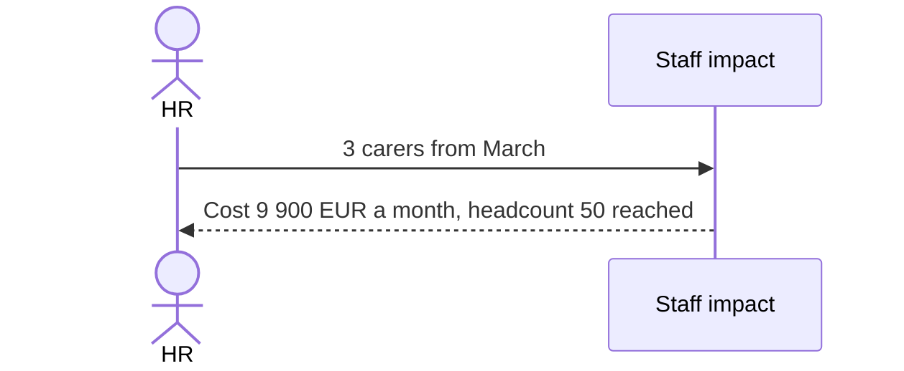

🏠 [Specs](../../../../README.md) › 🧩 [Functional capabilities](../../../README.md) ›
🔮 [F23 What-if simulation and impact](../../README.md) › 📝 [Use cases](../README.md) ›
📝 [Use cases: FL-F23-03 See the impact](README.md) › 📝 UC-F23-28 Simulate a hiring plan

# 📝 UC-F23-28 Simulate a hiring plan

**Status:** ✅ specified

## Summary

HR simulates a hiring plan (roles, dates, salaries) and sees the payroll cost, capacity and legal thresholds crossed, in
totals only.

## Personas

- [U06 Human resources](../../../../01-users/personas/u06-hr.md)

## Goal

Plan hires with their full cost.

## Trigger

Budget preparation.

## Frequency

Yearly.

## Preconditions

- Payroll rules (F13).

## Postconditions

- Success: totals shown.
- Failure: none.

## Main flow

1. HR opens Staff impact (S-F23-11) from a scenario.
2. They add 3 roles with dates and salaries.
3. The run uses payroll rules for cost (BR-F23-04).
4. It shows totals and thresholds crossed (UC-F23-12).

## Alternative flows

- 2a. Part time.

## Error flows

- 4e. A named person asked: refused (BR-F23-12).
- Any step: a service does not answer; the call is retried first (BR-F3-32), then the message follows the error pattern
  (D122) and what was typed stays on the screen.

## Business rules

- [BR-F23-12 No automated decisions about people](../../business-rules/br-f23-12-no-automated-decisions-on-people.md)

## Entities

None.

## Permissions

HR.

## Notifications

- None.

## Audit events

Scenarios.

## AI involvement

Explains.

## API, MCP and A2A exposure

Through the API (T5) and as AI assistant tools (T6), with the caller's rights (BR-F3-34).

## Screens

None.

## Flowchart

See [FL-F23-03 See the impact](../../flows/fl-f23-03-see-the-impact.md#flowchart).

## Sequence diagram

## Acceptance criteria

1. **Given** 3 carers at 2 100.00 EUR gross **when** simulated **then** the employer cost totals show.
2. **Given** headcount reaching 50 **when** simulated **then** the threshold shows.
3. **Given** a named employee **when** asked **then** refused.

## Non-functional notes

D408's targets ([Performance](../../../../05-non-functional/performance.md)): 95 % of screens within 1 second; lists
paged on the server, the first page within 1 second; reports within 5 seconds or in the background.

## Regulatory references

None.

## Related use cases

- [UC-F23-11 See the impact on staff, payroll and planning](uc-f23-11-see-the-impact-on-staff-payroll-and-planning.md)

## Open questions

None.

---

⬅️ [UC-F23-27 Simulate a supplier switch](uc-f23-27-simulate-a-supplier-switch.md) · ⬆️ [Up](README.md) ·
➡️ [UC-F23-29](../06-goals-and-financing/uc-f23-29-prepare-a-forecast-pack-for-the-bank.md)
