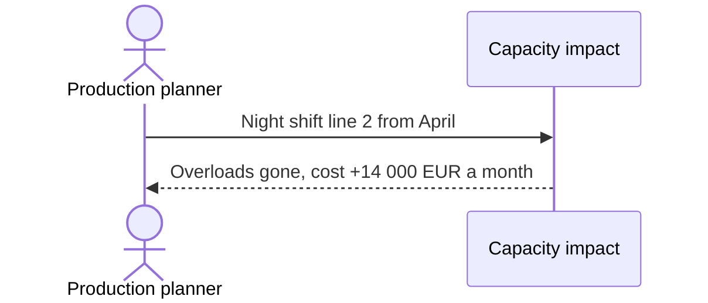

🏠 [Specs](../../../../README.md) › 🧩 [Functional capabilities](../../../README.md) ›
🔮 [F23 What-if simulation and impact](../../README.md) › 📝 [Use cases](../README.md) ›
📝 [Use cases: FL-F23-03 See the impact](README.md) › 📝 UC-F23-30 Simulate a new shift or machine

# 📝 UC-F23-30 Simulate a new shift or machine

**Status:** ✅ specified

## Summary

The production planner simulates a new shift or machine and sees capacity, overloads and costs.

## Personas

- [U21 Production planner](../../../../01-users/personas/u21-production-planner.md)

## Goal

Decide capacity changes on facts.

## Trigger

Overload forecast.

## Frequency

A few a year.

## Preconditions

- Routings and work centres in F12.

## Postconditions

- Success: impact shown.
- Failure: none.

## Main flow

1. The planner opens Capacity impact (S-F23-10) from a scenario.
2. They add a night shift on line 2 from April.
3. The run uses F12's rules (BR-F23-04).
4. It shows overloads removed and the added cost.

## Alternative flows

- 2a. A new machine with its cost.

## Error flows

- 3e. Missing routing: flagged.
- Any step: a service does not answer; the call is retried first (BR-F3-32), then the message follows the error pattern
  (D122) and what was typed stays on the screen.

## Business rules

- [BR-F23-04 The same rules as the ERP](../../business-rules/br-f23-04-same-rules-as-the-erp.md)

## Entities

None.

## Permissions

Production planner.

## Notifications

- None.

## Audit events

Scenarios.

## AI involvement

Explains.

## API, MCP and A2A exposure

Through the API (T5) and as AI assistant tools (T6), with the caller's rights (BR-F3-34).

## Screens

None.

## Flowchart

See [FL-F23-03 See the impact](../../flows/fl-f23-03-see-the-impact.md#flowchart).

## Sequence diagram

## Acceptance criteria

1. **Given** line 2 overloaded 18 % in April **when** a night shift is simulated **then** the overload disappears.
2. **Given** the shift cost **when** shown **then** +14 000.00 EUR a month.
3. **Given** a missing routing **when** run **then** flagged.

## Non-functional notes

D408's targets ([Performance](../../../../05-non-functional/performance.md)): 95 % of screens within 1 second; lists
paged on the server, the first page within 1 second; reports within 5 seconds or in the background.

## Regulatory references

None.

## Related use cases

- [UC-F23-10 See the impact on production and capacity](uc-f23-10-see-the-impact-on-production-and-capacity.md)

## Open questions

None.

---

⬅️ [UC-F23-29](../06-goals-and-financing/uc-f23-29-prepare-a-forecast-pack-for-the-bank.md) · ⬆️ [Up](README.md) ·
➡️ [UC-F23-31](../08-budgets-rolling-group-and-valuation/uc-f23-31-build-the-budget-with-department-owners.md)
