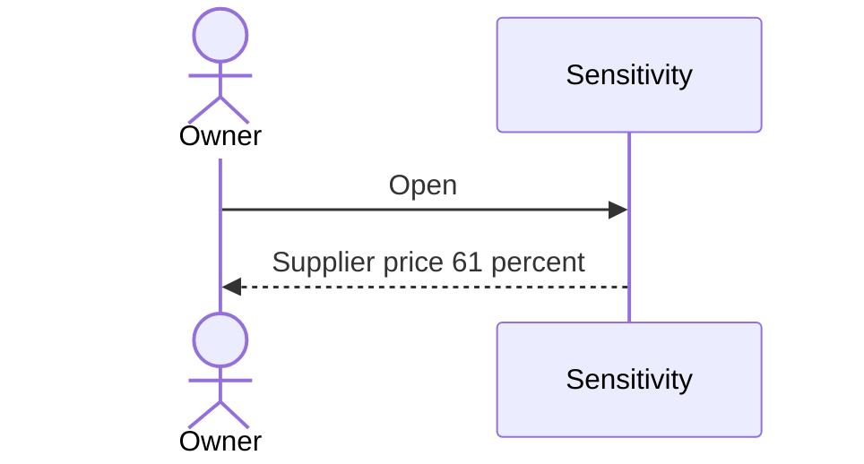

🏠 [Specs](../../../../README.md) › 🧩 [Functional capabilities](../../../README.md) ›
🔮 [F23 What-if simulation and impact](../../README.md) › 📝 [Use cases](../README.md) ›
📝 [Use cases: FL-F23-04 Decide](README.md) › 📝 UC-F23-14 See what matters most

# 📝 UC-F23-14 See what matters most

**Status:** ✅ specified

## Summary

The owner and accounting see what matters most.

## Personas

- [U13 Owner](../../../../01-users/personas/u13-owner.md)
- [U05 Accounting](../../../../01-users/personas/u05-accounting.md)

## Goal

Focus.

## Trigger

Run.

## Frequency

Monthly.

## Preconditions

- Run with ranges.

## Postconditions

- Success: read.
- Failure: none.

## Main flow

1. Open (S-F23-14).
2. Read ranking (BR-F23-08).
3. Adjust inputs.
4. Re-run.

## Alternative flows

- 3a. Goal seeking on the top lever (UC-F23-21).

## Error flows

- 1e. No ranges.
- Any step: a service does not answer; the call is retried first (BR-F3-32), then the message follows the error pattern
  (D122) and what was typed stays on the screen.

## Business rules

- [BR-F23-08 What matters most is ranked](../../business-rules/br-f23-08-sensitivity-ranked.md)

## Entities

- [E-F23-06 Sensitivity](../../data/e-f23-06-sensitivity.md)

## Permissions

Owner, accounting.

## Notifications

- None.

## Audit events

None.

## AI involvement

Explains.

## API, MCP and A2A exposure

Through T5 and T6 with the caller's rights (BR-F3-34).

## Screens

- [S-F23-14 Sensitivity](../../screens/04-decide/s-f23-14-sensitivity.md)

## Flowchart

See [FL-F23-04 Decide](../../flows/fl-f23-04-decide.md#flowchart).

## Sequence diagram

## Acceptance criteria

1. **Given** ranges **when** read **then** supplier price 61 %.
2. **Given** no ranges **when** read **then** said.
3. **Given** adjusted **when** re-run **then** updated.

## Non-functional notes

D408's targets ([Performance](../../../../05-non-functional/performance.md)): 95 % of screens within 1 second; lists
paged on the server, the first page within 1 second; reports within 5 seconds or in the background.

## Regulatory references

Values of the France country pack read by scenarios:
[CR-FR-046 Headcount thresholds](../../../../10-country-packs/france/labour/cr-fr-046-headcount-thresholds.md),
[CR-FR-008 VAT rates](../../../../10-country-packs/france/tax-and-vat/cr-fr-008-vat-rates.md),
[CR-FR-185 Minimum wage (SMIC)](../../../../10-country-packs/france/payroll/cr-fr-185-minimum-wage.md),
[CR-FR-064 Accounting frameworks of the books](../../../../10-country-packs/france/accounting/cr-fr-064-accounting-frameworks.md),
[CR-FR-058 AI in recruitment and work is high-risk](../../../../10-country-packs/france/ai-and-recording/cr-fr-058-high-risk-ai-in-employment.md),
[CR-FR-057 A person confirms what the AI does](../../../../10-country-packs/france/ai-and-recording/cr-fr-057-human-oversight.md).

## Related use cases

- [UC-F23-21 Seek a goal](../06-goals-and-financing/uc-f23-21-seek-a-goal.md)

## Open questions

None.

---

⬅️ [UC-F23-13](../03-see-the-impact/uc-f23-13-include-platform-costs-in-a-scenario.md) · ⬆️ [Up](README.md) ·
➡️ [UC-F23-15 Compare scenarios side by side](uc-f23-15-compare-scenarios-side-by-side.md)
