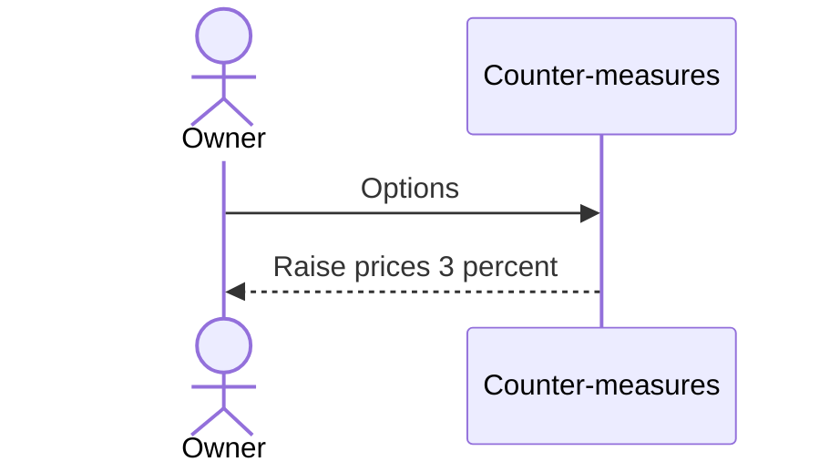

🏠 [Specs](../../../../README.md) › 🧩 [Functional capabilities](../../../README.md) ›
🔮 [F23 What-if simulation and impact](../../README.md) › 📝 [Use cases](../README.md) ›
📝 [Use cases: FL-F23-04 Decide](README.md) › 📝 UC-F23-16 Get counter-measures proposed

# 📝 UC-F23-16 Get counter-measures proposed

**Status:** ✅ specified

## Summary

The owner and managers get counter-measures proposed.

## Personas

- [U13 Owner](../../../../01-users/personas/u13-owner.md)
- [U02 Manager](../../../../01-users/personas/u02-manager.md)

## Goal

Options.

## Trigger

Bad result.

## Frequency

Monthly.

## Preconditions

- Run.

## Postconditions

- Success: options.
- Failure: none.

## Main flow

1. Ask (S-F23-16).
2. Read options (BR-F23-09).
3. Simulate one.
4. Keep.

## Alternative flows

- 3a. Goal seeking.

## Error flows

- 2e. About people: totals only.
- Any step: a service does not answer; the call is retried first (BR-F3-32), then the message follows the error pattern
  (D122) and what was typed stays on the screen.

## Business rules

- [BR-F23-09 Assumptions are visible](../../business-rules/br-f23-09-assumptions-visible.md)
- [BR-F23-12 No automated decisions about people](../../business-rules/br-f23-12-no-automated-decisions-on-people.md)

## Entities

- [E-F23-07 Counter-measure](../../data/e-f23-07-counter-measure.md)

## Permissions

Owner, managers.

## Notifications

- None.

## Audit events

Options.

## AI involvement

Proposes.

## API, MCP and A2A exposure

Through T5 and T6 with the caller's rights (BR-F3-34).

## Screens

- [S-F23-16 Counter-measures](../../screens/04-decide/s-f23-16-counter-measures.md)

## Flowchart

See [FL-F23-04 Decide](../../flows/fl-f23-04-decide.md#flowchart).

## Sequence diagram

## Acceptance criteria

1. **Given** a margin drop **when** asked **then** options.
2. **Given** simulated **when** run **then** effect.
3. **Given** people **when** proposed **then** totals only.

## Non-functional notes

D408's targets ([Performance](../../../../05-non-functional/performance.md)): 95 % of screens within 1 second; lists
paged on the server, the first page within 1 second; reports within 5 seconds or in the background.

## Regulatory references

Values of the France country pack read by scenarios:
[CR-FR-046 Headcount thresholds](../../../../10-country-packs/france/labour/cr-fr-046-headcount-thresholds.md),
[CR-FR-008 VAT rates](../../../../10-country-packs/france/tax-and-vat/cr-fr-008-vat-rates.md),
[CR-FR-185 Minimum wage (SMIC)](../../../../10-country-packs/france/payroll/cr-fr-185-minimum-wage.md),
[CR-FR-064 Accounting frameworks of the books](../../../../10-country-packs/france/accounting/cr-fr-064-accounting-frameworks.md),
[CR-FR-058 AI in recruitment and work is high-risk](../../../../10-country-packs/france/ai-and-recording/cr-fr-058-high-risk-ai-in-employment.md),
[CR-FR-057 A person confirms what the AI does](../../../../10-country-packs/france/ai-and-recording/cr-fr-057-human-oversight.md).

## Related use cases

- [UC-F23-21 Seek a goal](../06-goals-and-financing/uc-f23-21-seek-a-goal.md)

## Open questions

None.

---

⬅️ [UC-F23-15 Compare scenarios side by side](uc-f23-15-compare-scenarios-side-by-side.md) · ⬆️ [Up](README.md) ·
➡️ [UC-F23-17 Turn a scenario into actions](../05-act-and-watch/uc-f23-17-turn-a-scenario-into-actions.md)
