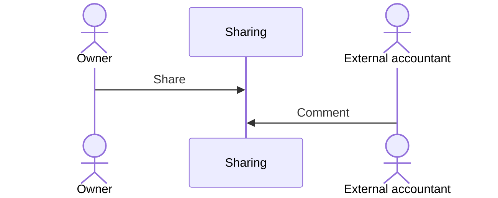

🏠 [Specs](../../../../README.md) › 🧩 [Functional capabilities](../../../README.md) ›
🔮 [F23 What-if simulation and impact](../../README.md) › 📝 [Use cases](../README.md) ›
📝 [Use cases: FL-F23-04 Decide](README.md) › 📝 UC-F23-19 Share and comment a scenario

# 📝 UC-F23-19 Share and comment a scenario

**Status:** ✅ specified

## Summary

The owner shares a scenario with the accountant who comments; versions kept.

## Personas

- [U13 Owner](../../../../01-users/personas/u13-owner.md)
- [U08 External accountant](../../../../01-users/personas/u08-external-accountant.md)

## Goal

Collaborate.

## Trigger

Review.

## Frequency

Quarterly.

## Preconditions

- Scenario.

## Postconditions

- Success: shared.
- Failure: none.

## Main flow

1. Share (S-F23-19).
2. Comment.
3. Keep versions.
4. Filtered per reader (BR-F23-06).

## Alternative flows

- 2a. Pack for the bank (UC-F23-29).

## Error flows

- 4e. Not allowed: filtered.
- Any step: a service does not answer; the call is retried first (BR-F3-32), then the message follows the error pattern
  (D122) and what was typed stays on the screen.

## Business rules

- [BR-F23-06 Rights apply to scenarios](../../business-rules/br-f23-06-rights-apply-to-scenarios.md)

## Entities

- [E-F23-02 Scenario](../../data/e-f23-02-scenario.md)
- [E-F23-10 Scenario comment](../../data/e-f23-10-scenario-comment.md)

## Permissions

Owner.

## Notifications

- Readers.

## Audit events

Comments.

## AI involvement

None.

## API, MCP and A2A exposure

Through T5 and T6 with the caller's rights (BR-F3-34).

## Screens

- [S-F23-19 Sharing](../../screens/04-decide/s-f23-19-sharing.md)

## Flowchart

See [FL-F23-04 Decide](../../flows/fl-f23-04-decide.md#flowchart).

## Sequence diagram

## Acceptance criteria

1. **Given** shared **when** read **then** filtered.
2. **Given** a comment **when** added **then** owner told.
3. **Given** versions **when** kept **then** listed.

## Non-functional notes

D408's targets ([Performance](../../../../05-non-functional/performance.md)): 95 % of screens within 1 second; lists
paged on the server, the first page within 1 second; reports within 5 seconds or in the background.

## Regulatory references

Values of the France country pack read by scenarios:
[CR-FR-046 Headcount thresholds](../../../../10-country-packs/france/labour/cr-fr-046-headcount-thresholds.md),
[CR-FR-008 VAT rates](../../../../10-country-packs/france/tax-and-vat/cr-fr-008-vat-rates.md),
[CR-FR-185 Minimum wage (SMIC)](../../../../10-country-packs/france/payroll/cr-fr-185-minimum-wage.md),
[CR-FR-064 Accounting frameworks of the books](../../../../10-country-packs/france/accounting/cr-fr-064-accounting-frameworks.md),
[CR-FR-058 AI in recruitment and work is high-risk](../../../../10-country-packs/france/ai-and-recording/cr-fr-058-high-risk-ai-in-employment.md),
[CR-FR-057 A person confirms what the AI does](../../../../10-country-packs/france/ai-and-recording/cr-fr-057-human-oversight.md).

## Related use cases

- [UC-F23-29 Prepare a forecast pack for the bank](../06-goals-and-financing/uc-f23-29-prepare-a-forecast-pack-for-the-bank.md)

## Open questions

None.

---

⬅️ [UC-F23-18](../05-act-and-watch/uc-f23-18-be-warned-when-a-real-change-hits-the-forecast.md) · ⬆️ [Up](README.md) ·
➡️ [UC-F23-20 Ask the AI assistant what if](../02-run/uc-f23-20-ask-the-assistant-what-if.md)
