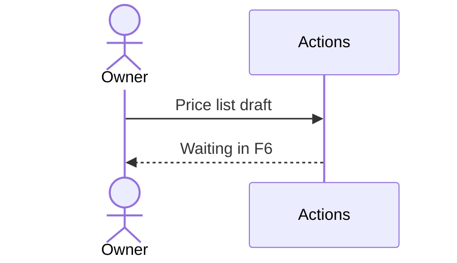

🏠 [Specs](../../../../README.md) › 🧩 [Functional capabilities](../../../README.md) ›
🔮 [F23 What-if simulation and impact](../../README.md) › 📝 [Use cases](../README.md) ›
📝 [Use cases: FL-F23-05 Act and watch](README.md) › 📝 UC-F23-17 Turn a scenario into actions

# 📝 UC-F23-17 Turn a scenario into actions

**Status:** ✅ specified

## Summary

The owner turns a scenario into proposals for each capability.

## Personas

- [U13 Owner](../../../../01-users/personas/u13-owner.md)

## Goal

Act.

## Trigger

Decision.

## Frequency

Monthly.

## Preconditions

- Chosen scenario.

## Postconditions

- Success: proposals.
- Failure: none.

## Main flow

1. Choose actions (S-F23-17).
2. Create proposals (BR-F23-10).
3. Approvals in each capability.
4. Follow.

## Alternative flows

- 2a. Price list in F6.

## Error flows

- 3e. Refused.
- Any step: a service does not answer; the call is retried first (BR-F3-32), then the message follows the error pattern
  (D122) and what was typed stays on the screen.

## Business rules

- [BR-F23-10 Actions need a person](../../business-rules/br-f23-10-actions-need-a-person.md)

## Entities

- [E-F23-08 Action proposal](../../data/e-f23-08-action-proposal.md)

## Permissions

Owner.

## Notifications

- Approvers.

## Audit events

Proposals.

## AI involvement

None.

## API, MCP and A2A exposure

Through T5 and T6 with the caller's rights (BR-F3-34).

## Screens

- [S-F23-17 Actions](../../screens/05-act-and-watch/s-f23-17-actions.md)

## Flowchart

See [FL-F23-05 Act and watch](../../flows/fl-f23-05-act-and-watch.md#flowchart).

## Sequence diagram

## Acceptance criteria

1. **Given** a price action **when** created **then** a draft in F6.
2. **Given** refused **when** refused **then** shown.
3. **Given** approved **when** approved **then** applied by a person.

## Non-functional notes

D408's targets ([Performance](../../../../05-non-functional/performance.md)): 95 % of screens within 1 second; lists
paged on the server, the first page within 1 second; reports within 5 seconds or in the background.

## Regulatory references

Values of the France country pack read by scenarios:
[CR-FR-046 Headcount thresholds](../../../../10-country-packs/france/labour/cr-fr-046-headcount-thresholds.md),
[CR-FR-008 VAT rates](../../../../10-country-packs/france/tax-and-vat/cr-fr-008-vat-rates.md),
[CR-FR-185 Minimum wage (SMIC)](../../../../10-country-packs/france/payroll/cr-fr-185-minimum-wage.md),
[CR-FR-064 Accounting frameworks of the books](../../../../10-country-packs/france/accounting/cr-fr-064-accounting-frameworks.md),
[CR-FR-058 AI in recruitment and work is high-risk](../../../../10-country-packs/france/ai-and-recording/cr-fr-058-high-risk-ai-in-employment.md),
[CR-FR-057 A person confirms what the AI does](../../../../10-country-packs/france/ai-and-recording/cr-fr-057-human-oversight.md).

## Related use cases

- [UC-F23-18 Be warned when a real change hits the forecast](uc-f23-18-be-warned-when-a-real-change-hits-the-forecast.md)

## Open questions

None.

---

⬅️ [UC-F23-16 Get counter-measures proposed](../04-decide/uc-f23-16-get-counter-measures-proposed.md) ·
⬆️ [Up](README.md) · ➡️ [UC-F23-18](uc-f23-18-be-warned-when-a-real-change-hits-the-forecast.md)
