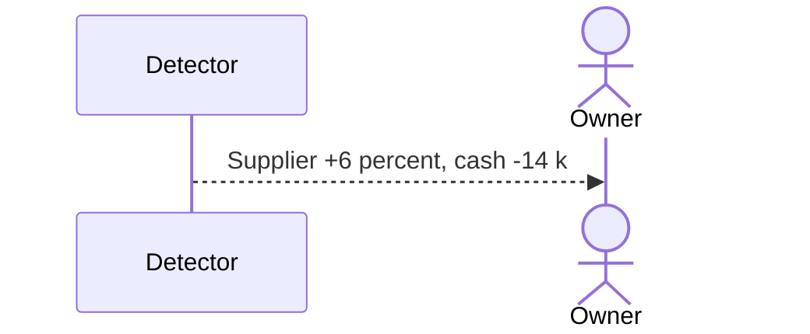

🏠 [Specs](../../../../README.md) › 🧩 [Functional capabilities](../../../README.md) ›
🔮 [F23 What-if simulation and impact](../../README.md) › 📝 [Use cases](../README.md) ›
📝 [Use cases: FL-F23-05 Act and watch](README.md) › 📝 UC-F23-18 Be warned when a real change hits the forecast

# 📝 UC-F23-18 Be warned when a real change hits the forecast

**Status:** ✅ specified

## Summary

The owner and treasurer are warned when a real change hits the forecast.

## Personas

- [U13 Owner](../../../../01-users/personas/u13-owner.md)
- [U31 Treasurer](../../../../01-users/personas/u31-treasurer.md)

## Goal

React early.

## Trigger

Real change.

## Frequency

Monthly.

## Preconditions

- Baseline.

## Postconditions

- Success: warned.
- Failure: none.

## Main flow

1. Change detected.
2. Impact computed (BR-F23-11).
3. Warning (S-F23-18).
4. Open the scenario.

## Alternative flows

- 2a. Within tolerance.

## Error flows

- 2e. None.
- Any step: a service does not answer; the call is retried first (BR-F3-32), then the message follows the error pattern
  (D122) and what was typed stays on the screen.

## Business rules

- [BR-F23-11 Warned when a real change hits](../../business-rules/br-f23-11-real-change-warnings.md)

## Entities

- [E-F23-09 Change warning](../../data/e-f23-09-change-warning.md)

## Permissions

Owner, treasurer.

## Notifications

- Warning.

## Audit events

Warnings.

## AI involvement

None.

## API, MCP and A2A exposure

Through T5 and T6 with the caller's rights (BR-F3-34).

## Screens

- [S-F23-18 Change warnings](../../screens/05-act-and-watch/s-f23-18-change-warnings.md)

## Flowchart

See [FL-F23-05 Act and watch](../../flows/fl-f23-05-act-and-watch.md#flowchart).

## Sequence diagram

## Acceptance criteria

1. **Given** +6 % **when** detected **then** warning -14 000.00 EUR.
2. **Given** within tolerance **when** detected **then** none.
3. **Given** opened **when** opened **then** scenario.

## Non-functional notes

D408's targets ([Performance](../../../../05-non-functional/performance.md)): 95 % of screens within 1 second; lists
paged on the server, the first page within 1 second; reports within 5 seconds or in the background.

## Regulatory references

Values of the France country pack read by scenarios:
[CR-FR-046 Headcount thresholds](../../../../10-country-packs/france/labour/cr-fr-046-headcount-thresholds.md),
[CR-FR-008 VAT rates](../../../../10-country-packs/france/tax-and-vat/cr-fr-008-vat-rates.md),
[CR-FR-185 Minimum wage (SMIC)](../../../../10-country-packs/france/payroll/cr-fr-185-minimum-wage.md),
[CR-FR-064 Accounting frameworks of the books](../../../../10-country-packs/france/accounting/cr-fr-064-accounting-frameworks.md),
[CR-FR-058 AI in recruitment and work is high-risk](../../../../10-country-packs/france/ai-and-recording/cr-fr-058-high-risk-ai-in-employment.md),
[CR-FR-057 A person confirms what the AI does](../../../../10-country-packs/france/ai-and-recording/cr-fr-057-human-oversight.md).

## Related use cases

- [UC-F23-24 Measure forecast accuracy and recalibrate](../07-accuracy-and-drivers/uc-f23-24-measure-forecast-accuracy-and-recalibrate.md)

## Open questions

None.

---

⬅️ [UC-F23-17 Turn a scenario into actions](uc-f23-17-turn-a-scenario-into-actions.md) · ⬆️ [Up](README.md) ·
➡️ [UC-F23-19 Share and comment a scenario](../04-decide/uc-f23-19-share-and-comment-a-scenario.md)
