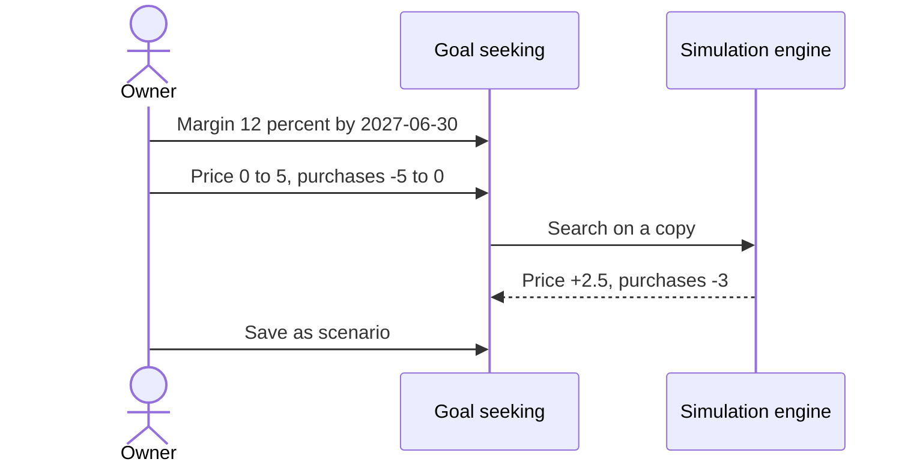

🏠 [Specs](../../../../README.md) › 🧩 [Functional capabilities](../../../README.md) ›
🔮 [F23 What-if simulation and impact](../../README.md) › 📝 [Use cases](../README.md) ›
📝 [Use cases: FL-F23-06 Goals and financing](README.md) › 📝 UC-F23-21 Seek a goal

# 📝 UC-F23-21 Seek a goal

**Status:** ✅ specified

## Summary

The owner sets a goal (a margin, a cash level or a profit by a date), chooses the levers allowed and their bounds, and
SimpleERP finds the smallest changes that reach it, or the closest result.

## Personas

- [U13 Owner](../../../../01-users/personas/u13-owner.md)
- [U05 Accounting](../../../../01-users/personas/u05-accounting.md), who checks the result

## Goal

Know what must change to reach a target.

## Trigger

A target set by the owner or the bank.

## Frequency

A few times a year.

## Preconditions

- A baseline exists (UC-F23-01).

## Postconditions

- Success: a scenario with the changes found.
- Failure: the closest result and the gap.

## Main flow

1. The owner opens Goal seeking (S-F23-21) and sets "margin 12 % by 2027-06-30".
2. They choose the levers and bounds: price up to +5 %, purchases down to -5 %.
3. SimpleERP searches on a copy with the real rules (BR-F23-13, BR-F23-04).
4. It shows the smallest combination and its impact across areas.
5. The owner saves it as a scenario and may turn it into actions (UC-F23-17).

## Alternative flows

- 4a. Not reachable: closest result and gap.

## Error flows

- 2e. A lever without bounds: refused.
- Any step: a service does not answer; the call is retried first (BR-F3-32), then the message follows the error pattern
  (D122) and what was typed stays on the screen.

## Business rules

- [BR-F23-13 Goal seeking moves only the chosen levers](../../business-rules/br-f23-13-goal-seeking-moves-only-the-chosen-levers.md)
- [BR-F23-04 The same rules as the ERP](../../business-rules/br-f23-04-same-rules-as-the-erp.md)

## Entities

- [E-F23-11 Goal](../../data/e-f23-11-goal.md)
- [E-F23-02 Scenario](../../data/e-f23-02-scenario.md)

## Permissions

Owner and accounting; figures within rights (BR-F23-06).

## Notifications

- None.

## Audit events

Goals and results.

## AI involvement

The engine searches; the AI assistant explains; nothing is applied.

## API, MCP and A2A exposure

Through the API (T5) and as AI assistant tools (T6), with the caller's rights (BR-F3-34).

## Screens

- [S-F23-21 Goal seeking](../../screens/06-goals-and-financing/s-f23-21-goal-seeking.md)

## Flowchart

See [FL-F23-06 Goals and financing](../../flows/fl-f23-06-goals-and-financing.md#flowchart).

## Sequence diagram

## Acceptance criteria

1. **Given** the manufacturing example company at 9.8 % margin **when** the goal 12 % by June is sought with price and
   purchases **then** price +2.5 % and purchases -3 % are shown.
2. **Given** price limited to +1 % **when** sought **then** the closest is 10.8 % with a gap of 1.2 points.
3. **Given** a lever without bounds **when** saved **then** refused.
4. **Given** the result **when** saved **then** the live company is unchanged.

## Non-functional notes

D408's targets ([Performance](../../../../05-non-functional/performance.md)): 95 % of screens within 1 second; lists
paged on the server, the first page within 1 second; reports within 5 seconds or in the background.

## Regulatory references

None.

## Related use cases

- [UC-F23-22 Find the break-even point](uc-f23-22-find-the-break-even-point.md)
- [UC-F23-17 Turn a scenario into actions](../05-act-and-watch/uc-f23-17-turn-a-scenario-into-actions.md)

## Open questions

None.

---

⬅️ [UC-F23-20 Ask the AI assistant what if](../02-run/uc-f23-20-ask-the-assistant-what-if.md) · ⬆️ [Up](README.md) ·
➡️ [UC-F23-22 Find the break-even point](uc-f23-22-find-the-break-even-point.md)
