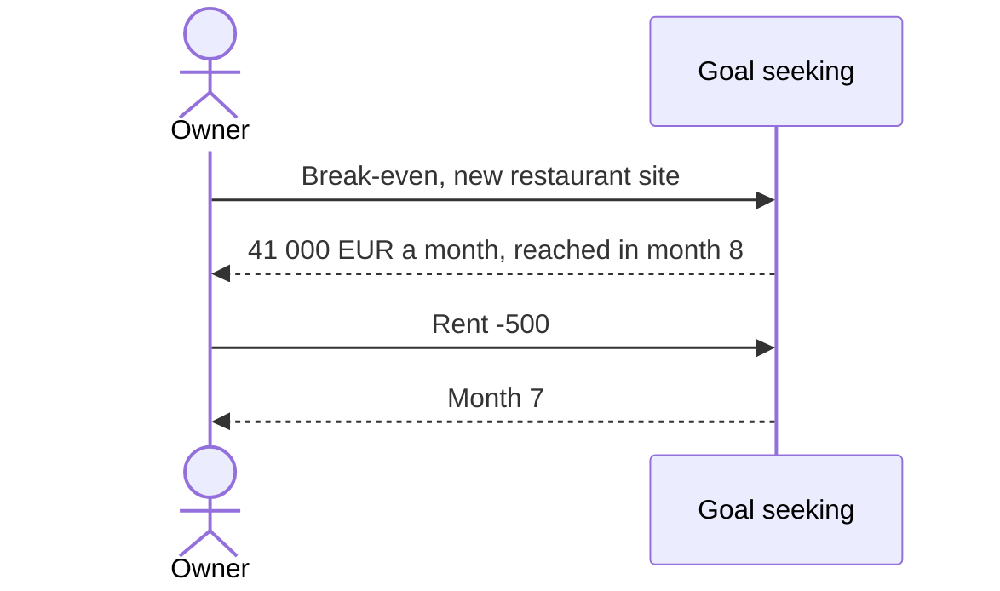

🏠 [Specs](../../../../README.md) › 🧩 [Functional capabilities](../../../README.md) ›
🔮 [F23 What-if simulation and impact](../../README.md) › 📝 [Use cases](../README.md) ›
📝 [Use cases: FL-F23-06 Goals and financing](README.md) › 📝 UC-F23-22 Find the break-even point

# 📝 UC-F23-22 Find the break-even point

**Status:** ✅ specified

## Summary

The owner asks for the break-even point: the sales needed each month to cover fixed and variable costs, and the month
the company or a new activity breaks even.

## Personas

- [U13 Owner](../../../../01-users/personas/u13-owner.md)
- [U05 Accounting](../../../../01-users/personas/u05-accounting.md)

## Goal

Know the sales needed to cover costs.

## Trigger

A new activity, a price change, a bank question.

## Frequency

A few times a year.

## Preconditions

- Costs split fixed and variable in F8.

## Postconditions

- Success: break-even sales and month shown.
- Failure: costs not split, said.

## Main flow

1. The owner opens Goal seeking (S-F23-21) and chooses "break-even".
2. They choose the scope: the company or an activity.
3. SimpleERP computes the break-even sales from fixed costs and the margin rate.
4. It shows the month when cumulative margin covers fixed costs.
5. The owner tests a change (price, rent) and sees the point move.

## Alternative flows

- 2a. A new site: its fixed costs entered as assumptions.

## Error flows

- 3e. Costs not split fixed and variable: the accountant is asked.
- Any step: a service does not answer; the call is retried first (BR-F3-32), then the message follows the error pattern
  (D122) and what was typed stays on the screen.

## Business rules

- [BR-F23-04 The same rules as the ERP](../../business-rules/br-f23-04-same-rules-as-the-erp.md)

## Entities

- [E-F23-11 Goal](../../data/e-f23-11-goal.md)

## Permissions

Owner and accounting.

## Notifications

- None.

## Audit events

Runs.

## AI involvement

The AI assistant explains the point.

## API, MCP and A2A exposure

Through the API (T5) and as AI assistant tools (T6), with the caller's rights (BR-F3-34).

## Screens

- [S-F23-21 Goal seeking](../../screens/06-goals-and-financing/s-f23-21-goal-seeking.md)

## Flowchart

See [FL-F23-06 Goals and financing](../../flows/fl-f23-06-goals-and-financing.md#flowchart).

## Sequence diagram

## Acceptance criteria

1. **Given** fixed costs of 12 300.00 EUR and a margin rate of 30 % **when** computed **then** break-even sales are 41
   000.00 EUR a month.
2. **Given** rent lowered by 500.00 EUR **when** re-run **then** the break-even month moves earlier.
3. **Given** costs not split **when** asked **then** the accountant is asked.

## Non-functional notes

D408's targets ([Performance](../../../../05-non-functional/performance.md)): 95 % of screens within 1 second; lists
paged on the server, the first page within 1 second; reports within 5 seconds or in the background.

## Regulatory references

None.

## Related use cases

- [UC-F23-21 Seek a goal](uc-f23-21-seek-a-goal.md)

## Open questions

None.

---

⬅️ [UC-F23-21 Seek a goal](uc-f23-21-seek-a-goal.md) · ⬆️ [Up](README.md) ·
➡️ [UC-F23-23 Simulate financing options](uc-f23-23-simulate-financing-options.md)
