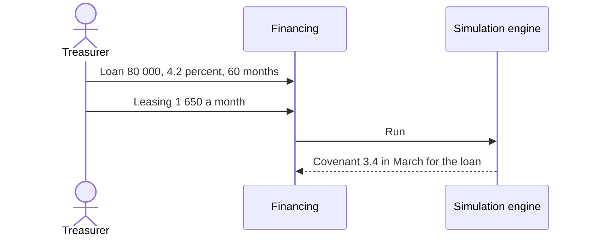

🏠 [Specs](../../../../README.md) › 🧩 [Functional capabilities](../../../README.md) ›
🔮 [F23 What-if simulation and impact](../../README.md) › 📝 [Use cases](../README.md) ›
📝 [Use cases: FL-F23-06 Goals and financing](README.md) › 📝 UC-F23-23 Simulate financing options

# 📝 UC-F23-23 Simulate financing options

**Status:** ✅ specified

## Summary

The treasurer and the owner compare financing options (a loan, a leasing, a credit line) in a scenario: cash month by
month, total cost, and the covenants of existing loans.

## Personas

- [U31 Treasurer](../../../../01-users/personas/u31-treasurer.md)
- [U13 Owner](../../../../01-users/personas/u13-owner.md)

## Goal

Choose the financing that fits cash and covenants.

## Trigger

An investment or a cash gap.

## Frequency

A few times a year.

## Preconditions

- Existing loans and their covenants entered by accounting.

## Postconditions

- Success: options compared, one chosen.
- Failure: none chosen.

## Main flow

1. The treasurer opens Financing (S-F23-22) in a scenario.
2. They add options with amount, rate, duration and fees.
3. SimpleERP computes schedules, interest and cash (BR-F23-14).
4. It checks covenants each month.
5. The owner compares and marks one chosen.

## Alternative flows

- 2a. Leasing with option to buy.

## Error flows

- 4e. A covenant breached: month and ratio flagged.
- Any step: a service does not answer; the call is retried first (BR-F3-32), then the message follows the error pattern
  (D122) and what was typed stays on the screen.

## Business rules

- [BR-F23-14 Financing options with their terms and covenants](../../business-rules/br-f23-14-financing-options-with-their-terms-and-covenants.md)

## Entities

- [E-F23-12 Financing option](../../data/e-f23-12-financing-option.md)
- [E-F23-05 Impact result](../../data/e-f23-05-impact-result.md)

## Permissions

Treasurer and owner; accounting reads.

## Notifications

- None.

## Audit events

Options and choice.

## AI involvement

The AI assistant explains differences.

## API, MCP and A2A exposure

Through the API (T5) and as AI assistant tools (T6), with the caller's rights (BR-F3-34).

## Screens

- [S-F23-22 Financing](../../screens/06-goals-and-financing/s-f23-22-financing.md)

## Flowchart

See [FL-F23-06 Goals and financing](../../flows/fl-f23-06-goals-and-financing.md#flowchart).

## Sequence diagram

## Acceptance criteria

1. **Given** a loan of 80 000.00 EUR at 4.2 % over 60 months **when** simulated **then** the instalment and total
   interest are shown.
2. **Given** net debt to EBITDA reaching 3.4 in March with a limit of 3 **when** simulated **then** March is flagged.
3. **Given** two options **when** compared **then** cash lows side by side.

## Non-functional notes

D408's targets ([Performance](../../../../05-non-functional/performance.md)): 95 % of screens within 1 second; lists
paged on the server, the first page within 1 second; reports within 5 seconds or in the background.

## Regulatory references

None.

## Related use cases

- [UC-F23-07 See the impact on cash and treasury](../03-see-the-impact/uc-f23-07-see-the-impact-on-cash-and-treasury.md)
- [UC-F23-29 Prepare a forecast pack for the bank](uc-f23-29-prepare-a-forecast-pack-for-the-bank.md)

## Open questions

None.

---

⬅️ [UC-F23-22 Find the break-even point](uc-f23-22-find-the-break-even-point.md) · ⬆️ [Up](README.md) ·
➡️ [UC-F23-24](../07-accuracy-and-drivers/uc-f23-24-measure-forecast-accuracy-and-recalibrate.md)
