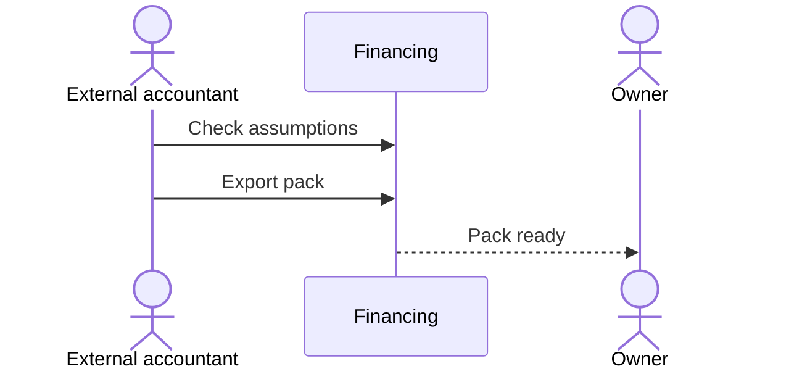

🏠 [Specs](../../../../README.md) › 🧩 [Functional capabilities](../../../README.md) ›
🔮 [F23 What-if simulation and impact](../../README.md) › 📝 [Use cases](../README.md) ›
📝 [Use cases: FL-F23-06 Goals and financing](README.md) › 📝 UC-F23-29 Prepare a forecast pack for the bank

# 📝 UC-F23-29 Prepare a forecast pack for the bank

**Status:** ✅ specified

## Summary

The external accountant prepares with the owner a forecast pack for the bank (baseline, chosen scenario, financing and
assumptions) from a shared scenario.

## Personas

- [U08 External accountant](../../../../01-users/personas/u08-external-accountant.md)
- [U13 Owner](../../../../01-users/personas/u13-owner.md)

## Goal

A clear pack for the bank meeting.

## Trigger

A loan request.

## Frequency

Rare.

## Preconditions

- Scenario shared with the accountant (UC-F23-19).

## Postconditions

- Success: pack exported.
- Failure: none.

## Main flow

1. The accountant opens Financing (S-F23-22) on the shared scenario.
2. They check assumptions and comment.
3. They add the financing chosen.
4. They export the pack: statements, cash, assumptions (BR-F23-09).
5. The owner sends it.

## Alternative flows

- 2a. The owner adjusts after comments.

## Error flows

- 4e. Figures the accountant may not see: excluded.
- Any step: a service does not answer; the call is retried first (BR-F3-32), then the message follows the error pattern
  (D122) and what was typed stays on the screen.

## Business rules

- [BR-F23-09 Assumptions are visible](../../business-rules/br-f23-09-assumptions-visible.md)
- [BR-F23-14 Financing options with their terms and covenants](../../business-rules/br-f23-14-financing-options-with-their-terms-and-covenants.md)

## Entities

- [E-F23-12 Financing option](../../data/e-f23-12-financing-option.md)
- [E-F23-10 Scenario comment](../../data/e-f23-10-scenario-comment.md)

## Permissions

Accountant on shared scenarios; owner.

## Notifications

- The owner when the pack is ready.

## Audit events

Exports.

## AI involvement

Drafts the narrative.

## API, MCP and A2A exposure

Through the API (T5) and as AI assistant tools (T6), with the caller's rights (BR-F3-34).

## Screens

- [S-F23-22 Financing](../../screens/06-goals-and-financing/s-f23-22-financing.md)

## Flowchart

See [FL-F23-06 Goals and financing](../../flows/fl-f23-06-goals-and-financing.md#flowchart).

## Sequence diagram

## Acceptance criteria

1. **Given** a shared scenario **when** exported **then** statements, cash and assumptions are in the pack.
2. **Given** a comment **when** added **then** the owner sees it.
3. **Given** figures not shared **when** exported **then** excluded.

## Non-functional notes

D408's targets ([Performance](../../../../05-non-functional/performance.md)): 95 % of screens within 1 second; lists
paged on the server, the first page within 1 second; reports within 5 seconds or in the background.

## Regulatory references

None.

## Related use cases

- [UC-F23-23 Simulate financing options](uc-f23-23-simulate-financing-options.md)
- [UC-F23-19 Share and comment a scenario](../04-decide/uc-f23-19-share-and-comment-a-scenario.md)

## Open questions

None.

---

⬅️ [UC-F23-28 Simulate a hiring plan](../03-see-the-impact/uc-f23-28-simulate-a-hiring-plan.md) · ⬆️ [Up](README.md) ·
➡️ [UC-F23-30 Simulate a new shift or machine](../03-see-the-impact/uc-f23-30-simulate-a-new-shift-or-machine.md)
