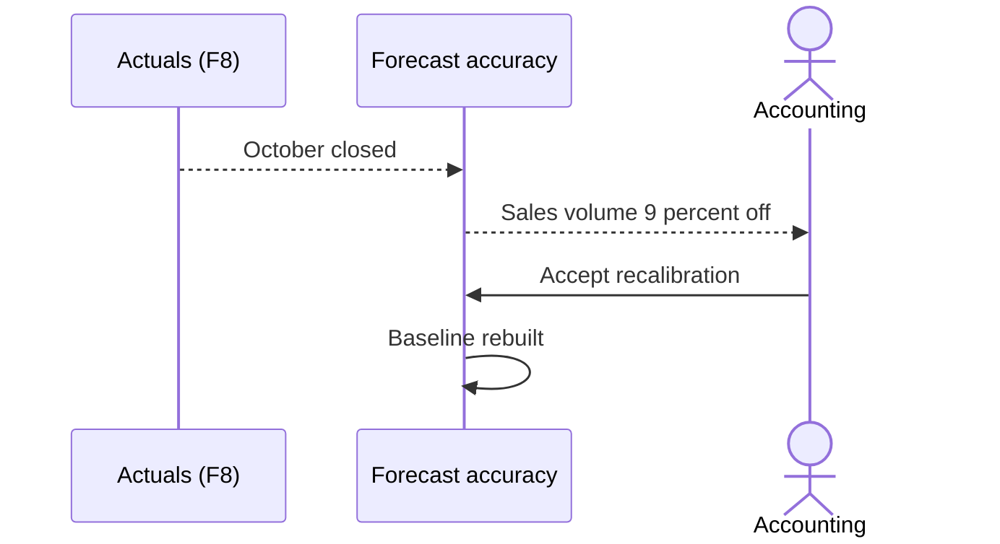

🏠 [Specs](../../../../README.md) › 🧩 [Functional capabilities](../../../README.md) ›
🔮 [F23 What-if simulation and impact](../../README.md) › 📝 [Use cases](../README.md) ›
📝 [Use cases: FL-F23-07 Accuracy and drivers](README.md) › 📝 UC-F23-24 Measure forecast accuracy and recalibrate

# 📝 UC-F23-24 Measure forecast accuracy and recalibrate

**Status:** ✅ specified

## Summary

Each month accounting sees how far the forecast was from the actuals, driver by driver, and accepts or refuses the
recalibrations proposed.

## Personas

- [U05 Accounting](../../../../01-users/personas/u05-accounting.md)
- [U13 Owner](../../../../01-users/personas/u13-owner.md)

## Goal

A forecast whose accuracy is known and improving.

## Trigger

A month closed in F8.

## Frequency

Monthly.

## Preconditions

- Actuals closed in F8; baseline drivers recorded.

## Postconditions

- Success: accuracy recorded; accepted recalibrations applied to the baseline.
- Failure: comparison waits.

## Main flow

1. The month closes in F8; SimpleERP compares forecast and actuals per driver (S-F23-23).
2. Accounting reads the errors.
3. For a driver above tolerance, a recalibration is proposed (BR-F23-15).
4. Accounting accepts or refuses with a reason.
5. The baseline is rebuilt with accepted ones.

## Alternative flows

- 4a. Exclude a one-off month with a reason.

## Error flows

- 1e. Month not closed: waits.
- Any step: a service does not answer; the call is retried first (BR-F3-32), then the message follows the error pattern
  (D122) and what was typed stays on the screen.

## Business rules

- [BR-F23-15 Accuracy measured, recalibration decided](../../business-rules/br-f23-15-accuracy-measured-recalibration-decided.md)
- [BR-F23-16 Budgets in F8, scenarios in F23](../../business-rules/br-f23-16-budgets-in-f8-scenarios-in-f23.md)

## Entities

- [E-F23-13 Driver accuracy](../../data/e-f23-13-driver-accuracy.md)
- [E-F23-01 Baseline forecast](../../data/e-f23-01-baseline-forecast.md)

## Permissions

Accounting decides; owner reads.

## Notifications

- Accounting when recalibrations are proposed.

## Audit events

Comparisons and decisions.

## AI involvement

Proposals; people decide.

## API, MCP and A2A exposure

Through the API (T5) and as AI assistant tools (T6), with the caller's rights (BR-F3-34).

## Screens

- [S-F23-23 Forecast accuracy](../../screens/07-accuracy-and-drivers/s-f23-23-forecast-accuracy.md)

## Flowchart

See [FL-F23-07 Accuracy and drivers](../../flows/fl-f23-07-accuracy-and-drivers.md#flowchart).

## Sequence diagram

## Acceptance criteria

1. **Given** sales volume forecast 100 and actual 109 **when** compared **then** 9 % error and a proposal.
2. **Given** accepted **when** saved **then** the baseline is rebuilt.
3. **Given** October not closed **when** compared **then** it waits.
4. **Given** the F8 budget **when** the baseline is built **then** it is an input, not a copy.

## Non-functional notes

D408's targets ([Performance](../../../../05-non-functional/performance.md)): 95 % of screens within 1 second; lists
paged on the server, the first page within 1 second; reports within 5 seconds or in the background.

## Regulatory references

None.

## Related use cases

- [UC-F23-01 See the baseline forecast](../01-build-a-scenario/uc-f23-01-see-the-baseline-forecast.md)
- [UC-F23-18 Be warned when a real change hits the forecast](../05-act-and-watch/uc-f23-18-be-warned-when-a-real-change-hits-the-forecast.md)

## Open questions

None.

---

⬅️ [UC-F23-23 Simulate financing options](../06-goals-and-financing/uc-f23-23-simulate-financing-options.md) ·
⬆️ [Up](README.md) · ➡️ [UC-F23-25 Use sector drivers](uc-f23-25-use-sector-drivers.md)
