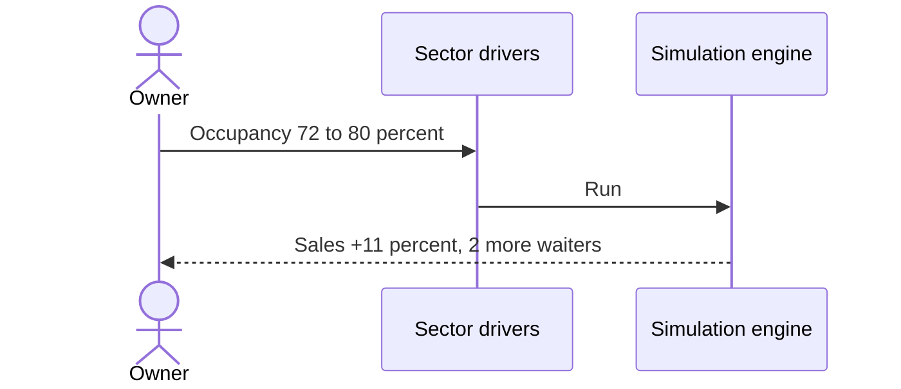

🏠 [Specs](../../../../README.md) › 🧩 [Functional capabilities](../../../README.md) ›
🔮 [F23 What-if simulation and impact](../../README.md) › 📝 [Use cases](../README.md) ›
📝 [Use cases: FL-F23-07 Accuracy and drivers](README.md) › 📝 UC-F23-25 Use sector drivers

# 📝 UC-F23-25 Use sector drivers

**Status:** ✅ specified

## Summary

The owner or a manager changes sector drivers in a scenario (occupancy of a restaurant, utilisation of consultants, fill
rate of training sessions) and sees the impact.

## Personas

- [U13 Owner](../../../../01-users/personas/u13-owner.md)
- [U02 Manager](../../../../01-users/personas/u02-manager.md)

## Goal

Scenarios in the sector's own terms.

## Trigger

A scenario on activity.

## Frequency

Monthly.

## Preconditions

- The sector pack provides drivers (BR-F23-17).

## Postconditions

- Success: impact computed.
- Failure: assumption marked.

## Main flow

1. The owner opens Sector drivers (S-F23-24) in a scenario.
2. They see the sector's drivers with current values from the records.
3. They change one: occupancy 72 % to 80 %.
4. The run shows the impact on sales, staff and margin.

## Alternative flows

- 2a. A driver without data: entered as an assumption.

## Error flows

- 3e. Out of range (above 100 %): refused.
- Any step: a service does not answer; the call is retried first (BR-F3-32), then the message follows the error pattern
  (D122) and what was typed stays on the screen.

## Business rules

- [BR-F23-17 Sector drivers from the sector pack](../../business-rules/br-f23-17-sector-drivers-from-the-sector-pack.md)

## Entities

- [E-F23-14 Sector driver](../../data/e-f23-14-sector-driver.md)
- [E-F23-03 Scenario change](../../data/e-f23-03-scenario-change.md)

## Permissions

Owner and managers.

## Notifications

- None.

## Audit events

Changes.

## AI involvement

Explains.

## API, MCP and A2A exposure

Through the API (T5) and as AI assistant tools (T6), with the caller's rights (BR-F3-34).

## Screens

- [S-F23-24 Sector drivers](../../screens/07-accuracy-and-drivers/s-f23-24-sector-drivers.md)

## Flowchart

See [FL-F23-07 Accuracy and drivers](../../flows/fl-f23-07-accuracy-and-drivers.md#flowchart).

## Sequence diagram

## Acceptance criteria

1. **Given** the restaurant example company at 72 % occupancy **when** 80 % is simulated **then** sales and staff needs
   are shown.
2. **Given** a consulting firm at 68 % utilisation **when** 75 % is simulated **then** margin is shown.
3. **Given** 110 % **when** entered **then** refused.

## Non-functional notes

D408's targets ([Performance](../../../../05-non-functional/performance.md)): 95 % of screens within 1 second; lists
paged on the server, the first page within 1 second; reports within 5 seconds or in the background.

## Regulatory references

None.

## Related use cases

- [UC-F23-03 Change one or several elements](../01-build-a-scenario/uc-f23-03-change-one-or-several-elements.md)
- [UC-F23-24 Measure forecast accuracy and recalibrate](uc-f23-24-measure-forecast-accuracy-and-recalibrate.md)

## Open questions

None.

---

⬅️ [UC-F23-24 Measure forecast accuracy and recalibrate](uc-f23-24-measure-forecast-accuracy-and-recalibrate.md) ·
⬆️ [Up](README.md) · ➡️ [UC-F23-26](../03-see-the-impact/uc-f23-26-simulate-a-price-change-on-the-pipeline.md)
