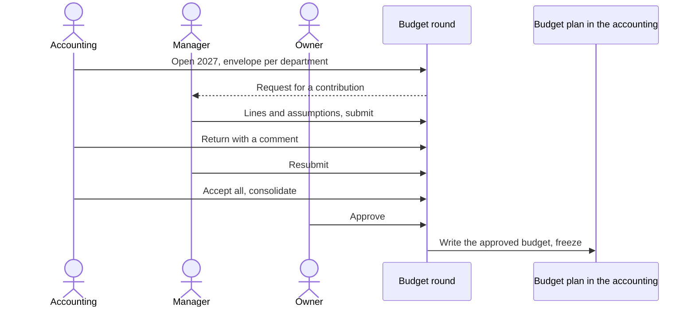

🏠 [Specs](../../../../README.md) › 🧩 [Functional capabilities](../../../README.md) ›
🔮 [F23 What-if simulation and impact](../../README.md) › 📝 [Use cases](../README.md) ›
📝 [Use cases: FL-F23-08 Budgets, rolling forecasts, group and valuation](README.md) ›
📝 UC-F23-31 Build the budget with department owners

# 📝 UC-F23-31 Build the budget with department owners

**Status:** ✅ specified

## Summary

Accounting opens a budget round for a year: each department gets an envelope and a deadline, its manager enters a
contribution (lines by account or analytic target, with the assumptions behind each), and accounting reviews, sends back
or accepts every contribution. When the owner approves the consolidated budget, it is written to the accounting budget
plan and every contribution is frozen.

## Personas

- [U02 Manager](../../../../01-users/personas/u02-manager.md), who enters and submits the department's contribution
- [U05 Accounting](../../../../01-users/personas/u05-accounting.md), who opens the round, reviews and consolidates

## Goal

The budget comes from the people who spend it, in one round, with the reasons recorded, and nobody changes it after
approval.

## Trigger

Accounting opens the budget round of a year, or a manager receives a request for a contribution.

## Frequency

Once a year, with a revision round in some companies.

## Preconditions

- Departments and their managers exist
  [UC-F9-17](../../../f09-hr-and-projects/use-cases/06-plan-and-deliver-work/uc-f09-17-manage-projects-and-tasks.md).
- The chart of accounts and the analytic plans exist
  [UC-F8-09](../../../f08-accounting/use-cases/04-tax-assets-and-analytics/uc-f08-09-track-analytics-and-budgets.md).
- The baseline forecast exists to start from ([E-F23-01 Baseline forecast](../../data/e-f23-01-baseline-forecast.md)).

## Postconditions

- **Succeeded:** the budget plan is approved and written to the accounting
  ([E-F8-16 Budget plan](../../../f08-accounting/data/e-f08-16-budget-plan.md)); every contribution is Frozen; the
  baseline forecast reads the approved budget
  ([BR-F23-16](../../business-rules/br-f23-16-budgets-in-f8-scenarios-in-f23.md)).
- **Failed:** no budget is approved; contributions stay as they are and the round stays open.

## Main flow

1. Accounting opens the collaborative budget screen
   ([S-F23-25](../../screens/08-budgets-rolling-group-and-valuation/s-f23-25-collaborative-budget.md)), creates the
   round for the year and sets each department's envelope and deadline.
2. Each manager receives the request, opens its contribution, prefilled from last year's actuals and the baseline, and
   enters its lines with the assumption of each.
3. The manager submits the contribution; accounting reads it against the envelope and the last year.
4. Accounting accepts the contribution or returns it with a comment; a returned contribution goes back to the manager.
5. When every contribution is accepted, accounting consolidates them into the proposed budget and shows the total
   against the envelopes and the forecast.
6. The owner approves; the budget plan is written to the accounting and all contributions are frozen
   ([BR-F23-18](../../business-rules/br-f23-18-a-budget-is-frozen-once-approved.md)).

## Alternative flows

- 2a. A manager asks the AI assistant to propose lines from last year's figures: the proposal is a draft the manager
  edits ([BR-F23-10](../../business-rules/br-f23-10-actions-need-a-person.md)).
- 3a. A contribution exceeds the envelope: it is flagged and accounting may accept it with a reason or return it.
- 6a. The owner refuses: the round reopens and the contributions keep their states.

## Error flows

- 2e. A manager misses the deadline: accounting is told and may enter or extend the contribution.
- 6e. Someone tries to change a contribution after approval: the change is refused and the way to revise the budget is
  shown ([BR-F23-18](../../business-rules/br-f23-18-a-budget-is-frozen-once-approved.md)).
- Any step: a service does not answer; the call is retried first
  ([BR-F3-32](../../../f03-assistant/business-rules/br-f03-32-retry-before-an-error.md)), then the message follows the
  error pattern ([D122](../../../../06-decisions/ux/d122-error-message-standard.md)) and what the user typed stays on
  the screen.

## Business rules

- [BR-F23-18](../../business-rules/br-f23-18-a-budget-is-frozen-once-approved.md)
- [BR-F23-16](../../business-rules/br-f23-16-budgets-in-f8-scenarios-in-f23.md)

## Entities

- [E-F23-15 Budget contribution](../../data/e-f23-15-budget-contribution.md): created, changed
- [E-F8-16 Budget plan](../../../f08-accounting/data/e-f08-16-budget-plan.md): created at approval, the budget plan
- [E-F23-01 Baseline forecast](../../data/e-f23-01-baseline-forecast.md): read, the baseline to start from

## Permissions

Accounting opens rounds, reviews and consolidates. A manager enters and submits their department's contribution only.
The owner approves the budget. The administrator may reassign a contribution to another manager.

## Notifications

Each manager: the request, a reminder 3 days before the deadline, a contribution returned. Accounting: a contribution
submitted, late or over its envelope. The owner: the consolidated budget to approve.

## Audit events

Each round opened, envelope set, contribution entered, submitted, returned, accepted and frozen, and the approval, with
who and when.

## AI involvement

No AI step of its own. The AI assistant may open the screen and prefill it from the user's words; the user checks and
confirms ([BR-F3-07](../../../f03-assistant/business-rules/br-f03-07-no-deletes-no-irreversible-acts.md)).

## API, MCP and A2A exposure

T5 operations of the capability for the personas above: create, read, update and list. The MCP tool of the
capability may read and propose, never confirm alone. No A2A skill.

## Screens

- [S-F23-25](../../screens/08-budgets-rolling-group-and-valuation/s-f23-25-collaborative-budget.md)

## Flowchart

See
[FL-F23-08 Budgets, rolling forecasts, group and valuation](../../flows/fl-f23-08-budgets-rolling-group-and-valuation.md#flowchart).

## Sequence diagram

## Acceptance criteria

1. **Given** a round with an envelope of 80,000 EUR **when** a manager submits 95,000 EUR **then** the contribution is
   flagged over its envelope.
2. **Given** a contribution returned with a comment **when** the manager opens it **then** the comment is shown and the
   contribution is editable again.
3. **Given** an approved budget **when** a manager tries to change a line **then** the change is refused and the
   contribution is shown as Frozen.
4. **Given** every contribution accepted **when** the owner approves **then** the budget plan exists in the accounting
   and the baseline reads it.

## Non-functional notes

The screen answers within 2 seconds for 10,000 records; every change is audited.

## Regulatory references

None specific to this use case beyond the rules above: a budget is an internal plan, not a legal document.

## Related use cases

- [UC-F23-32 Roll the forecast forward](uc-f23-32-roll-the-forecast-forward.md)
- [UC-F23-01](../01-build-a-scenario/uc-f23-01-see-the-baseline-forecast.md)
- [UC-F8-19](../../../f08-accounting/use-cases/06-benchmark-additions/uc-f08-19-plan-and-forecast.md)
- [UC-F8-09](../../../f08-accounting/use-cases/04-tax-assets-and-analytics/uc-f08-09-track-analytics-and-budgets.md)
- [UC-F23-15](../04-decide/uc-f23-15-compare-scenarios-side-by-side.md)

## Open questions

None.

---

⬅️ [UC-F23-30 Simulate a new shift or machine](../03-see-the-impact/uc-f23-30-simulate-a-new-shift-or-machine.md) ·
⬆️ [Up](README.md) · ➡️ [UC-F23-32 Roll the forecast forward](uc-f23-32-roll-the-forecast-forward.md)
