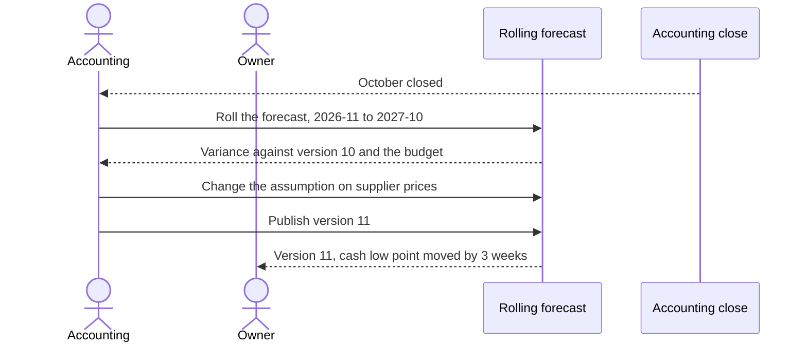

🏠 [Specs](../../../../README.md) › 🧩 [Functional capabilities](../../../README.md) ›
🔮 [F23 What-if simulation and impact](../../README.md) › 📝 [Use cases](../README.md) ›
📝 [Use cases: FL-F23-08 Budgets, rolling forecasts, group and valuation](README.md) ›
📝 UC-F23-32 Roll the forecast forward

# 📝 UC-F23-32 Roll the forecast forward

**Status:** ✅ specified

## Summary

After each month closes, accounting rolls the forecast forward: the month just ended is replaced by its actuals, the
horizon moves one month on, the assumptions are reviewed and a new numbered version is published. Versions are kept and
compared with each other, with the budget and with the actuals, so the company sees how its expectations moved.

## Personas

- [U05 Accounting](../../../../01-users/personas/u05-accounting.md), who rolls, reviews and publishes
- [U13 Owner](../../../../01-users/personas/u13-owner.md), who reads the new version and its movement

## Goal

The forecast always looks the same number of months ahead, and the history of what the company expected is never lost.

## Trigger

A period is closed
[UC-F8-10](../../../f08-accounting/use-cases/05-close-report-and-consolidate/uc-f08-10-close-the-period-and-the-year.md),
or the owner asks for a fresh forecast.

## Frequency

Every month.

## Preconditions

- The period just ended is closed in the accounting
  ([E-F8-10 Fiscal period](../../../f08-accounting/data/e-f08-10-fiscal-period.md)).
- A baseline forecast exists ([E-F23-01 Baseline forecast](../../data/e-f23-01-baseline-forecast.md)).
- The approved budget exists for comparison
  ([E-F8-16 Budget plan](../../../f08-accounting/data/e-f08-16-budget-plan.md)).

## Postconditions

- **Succeeded:** a new forecast version is Published with its horizon, its assumptions and its variances; the previous
  version is Superseded and kept.
- **Failed:** no version is published; the previous version stays the current one.

## Main flow

1. Accounting opens the rolling forecast screen
   ([S-F23-26](../../screens/08-budgets-rolling-group-and-valuation/s-f23-26-rolling-forecast.md)) after the month
   close.
2. simple-ERP replaces the closed month by its actuals and adds one month at the end of the horizon, using the baseline
   method ([BR-F23-02](../../business-rules/br-f23-02-baseline-from-history-and-plans.md)).
3. Accounting reviews the assumptions of the months ahead, changes the ones that moved and notes why.
4. simple-ERP shows the variance of the new version against the previous one, the budget and the actuals of the closed
   month.
5. Accounting publishes the version; the previous version becomes Superseded and stays readable
   ([BR-F23-19](../../business-rules/br-f23-19-each-rolling-forecast-keeps-its-version.md)).
6. The owner reads the new version and the movement since the last one.

## Alternative flows

- 2a. The horizon is set in the company's settings (12 months by default) and keeps its length.
- 3a. The AI assistant proposes the changed assumptions with its reasons: accounting accepts or edits them
  ([BR-F23-10](../../business-rules/br-f23-10-actions-need-a-person.md)).
- 5a. A draft version is discarded: the previous version stays the current one.

## Error flows

- 2e. The month is not closed: no version can be rolled for it and the screen says which period is open.
- 5e. A published version is edited by hand: refused, a new version is made instead
  ([BR-F23-19](../../business-rules/br-f23-19-each-rolling-forecast-keeps-its-version.md)).
- Any step: a service does not answer; the call is retried first
  ([BR-F3-32](../../../f03-assistant/business-rules/br-f03-32-retry-before-an-error.md)), then the message follows the
  error pattern ([D122](../../../../06-decisions/ux/d122-error-message-standard.md)) and what the user typed stays on
  the screen.

## Business rules

- [BR-F23-19](../../business-rules/br-f23-19-each-rolling-forecast-keeps-its-version.md)
- [BR-F23-02](../../business-rules/br-f23-02-baseline-from-history-and-plans.md)

## Entities

- [E-F23-16 Forecast version](../../data/e-f23-16-forecast-version.md): created, changed
- [E-F23-01 Baseline forecast](../../data/e-f23-01-baseline-forecast.md): read, the method and the history
- [E-F8-10 Fiscal period](../../../f08-accounting/data/e-f08-10-fiscal-period.md): read, the closed period
- [E-F8-16 Budget plan](../../../f08-accounting/data/e-f08-16-budget-plan.md): read, the budget compared with

## Permissions

Accounting rolls, edits assumptions and publishes. The owner and managers read the published versions. A
manager reads only the lines of their department.

## Notifications

The owner: a new version published, with the biggest movement. Accounting: a month closed, ready to roll.

## Audit events

Each version rolled, assumption changed, published and superseded, with who, when and the figures before and after.

## AI involvement

No AI step of its own. The AI assistant may open the screen and prefill it from the user's words; the user checks and
confirms ([BR-F3-07](../../../f03-assistant/business-rules/br-f03-07-no-deletes-no-irreversible-acts.md)).

## API, MCP and A2A exposure

T5 operations of the capability for the personas above: create, read, update and list. The MCP tool of the
capability may read and propose, never confirm alone. No A2A skill.

## Screens

- [S-F23-26](../../screens/08-budgets-rolling-group-and-valuation/s-f23-26-rolling-forecast.md)

## Flowchart

See
[FL-F23-08 Budgets, rolling forecasts, group and valuation](../../flows/fl-f23-08-budgets-rolling-group-and-valuation.md#flowchart).

## Sequence diagram

## Acceptance criteria

1. **Given** October closed and version 10 published **when** accounting rolls the forecast **then** the horizon is
   November 2026 to October 2027 and October is replaced by its actuals.
2. **Given** a published version **when** a newer one is published **then** the older one is Superseded and still
   readable.
3. **Given** a published version **when** someone edits a figure **then** the edit is refused and a new version is
   offered.
4. **Given** a month not closed **when** accounting rolls the forecast **then** it is refused and names the open period.

## Non-functional notes

The screen answers within 2 seconds for 10,000 records; every change is audited.

## Regulatory references

None specific to this use case: a forecast is an internal estimate. A forecast given to a bank or an investor is a
separate pack ([UC-F23-29](../06-goals-and-financing/uc-f23-29-prepare-a-forecast-pack-for-the-bank.md)).

## Related use cases

- [UC-F23-31](uc-f23-31-build-the-budget-with-department-owners.md)
- [UC-F23-33 Run a group scenario](uc-f23-33-run-a-group-scenario.md)
- [UC-F23-01](../01-build-a-scenario/uc-f23-01-see-the-baseline-forecast.md)
- [UC-F23-24](../07-accuracy-and-drivers/uc-f23-24-measure-forecast-accuracy-and-recalibrate.md)
- [UC-F8-19](../../../f08-accounting/use-cases/06-benchmark-additions/uc-f08-19-plan-and-forecast.md)
- [UC-F23-31](uc-f23-31-build-the-budget-with-department-owners.md)

## Open questions

None.

---

⬅️ [UC-F23-31 Build the budget with department owners](uc-f23-31-build-the-budget-with-department-owners.md) ·
⬆️ [Up](README.md) · ➡️ [UC-F23-33 Run a group scenario](uc-f23-33-run-a-group-scenario.md)
