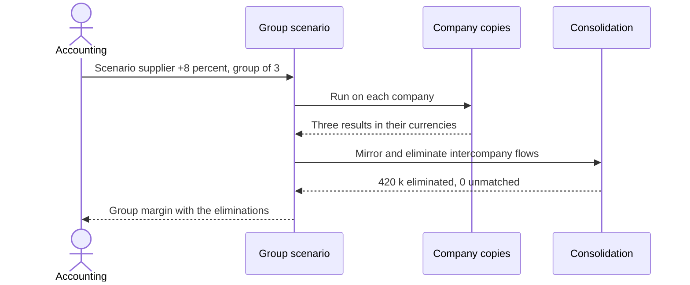

🏠 [Specs](../../../../README.md) › 🧩 [Functional capabilities](../../../README.md) ›
🔮 [F23 What-if simulation and impact](../../README.md) › 📝 [Use cases](../README.md) ›
📝 [Use cases: FL-F23-08 Budgets, rolling forecasts, group and valuation](README.md) › 📝 UC-F23-33 Run a group scenario

# 📝 UC-F23-33 Run a group scenario

**Status:** ✅ specified

## Summary

Accounting runs a scenario across a whole group of companies: each company's impact is computed with its own rules and
currency, and the consolidated result is shown after eliminating what the companies owe and sell to each other. The
screen shows every company, the eliminations and the group total.

## Personas

- [U05 Accounting](../../../../01-users/personas/u05-accounting.md), who runs the scenario on the group and reads the
  eliminations

## Goal

A group sees the true effect of a decision on the group, not a sum that counts its internal trade twice.

## Trigger

Accounting picks a scenario and a consolidation group and runs it.

## Frequency

A few times a quarter; at budget time.

## Preconditions

- A consolidation group exists
  ([E-F8-11 Consolidation group](../../../f08-accounting/data/e-f08-11-consolidation-group.md)) with its mapping and
  currencies
  [UC-F8-13](../../../f08-accounting/use-cases/05-close-report-and-consolidate/uc-f08-13-consolidate-the-group.md).
- The scenario exists ([E-F23-02 Scenario](../../data/e-f23-02-scenario.md)) and applies to the companies of the group.
- Each company's baseline exists ([E-F23-01 Baseline forecast](../../data/e-f23-01-baseline-forecast.md)).

## Postconditions

- **Succeeded:** the group result is shown per company, with the intercompany eliminations and the consolidated total;
  the scenario keeps its group run.
- **Failed:** no group result is saved; the companies' own results, if computed, stay with their scenario.

## Main flow

1. Accounting opens the group scenario screen
   ([S-F23-27](../../screens/08-budgets-rolling-group-and-valuation/s-f23-27-group-scenario.md)) and picks a scenario
   and a group.
2. simple-ERP runs the scenario on a copy for each company, with that company's rules and currency
   ([BR-F23-03](../../business-rules/br-f23-03-runs-on-a-copy.md),
   [BR-F23-04](../../business-rules/br-f23-04-same-rules-as-the-erp.md)).
3. It lists the flows between companies of the group (sales, loans, dividends) and mirrors them
   ([BR-F8-07](../../../f08-accounting/business-rules/br-f08-07-intercompany-mirrored-and-eliminated.md)).
4. It eliminates the mirrored flows and shows the consolidated sales, margin and cash.
5. Accounting reads per company and for the group, and opens an elimination to see the two entries behind it.
6. Accounting compares the group run with the baseline of the group or another scenario
   ([UC-F23-15](../04-decide/uc-f23-15-compare-scenarios-side-by-side.md)).

## Alternative flows

- 2a. A company of the group has no baseline: it is listed as missing and left out of the total, which says so.
- 3a. The flow is in a foreign currency: it is translated as the consolidation does
  [UC-F8-13](../../../f08-accounting/use-cases/05-close-report-and-consolidate/uc-f08-13-consolidate-the-group.md).
- 5a. The accountant of the group reads the run, within the rights of their access.

## Error flows

- 3e. A flow has no mirror in the other company: it is listed as unmatched and left out of the elimination, with the
  amount and the two companies
  ([BR-F23-20](../../business-rules/br-f23-20-group-scenarios-eliminate-intercompany-flows.md)).
- 4e. The eliminations do not balance: the run stops and shows the difference.
- Any step: a service does not answer; the call is retried first
  ([BR-F3-32](../../../f03-assistant/business-rules/br-f03-32-retry-before-an-error.md)), then the message follows the
  error pattern ([D122](../../../../06-decisions/ux/d122-error-message-standard.md)) and what the user typed stays on
  the screen.

## Business rules

- [BR-F23-20](../../business-rules/br-f23-20-group-scenarios-eliminate-intercompany-flows.md)
- [BR-F8-07](../../../f08-accounting/business-rules/br-f08-07-intercompany-mirrored-and-eliminated.md)

## Entities

- [E-F8-11 Consolidation group](../../../f08-accounting/data/e-f08-11-consolidation-group.md): read, the group and its
  mapping
- [E-F23-02 Scenario](../../data/e-f23-02-scenario.md): read, the scenario
- [E-F23-04 Simulation run](../../data/e-f23-04-simulation-run.md): created, the simulation runs

## Permissions

Accounting runs and reads group scenarios. The owner reads the group results. A company's manager reads only
their own company's column.

## Notifications

None: the result is read on the screen; a scenario shared with the owner follows
[UC-F23-19](../04-decide/uc-f23-19-share-and-comment-a-scenario.md).

## Audit events

Each group run (scenario, group, companies, rates used), each elimination listed and each unmatched flow.

## AI involvement

No AI step of its own. The AI assistant may open the screen and prefill it from the user's words; the user checks and
confirms ([BR-F3-07](../../../f03-assistant/business-rules/br-f03-07-no-deletes-no-irreversible-acts.md)).

## API, MCP and A2A exposure

T5 operations of the capability for the personas above: create, read, update and list. The MCP tool of the
capability may read and propose, never confirm alone. No A2A skill.

## Screens

- [S-F23-27](../../screens/08-budgets-rolling-group-and-valuation/s-f23-27-group-scenario.md)

## Flowchart

See
[FL-F23-08 Budgets, rolling forecasts, group and valuation](../../flows/fl-f23-08-budgets-rolling-group-and-valuation.md#flowchart).

## Sequence diagram

## Acceptance criteria

1. **Given** company A sells 100 k to company B in the scenario **when** the group run is computed **then** the 100 k is
   eliminated from the group sales and from the group costs.
2. **Given** a flow with no mirror **when** the run is computed **then** it is listed as unmatched and not eliminated.
3. **Given** a company with no baseline **when** the run is computed **then** it is listed as missing and the total says
   so.
4. **Given** a group of three companies **when** the run ends **then** each company's own result and the group result
   are shown.

## Non-functional notes

The screen answers within 2 seconds for 10,000 records; every change is audited.

## Regulatory references

None specific to this use case beyond the rules above; the group's own consolidation duties are in
[UC-F8-13](../../../f08-accounting/use-cases/05-close-report-and-consolidate/uc-f08-13-consolidate-the-group.md).

## Related use cases

- [UC-F23-32 Roll the forecast forward](uc-f23-32-roll-the-forecast-forward.md)
- [UC-F23-34 Value the company](uc-f23-34-value-the-company.md)
- [UC-F23-05](../02-run/uc-f23-05-run-the-scenario-on-a-copy-with-the-real-rules.md)
- [UC-F23-15](../04-decide/uc-f23-15-compare-scenarios-side-by-side.md)
- [UC-F8-13](../../../f08-accounting/use-cases/05-close-report-and-consolidate/uc-f08-13-consolidate-the-group.md)
- [UC-F7-15](../../../f07-purchasing-and-stock/use-cases/06-benchmark-additions/uc-f07-15-trade-between-group-companies.md)

## Open questions

None.

---

⬅️ [UC-F23-32 Roll the forecast forward](uc-f23-32-roll-the-forecast-forward.md) · ⬆️ [Up](README.md) ·
➡️ [UC-F23-34 Value the company](uc-f23-34-value-the-company.md)
