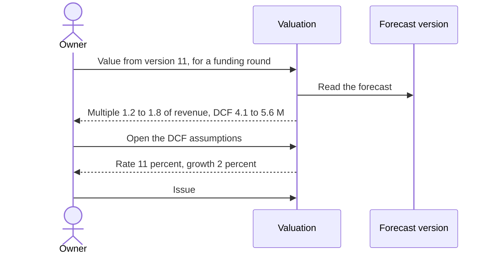

🏠 [Specs](../../../../README.md) › 🧩 [Functional capabilities](../../../README.md) ›
🔮 [F23 What-if simulation and impact](../../README.md) › 📝 [Use cases](../README.md) ›
📝 [Use cases: FL-F23-08 Budgets, rolling forecasts, group and valuation](README.md) › 📝 UC-F23-34 Value the company

# 📝 UC-F23-34 Value the company

**Status:** ✅ specified

## Summary

The owner values the company from its forecast or a scenario with one or several methods (a multiple of revenue or
profit, discounted cash flows, net assets). Every valuation shows its method and each assumption behind it, with a low,
a central and a high value, and can be compared with earlier valuations. A non-profit's treasurer values the
organisation's net assets the same way.

## Personas

- [U13 Owner](../../../../01-users/personas/u13-owner.md), who values the company
- [U31 Treasurer](../../../../01-users/personas/u31-treasurer.md), who values a non-profit's net assets

## Goal

The owner knows what the company may be worth under stated assumptions, and can explain and challenge every figure.

## Trigger

The owner or the treasurer starts a valuation, for example before a funding round, a sale or a gift of shares.

## Frequency

A few times a year.

## Preconditions

- A published forecast version or a scenario exists
  ([E-F23-16 Forecast version](../../data/e-f23-16-forecast-version.md),
  [E-F23-02 Scenario](../../data/e-f23-02-scenario.md)).
- The method's inputs exist: multiples and discount rates set by the owner with their source.

## Postconditions

- **Succeeded:** a valuation is Issued with its method, assumptions and range; earlier valuations of the same purpose
  are Superseded.
- **Failed:** no valuation is issued; the draft stays as it is.

## Main flow

1. The owner opens the valuation screen
   ([S-F23-28 Valuation](../../screens/08-budgets-rolling-group-and-valuation/s-f23-28-valuation.md)) and picks a
   forecast version or a scenario and a purpose (funding round, sale, internal view).
2. The owner picks one or more methods and enters or confirms the assumptions: multiple and its source, discount rate,
   growth after the horizon, net debt.
3. SimpleERP computes a low, central and high value per method, from ranges of the assumptions
   ([BR-F23-07](../../business-rules/br-f23-07-ranges-for-uncertain-inputs.md)).
4. Each value opens its method and its assumptions
   ([BR-F23-21](../../business-rules/br-f23-21-valuations-show-their-method-and-assumptions.md)).
5. The owner compares the methods and the earlier valuations, and issues the valuation.
6. The valuation can feed a fundraising dilution simulation
   [UC-F15-16](../../../f15-legal-assistant/use-cases/07-equity-contracts-and-disputes/uc-f15-16-simulate-a-fundraising-dilution.md).

## Alternative flows

- 2a. The AI assistant proposes assumptions from the sector drivers and the company's history, each with its source: the
  owner edits or accepts them ([BR-F23-10](../../business-rules/br-f23-10-actions-need-a-person.md)).
- 3a. One method is not applicable (no positive profit for a multiple of profit): it is shown as not applicable with the
  reason.
- 5a. The treasurer of a non-profit values net assets and the reserve target instead.

## Error flows

- 3e. An assumption is missing: the value is not computed and the missing assumption is named.
- 5e. The valuation is issued without a method: refused
  ([BR-F23-21](../../business-rules/br-f23-21-valuations-show-their-method-and-assumptions.md)).
- Any step: a service does not answer; the call is retried first
  ([BR-F3-32](../../../f03-assistant/business-rules/br-f03-32-retry-before-an-error.md)), then the message follows the
  error pattern ([D122](../../../../06-decisions/ux/d122-error-message-standard.md)) and what the user typed stays on
  the screen.

## Business rules

- [BR-F23-21](../../business-rules/br-f23-21-valuations-show-their-method-and-assumptions.md)
- [BR-F23-09 Assumptions are visible](../../business-rules/br-f23-09-assumptions-visible.md)

## Entities

- [E-F23-17 Valuation](../../data/e-f23-17-valuation.md): created, changed
- [E-F23-16 Forecast version](../../data/e-f23-16-forecast-version.md): read, the forecast valued
- [E-F23-02 Scenario](../../data/e-f23-02-scenario.md): read, the scenario valued
- [E-F15-17 Funding round](../../../f15-legal-assistant/data/e-f15-17-funding-round.md): read, the funding round the
  valuation may serve

## Permissions

Owner and treasurer create and issue valuations. Accounting reads them. Other roles read a valuation only
when the owner shares it.

## Notifications

The owner: a valuation issued, an earlier one superseded.

## Audit events

Each valuation created, each assumption and its source, each issue and supersession, with who and when.

## AI involvement

No AI step of its own. The AI assistant may open the screen and prefill it from the user's words; the user checks and
confirms ([BR-F3-07](../../../f03-assistant/business-rules/br-f03-07-no-deletes-no-irreversible-acts.md)).

## API, MCP and A2A exposure

T5 operations of the capability for the personas above: create, read, update and list. The MCP tool of the
capability may read and propose, never confirm alone. No A2A skill.

## Screens

- [S-F23-28 Valuation](../../screens/08-budgets-rolling-group-and-valuation/s-f23-28-valuation.md)

## Flowchart

See
[FL-F23-08 Budgets, rolling forecasts, group and valuation](../../flows/fl-f23-08-budgets-rolling-group-and-valuation.md#flowchart).

## Sequence diagram

## Acceptance criteria

1. **Given** a forecast version and a multiple with its source **when** the owner computes the valuation **then** a low,
   a central and a high value are shown with the multiple and its source.
2. **Given** a valuation **when** the owner opens a value **then** the method and every assumption are shown.
3. **Given** a method with a missing discount rate **when** the owner computes **then** no value is shown and the
   missing rate is named.
4. **Given** a new valuation of the same purpose **when** it is issued **then** the earlier one is Superseded and stays
   readable.

## Non-functional notes

The screen answers within 2 seconds for 10,000 records; every change is audited.

## Regulatory references

A valuation made here is an internal estimate under stated assumptions, not a certified valuation or an
expert's report; where a valuation is required by law or by a contract (for example a transfer of shares), the competent
professional makes it, and this screen only prepares the inputs. The France-pack rule on valuations is written later.

## Related use cases

- [UC-F23-33 Run a group scenario](uc-f23-33-run-a-group-scenario.md)
- [UC-F23-32 Roll the forecast forward](uc-f23-32-roll-the-forecast-forward.md)
- [UC-F23-23](../06-goals-and-financing/uc-f23-23-simulate-financing-options.md)
- [UC-F15-16](../../../f15-legal-assistant/use-cases/07-equity-contracts-and-disputes/uc-f15-16-simulate-a-fundraising-dilution.md)
- [UC-F23-29](../06-goals-and-financing/uc-f23-29-prepare-a-forecast-pack-for-the-bank.md)

## Open questions

None.

---

⬅️ [UC-F23-33 Run a group scenario](uc-f23-33-run-a-group-scenario.md) · ⬆️ [Up](README.md)
