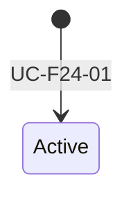

🏠 [Specs](../../../README.md) › 🧩 [Functional capabilities](../../README.md) › 🔌 [F24 Integrations hub](../README.md) ›
🗃️ [Data](README.md) › 🗃️ E-F24-01 Connector

# 🗃️ E-F24-01 Connector

**Status:** ✅ specified

## Purpose

A connector in the catalogue.

## Fields

| Name | Type | Required | Validation | Default | Example | Personal data | Custom fields |
|---|---|---|---|---|---|---|---|
| name, category, vendor country, default | records | yes | BR-F24-05 | - | Teamtailor, ATS, Sweden, yes | no | no |

## Relations

As its use cases.

The same item as [E-T12-01 Connector](../../../03-technical/t12-connectors-and-scrapers/data/e-t12-01-connector.md)
([D516](../../../06-decisions/foundations/d516-naming-rules-and-the-seven-classes-of-names.md), rule 4).

## Lifecycle

## Indexes and search

By number, date, partner.

## Retention

Kept for the period of its kind of record in the country pack (D293), or else its kind's default in the
[retention schedule](../../../05-non-functional/data-retention.md).

## Audit

Every change.

## Import and export

CSV, FEC where relevant.

## Used by

- [UC-F24-01](../use-cases/01-find-and-connect/uc-f24-01-browse-the-connector-catalogue.md)
- [UC-F24-18](../use-cases/05-keep-the-catalogue/uc-f24-18-review-the-list-of-50-every-year.md)
- [UC-F24-19](../use-cases/05-keep-the-catalogue/uc-f24-19-request-a-missing-connector.md)

## Open questions

None.

---

⬆️ [Up](README.md) · ➡️ [E-F24-02 Tool connection](e-f24-02-tool-connection.md)
