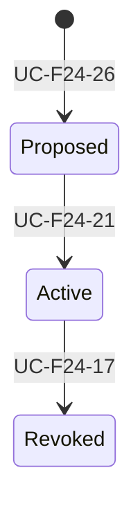

🏠 [Specs](../../../README.md) › 🧩 [Functional capabilities](../../README.md) › 🔌 [F24 Integrations hub](../README.md) ›
🗃️ [Data](README.md) › 🗃️ E-F24-02 Tool connection

# 🗃️ E-F24-02 Tool connection

**Status:** ✅ specified

## Purpose

A tool connected for a company.

## Fields

| Name | Type | Required | Validation | Default | Example | Personal data | Custom fields |
|---|---|---|---|---|---|---|---|
| company, connector, account, scopes, state | records | yes | BR-F24-02, BR-F24-10 | - | Acme, HubSpot, sales@acme, contacts deals, active | no | no |

### Capability extension: F21 Onboarding and module activation

From [E-F21-08 Connection](../../f21-onboarding-and-modules/data/e-f21-08-connection.md), merged here
([D516](../../../06-decisions/foundations/d516-naming-rules-and-the-seven-classes-of-names.md), shared name
"Connection"). A connected service.

| Name | Type | Required | Validation | Default | Example | Personal data | Custom fields |
|---|---|---|---|---|---|---|---|
| kind, account, state | records | yes | - | - | mail, acme mail, ok | no | no |

### Capability extension: F9 LinkedIn sourcing

A LinkedIn account linked through Unipile
([D518](../../../06-decisions/f09-hr-and-projects/d518-linkedin-sourcing-through-unipile.md),
[UC-F9-40](../../f09-hr-and-projects/use-cases/02-recruit/uc-f09-40-search-and-rank-linkedin-profiles.md)): the
connector is Unipile, whose API key is the company's and stays in the secret store; each HR user links their own account
on Unipile's hosted sign-in page, and SimpleERP keeps only the account ID Unipile returns, never the password.
LinkedIn sending is prepared by default: each message waits for the HR user's click; automatic sending is an option the
administrator turns on for the company when connecting Unipile, accepting the risk that LinkedIn's user agreement
restricts automated activity; a change of this setting applies only to the outreach sequences started after it, and a
running sequence keeps the mode it started with
([D570](../../../06-decisions/f09-hr-and-projects/d570-linkedin-sending-prepared-by-default.md)). A sourcing search runs
on the search the linked account offers
([D571](../../../06-decisions/f09-hr-and-projects/d571-linkedin-sourcing-uses-the-users-search.md)).

| Name | Type | Required | Validation | Default | Example | Personal data | Custom fields |
|---|---|---|---|---|---|---|---|
| linked user | user | for a personal account | the HR user who linked it | - | Claire P. | yes | no |
| provider account ID | text | yes | as Unipile returns it | - | as Unipile returns it | no | no |
| daily and weekly caps | numbers | no | never above the limits Unipile reports (BR-F9-41) | set by the administrator | 20 invitations a day | no | no |
| LinkedIn sending | prepared, automatic | for the company's Unipile connection | automatic only when the administrator turns it on and accepts the risk; a change applies only to the sequences started after it (D570) | prepared | prepared | no | no |
| LinkedIn search | the account's own search, Sales Navigator, Recruiter | for a personal account | as Unipile reports it for the account (D571) | the account's own search | Sales Navigator | no | no |

## Relations

As its use cases.

The same item as
[E-T12-05 Tool connection](../../../03-technical/t12-connectors-and-scrapers/data/e-t12-05-tool-connection.md)
([D516](../../../06-decisions/foundations/d516-naming-rules-and-the-seven-classes-of-names.md), rule 4).

## Lifecycle

## Indexes and search

By number, date, partner.

## Retention

Kept for the period of its kind of record in the country pack (D293), or else its kind's default in the
[retention schedule](../../../05-non-functional/data-retention.md).

## Audit

Every change.

## Import and export

CSV, FEC where relevant.

## Used by

- [UC-F24-02](../use-cases/01-find-and-connect/uc-f24-02-connect-a-tool-in-the-fewest-steps.md)
- [UC-F24-03](../use-cases/02-office-suites/uc-f24-03-sign-in-once-through-the-suite-s-identity-provider.md)
- [UC-F24-17](../use-cases/04-run-and-control/uc-f24-17-disconnect-and-keep-or-delete-the-data.md)
- [UC-F24-20](../use-cases/04-run-and-control/uc-f24-20-control-the-rights-and-costs-of-connectors.md)
- [UC-F24-21 Connect a bank, payment, shop, accounting or carrier tool](../use-cases/06-business-tools/uc-f24-21-connect-a-bank-payment-shop-accounting-or-carrier-tool.md)
- [UC-F24-22 Automate with n8n, Make or Zapier](../use-cases/06-business-tools/uc-f24-22-automate-with-n8n-make-or-zapier.md)
- [UC-F24-23 Bring HR and payroll data from Silae, PayFit or Lucca](../use-cases/06-business-tools/uc-f24-23-bring-hr-and-payroll-data-from-silae-payfit-or-lucca.md)
- [UC-F24-26 See which tools receive my data](../use-cases/07-employees-and-their-tools/uc-f24-26-see-which-tools-receive-my-data.md)
- [UC-F21-10 Connect email, calendar and bank](../../f21-onboarding-and-modules/use-cases/03-team-and-data/uc-f21-10-connect-email-calendar-and-bank.md)
- [UC-F9-40 Search and rank LinkedIn profiles](../../f09-hr-and-projects/use-cases/02-recruit/uc-f09-40-search-and-rank-linkedin-profiles.md)
- [UC-F9-41 Run a LinkedIn outreach sequence](../../f09-hr-and-projects/use-cases/02-recruit/uc-f09-41-run-a-linkedin-outreach-sequence.md)

## Open questions

None.

---

⬅️ [E-F24-01 Connector](e-f24-01-connector.md) · ⬆️ [Up](README.md) ·
➡️ [E-F24-03 Suite component](e-f24-03-suite-component.md)
