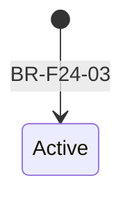

🏠 [Specs](../../../README.md) › 🧩 [Functional capabilities](../../README.md) › 🔌 [F24 Integrations hub](../README.md) ›
🗃️ [Data](README.md) › 🗃️ E-F24-03 Suite component

# 🗃️ E-F24-03 Suite component

**Status:** ✅ specified

## Purpose

A connected component of an office suite.

## Fields

| Name | Type | Required | Validation | Default | Example | Personal data | Custom fields |
|---|---|---|---|---|---|---|---|
| connection, component, access | records | yes | BR-F24-03 | - | openDesk, Nextcloud files, read and write | no | no |

## Relations

As its use cases.

## Lifecycle

## Indexes and search

By number, date, partner.

## Retention

Kept for the period of its kind of record in the country pack (D293), or else its kind's default in the
[retention schedule](../../../05-non-functional/data-retention.md).

## Audit

Every change.

## Import and export

CSV, FEC where relevant.

## Used by

- [UC-F24-03](../use-cases/02-office-suites/uc-f24-03-sign-in-once-through-the-suite-s-identity-provider.md)
- [UC-F24-04](../use-cases/02-office-suites/uc-f24-04-store-and-edit-documents-in-the-suite.md)
- [UC-F24-05](../use-cases/02-office-suites/uc-f24-05-sync-mail-calendars-and-contacts.md)
- [UC-F24-06](../use-cases/02-office-suites/uc-f24-06-use-the-suite-s-chat-for-notifications-and-the-assistant.md)
- [UC-F24-07](../use-cases/02-office-suites/uc-f24-07-start-meetings-from-the-suite-s-video.md)
- [UC-F24-08](../use-cases/02-office-suites/uc-f24-08-link-projects-wiki-notes-and-tables.md)
- [UC-F24-09](../use-cases/02-office-suites/uc-f24-09-use-the-suites-full-read-and-write-api.md)

## Open questions

None.

---

⬅️ [E-F24-02 Tool connection](e-f24-02-tool-connection.md) · ⬆️ [Up](README.md) ·
➡️ [E-F24-04 Linked document](e-f24-04-linked-document.md)
