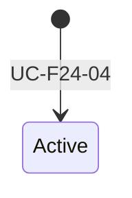

🏠 [Specs](../../../README.md) › 🧩 [Functional capabilities](../../README.md) › 🔌 [F24 Integrations hub](../README.md) ›
🗃️ [Data](README.md) › 🗃️ E-F24-04 Linked document

# 🗃️ E-F24-04 Linked document

**Status:** ✅ specified

## Purpose

An ERP document stored in a suite.

## Fields

| Name | Type | Required | Validation | Default | Example | Personal data | Custom fields |
|---|---|---|---|---|---|---|---|
| record, suite path, version | records | yes | - | - | INV-2026-0142, /Acme/Invoices/, 3 | no | no |

## Relations

As its use cases.

## Lifecycle

## Indexes and search

By number, date, partner.

## Retention

Kept for the period of its kind of record in the country pack (D293), or else its kind's default in the
[retention schedule](../../../05-non-functional/data-retention.md).

## Audit

Every change.

## Import and export

CSV, FEC where relevant.

## Used by

- [UC-F24-04](../use-cases/02-office-suites/uc-f24-04-store-and-edit-documents-in-the-suite.md)

## Open questions

None.

---

⬅️ [E-F24-03 Suite component](e-f24-03-suite-component.md) · ⬆️ [Up](README.md) ·
➡️ [E-F24-05 Calendar link](e-f24-05-calendar-link.md)
