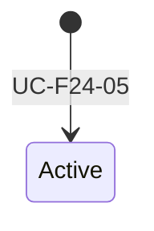

🏠 [Specs](../../../README.md) › 🧩 [Functional capabilities](../../README.md) › 🔌 [F24 Integrations hub](../README.md) ›
🗃️ [Data](README.md) › 🗃️ E-F24-05 Calendar link

# 🗃️ E-F24-05 Calendar link

**Status:** ✅ specified

## Purpose

A synchronised calendar or address book.

## Fields

| Name | Type | Required | Validation | Default | Example | Personal data | Custom fields |
|---|---|---|---|---|---|---|---|
| user, calendar, direction | records | yes | - | - | PM, work, both | yes | no |

## Relations

As its use cases.

## Lifecycle

## Indexes and search

By number, date, partner.

## Retention

Kept for the period of its kind of record in the country pack (D293), or else its kind's default in the
[retention schedule](../../../05-non-functional/data-retention.md).

## Audit

Every change.

## Import and export

CSV, FEC where relevant.

## Used by

- [UC-F24-05](../use-cases/02-office-suites/uc-f24-05-sync-mail-calendars-and-contacts.md)
- [UC-F24-25 Connect my own calendar and mail on the phone](../use-cases/07-employees-and-their-tools/uc-f24-25-connect-my-own-calendar-and-mail-on-the-phone.md)

## Open questions

None.

---

⬅️ [E-F24-04 Linked document](e-f24-04-linked-document.md) · ⬆️ [Up](README.md) ·
➡️ [E-F24-06 Sync job](e-f24-06-sync-job.md)
