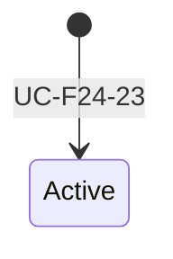

🏠 [Specs](../../../README.md) › 🧩 [Functional capabilities](../../README.md) › 🔌 [F24 Integrations hub](../README.md) ›
🗃️ [Data](README.md) › 🗃️ E-F24-06 Sync job

# 🗃️ E-F24-06 Sync job

**Status:** ✅ specified

## Purpose

A sync or import run.

## Fields

| Name | Type | Required | Validation | Default | Example | Personal data | Custom fields |
|---|---|---|---|---|---|---|---|
| connection, kind, records, errors | records | yes | BR-F24-07 | - | HubSpot, two-way, 412, 0 | no | no |

## Relations

As its use cases.

## Lifecycle

## Indexes and search

By number, date, partner.

## Retention

Kept for the period of its kind of record in the country pack (D293), or else its kind's default in the
[retention schedule](../../../05-non-functional/data-retention.md).

## Audit

Every change.

## Import and export

CSV, FEC where relevant.

## Used by

- [UC-F24-10](../use-cases/03-crm-and-ats/uc-f24-10-sync-a-crm-both-ways.md)
- [UC-F24-11](../use-cases/03-crm-and-ats/uc-f24-11-sync-an-ats-both-ways.md)
- [UC-F24-13](../use-cases/03-crm-and-ats/uc-f24-13-import-history-once.md)
- [UC-F24-23 Bring HR and payroll data from Silae, PayFit or Lucca](../use-cases/06-business-tools/uc-f24-23-bring-hr-and-payroll-data-from-silae-payfit-or-lucca.md)

## Open questions

None.

---

⬅️ [E-F24-05 Calendar link](e-f24-05-calendar-link.md) · ⬆️ [Up](README.md) ·
➡️ [E-F24-07 Field mapping](e-f24-07-field-mapping.md)
