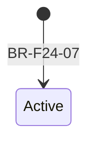

🏠 [Specs](../../../README.md) › 🧩 [Functional capabilities](../../README.md) › 🔌 [F24 Integrations hub](../README.md) ›
🗃️ [Data](README.md) › 🗃️ E-F24-07 Field mapping

# 🗃️ E-F24-07 Field mapping

**Status:** ✅ specified

## Purpose

A field map with owners.

## Fields

| Name | Type | Required | Validation | Default | Example | Personal data | Custom fields |
|---|---|---|---|---|---|---|---|
| connection, outside field, ERP field, owner | records | yes | BR-F24-07 | - | HubSpot, phone, contact phone, CRM | no | no |

## Relations

As its use cases.

## Lifecycle

## Indexes and search

By number, date, partner.

## Retention

Kept for the period of its kind of record in the country pack (D293), or else its kind's default in the
[retention schedule](../../../05-non-functional/data-retention.md).

## Audit

Every change.

## Import and export

CSV, FEC where relevant.

## Used by

- [UC-F24-10](../use-cases/03-crm-and-ats/uc-f24-10-sync-a-crm-both-ways.md)
- [UC-F24-11](../use-cases/03-crm-and-ats/uc-f24-11-sync-an-ats-both-ways.md)
- [UC-F24-12](../use-cases/03-crm-and-ats/uc-f24-12-map-fields-and-resolve-conflicts.md)

## Open questions

None.

---

⬅️ [E-F24-06 Sync job](e-f24-06-sync-job.md) · ⬆️ [Up](README.md) ·
➡️ [E-F24-08 Sync log entry](e-f24-08-sync-log-entry.md)
