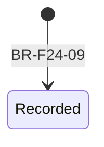

🏠 [Specs](../../../README.md) › 🧩 [Functional capabilities](../../README.md) › 🔌 [F24 Integrations hub](../README.md) ›
🗃️ [Data](README.md) › 🗃️ E-F24-08 Sync log entry

# 🗃️ E-F24-08 Sync log entry

**Status:** ✅ specified

## Purpose

One synced change or error.

## Fields

| Name | Type | Required | Validation | Default | Example | Personal data | Custom fields |
|---|---|---|---|---|---|---|---|
| job, record, change, result | records | yes | BR-F24-09 | - | S-88, contact 12, phone, conflict | yes | no |

## Relations

As its use cases.

## Lifecycle

## Indexes and search

By number, date, partner.

## Retention

Kept for the period of its kind of record in the country pack (D293), or else its kind's default in the
[retention schedule](../../../05-non-functional/data-retention.md).

## Audit

Every change.

## Import and export

CSV, FEC where relevant.

## Used by

- [UC-F24-13](../use-cases/03-crm-and-ats/uc-f24-13-import-history-once.md)
- [UC-F24-15](../use-cases/04-run-and-control/uc-f24-15-follow-each-connector-s-health-and-sync-log.md)
- [UC-F24-17](../use-cases/04-run-and-control/uc-f24-17-disconnect-and-keep-or-delete-the-data.md)

## Open questions

None.

---

⬅️ [E-F24-07 Field mapping](e-f24-07-field-mapping.md) · ⬆️ [Up](README.md) ·
➡️ [E-F24-09 Connector action](e-f24-09-connector-action.md)
