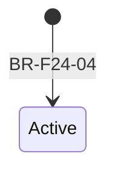

🏠 [Specs](../../../README.md) › 🧩 [Functional capabilities](../../README.md) › 🔌 [F24 Integrations hub](../README.md) ›
🗃️ [Data](README.md) › 🗃️ E-F24-09 Connector action

# 🗃️ E-F24-09 Connector action

**Status:** ✅ specified

## Purpose

An action exposed as an AI assistant tool.

## Fields

| Name | Type | Required | Validation | Default | Example | Personal data | Custom fields |
|---|---|---|---|---|---|---|---|
| connector, action, writes | records | yes | BR-F24-04 | - | Element, post message, yes | no | no |

## Relations

As its use cases.

## Lifecycle

## Indexes and search

By number, date, partner.

## Retention

Kept for the period of its kind of record in the country pack (D293), or else its kind's default in the
[retention schedule](../../../05-non-functional/data-retention.md).

## Audit

Every change.

## Import and export

CSV, FEC where relevant.

## Used by

- [UC-F24-14](../use-cases/04-run-and-control/uc-f24-14-ask-the-assistant-to-act-in-a-connected-tool.md)
- [UC-F24-20](../use-cases/04-run-and-control/uc-f24-20-control-the-rights-and-costs-of-connectors.md)

## Open questions

None.

---

⬅️ [E-F24-08 Sync log entry](e-f24-08-sync-log-entry.md) · ⬆️ [Up](README.md) ·
➡️ [E-F24-10 Connector incident](e-f24-10-connector-incident.md)
