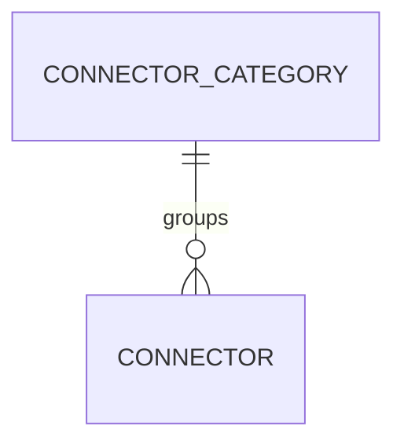
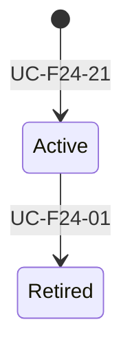

🏠 [Specs](../../../README.md) › 🧩 [Functional capabilities](../../README.md) › 🔌 [F24 Integrations hub](../README.md) ›
🗃️ [Data](README.md) › 🗃️ E-F24-11 Connector category

# 🗃️ E-F24-11 Connector category

**Status:** 🔄 waiting for the owner

## Purpose

A category of the catalogue with its fallback icon.

## Fields

| Name | Type | Required | Validation | Default | Example | Personal data | Custom fields |
|---|---|---|---|---|---|---|---|
| name | text | yes | unique | - | Banks | no | no |
| fallback icon | text | yes | a Lucide icon name (D45) | - | landmark (Proposed) | no | no |
| order | number | yes | - | - | 4 | no | no |

## Relations

## Lifecycle

## Indexes and search

By name.

## Retention

Kept with the catalogue.

## Audit

Every creation and change, with who, when, the old and the new value.

## Import and export

CSV and JSON export through the API (T5); no bulk import.

## Used by

- [UC-F24-21 Connect a bank, payment, shop, accounting or carrier tool](../use-cases/06-business-tools/uc-f24-21-connect-a-bank-payment-shop-accounting-or-carrier-tool.md)
- [UC-F24-27 Keep the integration icons](../use-cases/05-keep-the-catalogue/uc-f24-27-keep-the-integration-icons.md)
- [UC-F24-01 Browse the connector catalogue](../use-cases/01-find-and-connect/uc-f24-01-browse-the-connector-catalogue.md)

## Open questions

None.

---

⬅️ [E-F24-10 Connector incident](e-f24-10-connector-incident.md) · ⬆️ [Up](README.md) ·
➡️ [E-F24-12 Integration icon](e-f24-12-integration-icon.md)
