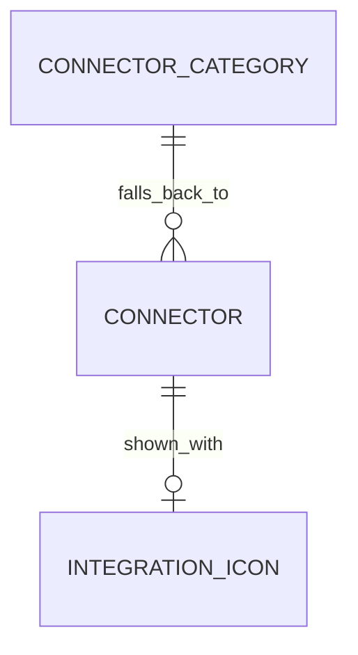
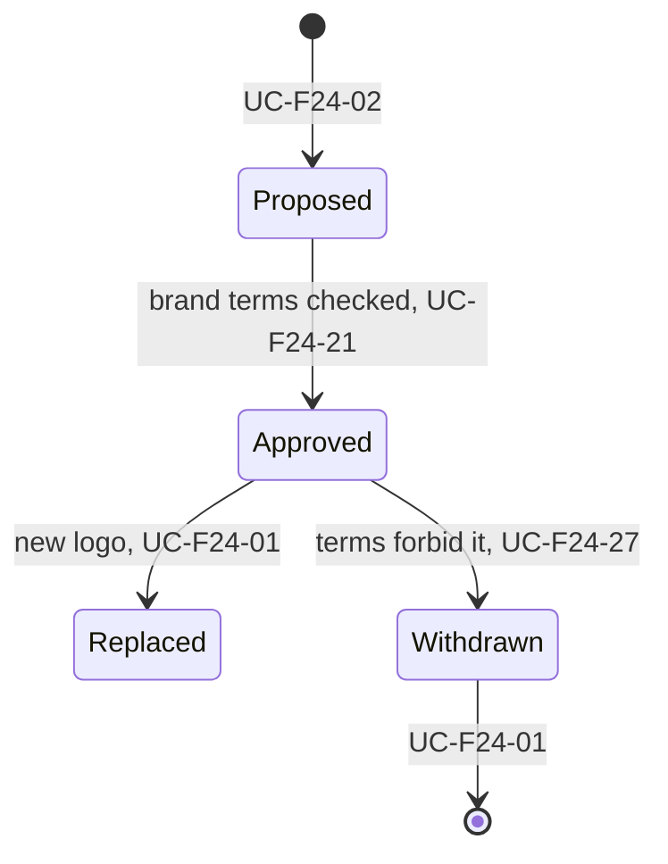

🏠 [Specs](../../../README.md) › 🧩 [Functional capabilities](../../README.md) › 🔌 [F24 Integrations hub](../README.md) ›
🗃️ [Data](README.md) › 🗃️ E-F24-12 Integration icon

# 🗃️ E-F24-12 Integration icon

**Status:** ✅ specified

## Purpose

The logo shown for an integration, with its variants and the terms that allow it.

## Fields

| Name | Type | Required | Validation | Default | Example | Personal data | Custom fields |
|---|---|---|---|---|---|---|---|
| connector | link | yes | a connector | - | HubSpot | no | no |
| file | file | yes | SVG, or PNG of at least 80 px; 50 KB at most | - | hubspot.svg | no | no |
| dark variant | file | no | same rules | - | hubspot-dark.svg | no | no |
| brand terms | link | yes | the vendor's published brand page | - | vendor brand page | no | no |
| checked | date | yes | - | - | 2026-11-12 | no | no |

## Relations

## Lifecycle

## Indexes and search

By connector; filter "no logo", "no dark variant".

## Retention

As long as the connector is listed.

## Audit

Every creation and change, with who, when, the old and the new value.

## Import and export

Logo files shipped with the catalogue.

## Used by

- [UC-F24-21 Connect a bank, payment, shop, accounting or carrier tool](../use-cases/06-business-tools/uc-f24-21-connect-a-bank-payment-shop-accounting-or-carrier-tool.md)
- [UC-F24-27 Keep the integration icons](../use-cases/05-keep-the-catalogue/uc-f24-27-keep-the-integration-icons.md)
- [UC-F24-01 Browse the connector catalogue](../use-cases/01-find-and-connect/uc-f24-01-browse-the-connector-catalogue.md)
- [UC-F24-02 Connect a tool in the fewest steps](../use-cases/01-find-and-connect/uc-f24-02-connect-a-tool-in-the-fewest-steps.md)

## Open questions

None.

---

⬅️ [E-F24-11 Connector category](e-f24-11-connector-category.md) · ⬆️ [Up](README.md) ·
➡️ [E-F24-13 Webhook subscription](e-f24-13-webhook-subscription.md)
