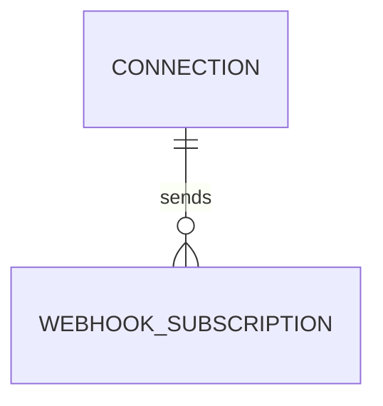
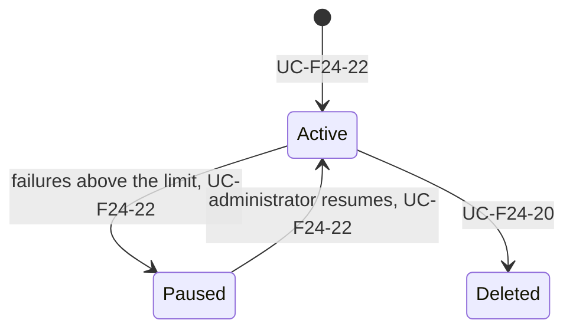

🏠 [Specs](../../../README.md) › 🧩 [Functional capabilities](../../README.md) › 🔌 [F24 Integrations hub](../README.md) ›
🗃️ [Data](README.md) › 🗃️ E-F24-13 Webhook subscription

# 🗃️ E-F24-13 Webhook subscription

**Status:** ✅ specified

## Purpose

An outside endpoint that receives SimpleERP events, signed with a secret.

## Fields

| Name | Type | Required | Validation | Default | Example | Personal data | Custom fields |
|---|---|---|---|---|---|---|---|
| connection | link | yes | an automation connection | - | n8n | no | no |
| events | list | yes | offered events | - | invoice paid, order created | no | no |
| endpoint | URL | yes | https only | - | https://n8n.example/webhook/41 | no | no |
| secret | vault key | yes | never shown | generated | vault reference | no | no |
| state | choice | yes | active, paused | active | active | no | no |
| failures | number | yes | - | 0 | 0 | no | no |

## Relations

The same item as
[E-T05-02 Webhook subscription](../../../03-technical/t05-api-and-webhooks/data/e-t05-02-webhook-subscription.md)
([D517](../../../06-decisions/foundations/d517-the-drafts-open-points-answered-on-2026-11-13.md), S0-3).

## Lifecycle

## Indexes and search

By connection and event.

## Retention

Deleted with the connection.

## Audit

Every creation and change, with who, when, the old and the new value.

## Import and export

CSV and JSON export through the API (T5); no bulk import.

## Used by

- [UC-F24-22 Automate with n8n, Make or Zapier](../use-cases/06-business-tools/uc-f24-22-automate-with-n8n-make-or-zapier.md)
- [UC-F24-20 Control the rights and costs of connectors](../use-cases/04-run-and-control/uc-f24-20-control-the-rights-and-costs-of-connectors.md)

## Open questions

None.

---

⬅️ [E-F24-12 Integration icon](e-f24-12-integration-icon.md) · ⬆️ [Up](README.md) ·
➡️ [E-F24-14 E-invoicing registration](e-f24-14-e-invoicing-registration.md)
