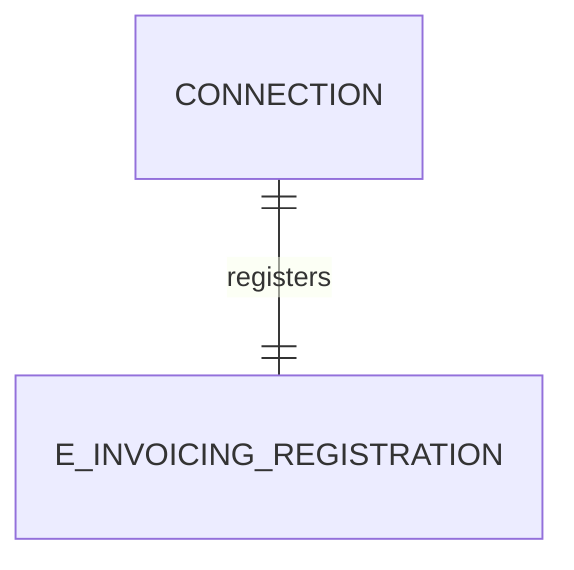
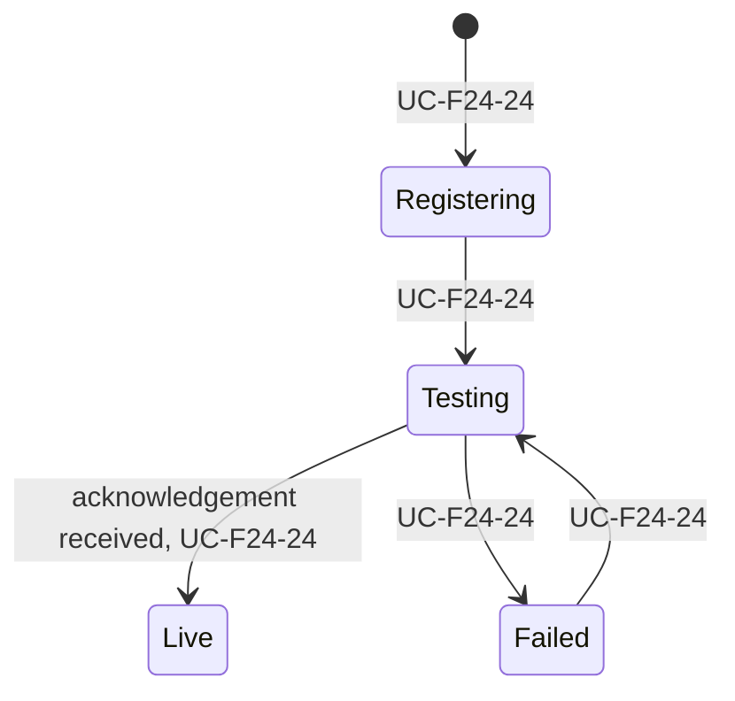

🏠 [Specs](../../../README.md) › 🧩 [Functional capabilities](../../README.md) › 🔌 [F24 Integrations hub](../README.md) ›
🗃️ [Data](README.md) › 🗃️ E-F24-14 E-invoicing registration

# 🗃️ E-F24-14 E-invoicing registration

**Status:** ✅ specified

## Purpose

The company's registration on its e-invoicing platform and its go-live state.

## Fields

| Name | Type | Required | Validation | Default | Example | Personal data | Custom fields |
|---|---|---|---|---|---|---|---|
| platform | choice | yes | Super PDP, B2Brouter, AFNOR adapter | - | Super PDP | no | no |
| company identifiers | text | yes | SIREN and addresses | from F1 | SIREN, routing address | no | no |
| test invoice | link | yes | a test invoice | - | TEST-0001 | no | no |
| state | choice | yes | registering, testing, live, failed | registering | live | no | no |

## Relations

## Lifecycle

## Indexes and search

By platform and state.

## Retention

As the connection; invoices follow CR-FR-002.

## Audit

Every creation and change, with who, when, the old and the new value.

## Import and export

CSV and JSON export through the API (T5); no bulk import.

## Used by

- [UC-F24-24 Connect the e-invoicing platform](../use-cases/06-business-tools/uc-f24-24-connect-the-e-invoicing-platform.md)

## Open questions

None.

---

⬅️ [E-F24-13 Webhook subscription](e-f24-13-webhook-subscription.md) · ⬆️ [Up](README.md) ·
➡️ [E-F24-15 Connector catalogue review](e-f24-15-connector-catalogue-review.md)
