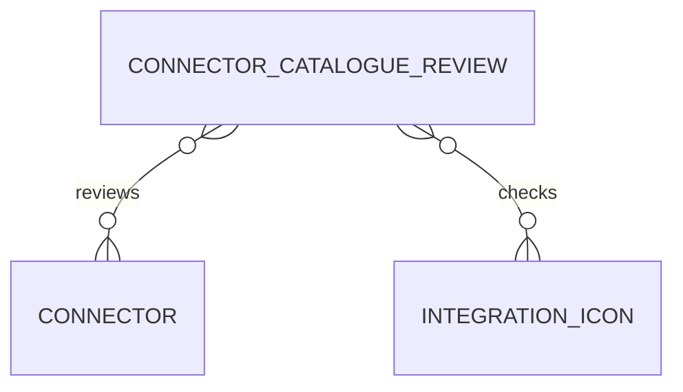
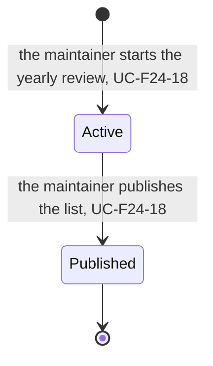

🏠 [Specs](../../../README.md) › 🧩 [Functional capabilities](../../README.md) › 🔌 [F24 Integrations hub](../README.md) ›
🗃️ [Data](README.md) › 🗃️ E-F24-15 Connector catalogue review

# 🗃️ E-F24-15 Connector catalogue review

**Status:** ✅ specified

## Purpose

The connector catalogue review the flow charts name with the words "Yearly review"
([FL-F24-05](../flows/fl-f24-05-keep-the-catalogue.md)). A review compares the default list of 50 connectors with market
presence in Europe and France once a year, proposes what to keep or replace, checks the icons and publishes the list
(BR-F24-06). The owner decided to create it
([D516](../../../06-decisions/foundations/d516-naming-rules-and-the-seven-classes-of-names.md)); its fields are derived
from the specifications and confirmed by the owner (D572).

## Fields

| Name | Type | Required | Validation | Default | Example | Personal data | Custom fields |
|---|---|---|---|---|---|---|---|
| title | text | yes | not empty | "Yearly review" and the year | Yearly review 2027 | no | no |
| year | year | yes | one review per year (BR-F24-06) | the current year | 2027 | no | no |
| market data | text | yes | market presence in Europe and France | - | market shares 2026 | no | no |
| changes | list of connector, change, reason | yes | change is keep or replace | keep | Replace 2, market shares fell | no | no |
| icons checked | yes or no | yes | yes before publishing (UC-F24-27) | no | yes | no | no |
| reviewed by | user | yes | a SimpleERP maintainer | the creator | Marc D. | yes | no |
| published on | date | when published | - | - | 2027-01-15 | no | no |
| state | choice | yes | Active, Published | Active | Published | no | no |

Derived from [UC-F24-18](../use-cases/05-keep-the-catalogue/uc-f24-18-review-the-list-of-50-every-year.md) (compare,
propose changes or keep, check the icons, publish, tell the users of leaving tools),
[BR-F24-06](../business-rules/br-f24-06-list-reviewed-yearly.md) (yearly, market presence in Europe and France), the
list view [S-F24-L15](../screens/00-lists/s-f24-l15-connector-catalogue-reviews.md) (title and state) and the screen
[S-F24-18 Yearly review](../screens/05-keep-the-catalogue/s-f24-18-yearly-review.md) (the changes with their reason;
the published list is read-only).

## Relations

- [E-F24-01 Connector](e-f24-01-connector.md): the connectors of the list, kept or replaced; a tool leaving the list
  keeps working for its users until its end of support is announced (BR-F24-06).
- [E-F24-12 Integration icon](e-f24-12-integration-icon.md): the icons checked before publishing (UC-F24-27).

## Lifecycle

The published list is read-only (S-F24-18).

## Indexes and search

By year and state; searched on the title. The list view sorts on the title and the state and filters on the state
([S-F24-L15](../screens/00-lists/s-f24-l15-connector-catalogue-reviews.md)).

## Retention

As the other records of its capability.

## Audit

Every change, as the other records of its capability.

## Import and export

CSV and JSON export through the API (T5) of the fields the user may see; no bulk import.

## Used by

- [UC-F24-18 Review the list of 50 every year](../use-cases/05-keep-the-catalogue/uc-f24-18-review-the-list-of-50-every-year.md)

## Open questions

The list view [S-F24-L15](../screens/00-lists/s-f24-l15-connector-catalogue-reviews.md) and the state table of
[S-F24-18](../screens/05-keep-the-catalogue/s-f24-18-yearly-review.md) show only the state Active, while UC-F24-18 and
S-F24-18 name a published list.

---

⬅️ [E-F24-14 E-invoicing registration](e-f24-14-e-invoicing-registration.md) · ⬆️ [Up](README.md) ·
➡️ [E-F24-16 Connector request](e-f24-16-connector-request.md)
