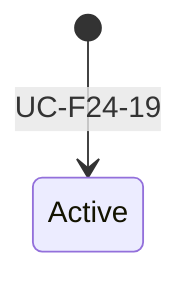

🏠 [Specs](../../../README.md) › 🧩 [Functional capabilities](../../README.md) › 🔌 [F24 Integrations hub](../README.md) ›
🗃️ [Data](README.md) › 🗃️ E-F24-16 Connector request

# 🗃️ E-F24-16 Connector request

**Status:** 🔄 waiting for the owner

## Purpose

(Proposed) The connector request the flow charts name with the words "Requests"
([FL-F24-05](../flows/fl-f24-05-keep-the-catalogue.md)). The owner decided to create it
([D516](../../../06-decisions/foundations/d516-naming-rules-and-the-seven-classes-of-names.md)); what it holds waits for
the owner's confirmation.

## Fields

(Proposed) To define with the owner: the flow charts name the record, not its fields.

## Relations

(Proposed) To define with the owner, from the use cases below.

## Lifecycle

## Indexes and search

(Proposed) To define with the owner.

## Retention

(Proposed) As the other records of its capability, to confirm with the owner.

## Audit

(Proposed) Every change, as the other records of its capability.

## Import and export

(Proposed) To define with the owner.

## Used by

- [UC-F24-19 Request a missing connector](../use-cases/05-keep-the-catalogue/uc-f24-19-request-a-missing-connector.md)

## Open questions

(Proposed) Its fields, relations and states wait for the owner (waiting list, step 36e).

---

⬅️ [E-F24-15 Connector catalogue review](e-f24-15-connector-catalogue-review.md) · ⬆️ [Up](README.md) ·
➡️ [E-F24-17 Connector draft](e-f24-17-connector-draft.md)
