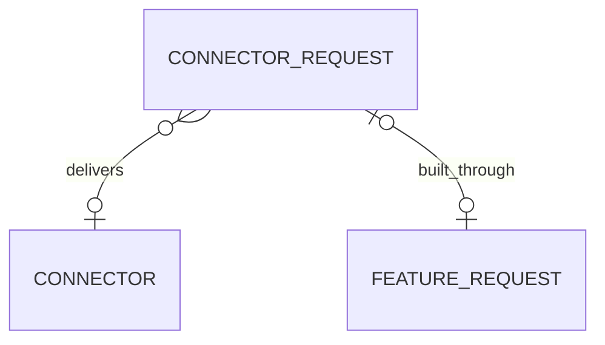
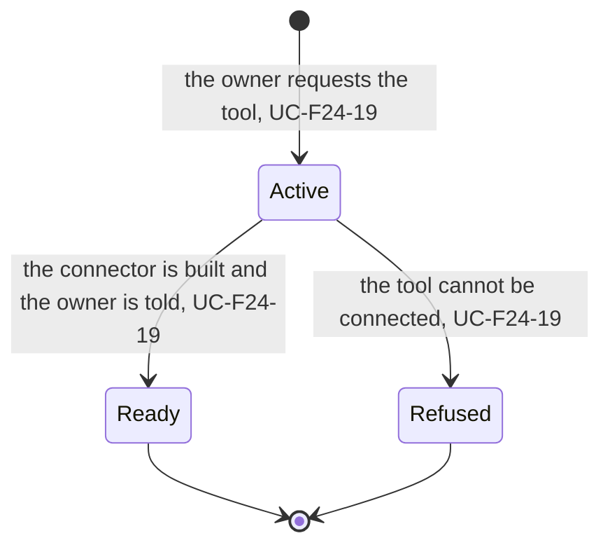

🏠 [Specs](../../../README.md) › 🧩 [Functional capabilities](../../README.md) › 🔌 [F24 Integrations hub](../README.md) ›
🗃️ [Data](README.md) › 🗃️ E-F24-16 Connector request

# 🗃️ E-F24-16 Connector request

**Status:** ✅ specified

## Purpose

The connector request the flow charts name with the words "Requests"
([FL-F24-05](../flows/fl-f24-05-keep-the-catalogue.md)). A request is an owner asking for a tool the catalogue does not
connect yet; the connector factory or the maintainers build it and the owner is told when it is ready, or the request is
refused with its reason. The owner decided to create it
([D516](../../../06-decisions/foundations/d516-naming-rules-and-the-seven-classes-of-names.md)); its fields are derived
from the specifications and confirmed by the owner (D572).

## Fields

| Name | Type | Required | Validation | Default | Example | Personal data | Custom fields |
|---|---|---|---|---|---|---|---|
| title | text | yes | not empty | the tool's name | Silae payroll export | no | no |
| tool | text | yes | not empty | - | Axonaut | no | no |
| need | text | yes | not empty | - | We use Axonaut for invoicing and a niche ATS. | no | no |
| requested by | user | yes | the owner | the creator | Claire P. | yes | no |
| requested on | date | yes | set at the request | today | 2027-03-02 | no | no |
| built by | choice | no | connector factory (F19), maintainers | - | connector factory | no | no |
| connector | link | when ready | a connector (E-F24-01) | - | Axonaut | no | no |
| refusal reason | text | when refused | not empty | - | It offers no API and forbids automated access in its terms. | no | no |
| state | choice | yes | Active, Ready, Refused | Active | Ready | no | no |

Derived from [UC-F24-19](../use-cases/05-keep-the-catalogue/uc-f24-19-request-a-missing-connector.md) (the request,
built by the factory or the maintainers, told when ready, refused with a reason), the list view
[S-F24-L16](../screens/00-lists/s-f24-l16-connector-requests.md) (title and state) and the screen
[S-F24-19 Requests](../screens/05-keep-the-catalogue/s-f24-19-requests.md) (requests with their state; requesters read
their own).

## Relations

- [E-F24-01 Connector](e-f24-01-connector.md): the connector the owner connects once it is ready, in the fewest steps
  (BR-F24-02).
- [E-F19-01 Feature request](../../f19-feature-factory/data/e-f19-01-feature-request.md): the order to the connector
  factory when it builds the connector (UC-F24-19, step 2a).

## Lifecycle

## Indexes and search

By tool, requested by and state; searched on the title and the tool. The list view sorts on the title and the state and
filters on the state ([S-F24-L16](../screens/00-lists/s-f24-l16-connector-requests.md)).

## Retention

As the other records of its capability.

## Audit

Every change, as the other records of its capability.

## Import and export

CSV and JSON export through the API (T5) of the fields the user may see; no bulk import.

## Used by

- [UC-F24-19 Request a missing connector](../use-cases/05-keep-the-catalogue/uc-f24-19-request-a-missing-connector.md)

## Open questions

The list view [S-F24-L16](../screens/00-lists/s-f24-l16-connector-requests.md) and the state table of
[S-F24-19](../screens/05-keep-the-catalogue/s-f24-19-requests.md) show only the state Active, while UC-F24-19 names
ready and refused requests.

---

⬅️ [E-F24-15 Connector catalogue review](e-f24-15-connector-catalogue-review.md) · ⬆️ [Up](README.md) ·
➡️ [E-F24-17 Connector draft](e-f24-17-connector-draft.md)
