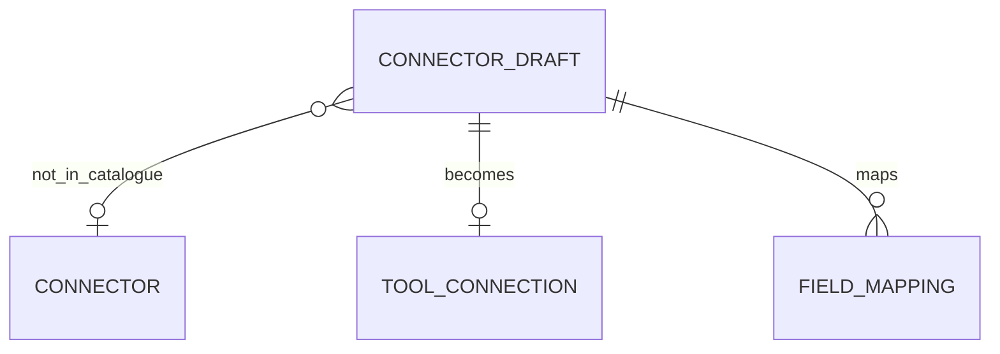
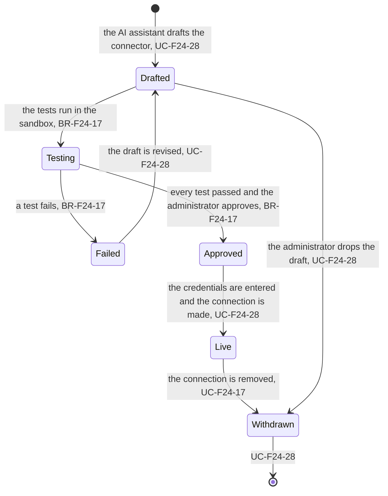

🏠 [Specs](../../../README.md) › 🧩 [Functional capabilities](../../README.md) › 🔌 [F24 Integrations hub](../README.md) ›
🗃️ [Data](README.md) › 🗃️ E-F24-17 Connector draft

# 🗃️ E-F24-17 Connector draft

**Status:** ✅ specified

## Purpose

A connector drafted by the AI assistant for a tool outside the catalogue: its documentation, sign-in, mapping, tests and
approval ([D543](../../../06-decisions/f24-integrations-hub/d543-benchmark-gaps-f24-integrations-hub.md)). It differs
from the catalogue connector ([E-F24-01 Connector](e-f24-01-connector.md)): a draft belongs to one company and becomes a
connection of that company, not an entry of the catalogue unless it passes the catalogue review.

## Fields

| Name | Type | Required | Validation | Default | Example | Personal data | Custom fields |
|---|---|---|---|---|---|---|---|
| tool | text | yes | 1 to 80 characters | - | Ticket tool | no | no |
| documentation | link or file | yes | readable | - | docs.example.com/api | no | no |
| version | number | yes | next in the series | 1 | 2 | no | no |
| sign-in | API key, OAuth, basic | yes | a value of the list | - | API key | no | no |
| direction | read, write, two-way | yes | a value of the list | read | two-way | no | no |
| mapping | list of field pairs | yes | at least one pair | - | 14 of 16 | no | no |
| test results | list of test, result, detail | yes | all tests run on the current version | - | 11 of 12 passed | no | no |
| built by | AI assistant, user | yes | the AI assistant or a user | AI assistant | AI assistant | no | no |
| state | Drafted, Testing, Failed, Approved, Live, Withdrawn | yes | the lifecycle below | Drafted | Testing | no | no |
| owner | user | yes | a user of the company | the creator | Claire P. | yes | no |

## Relations

- [E-F24-01 Connector](e-f24-01-connector.md)
- [E-F24-02 Tool connection](e-f24-02-tool-connection.md)
- [E-F24-07 Field mapping](e-f24-07-field-mapping.md)

## Lifecycle

## Indexes and search

By tool, state, version and author.

## Retention

Kept while Live, and 3 years after withdrawal with its test results.

## Audit

Every draft, version, test run, approval, going live and withdrawal, with who or what built it.

## Import and export

No import. Export of a draft as a file the administrator can keep.

## Used by

- [UC-F24-28](../use-cases/08-ai-connectors-suites-and-warehouse/uc-f24-28-have-the-ai-build-a-connector.md)

## Open questions

None.

---

⬅️ [E-F24-16 Connector request](e-f24-16-connector-request.md) · ⬆️ [Up](README.md) ·
➡️ [E-F24-18 Export pipeline](e-f24-18-export-pipeline.md)
