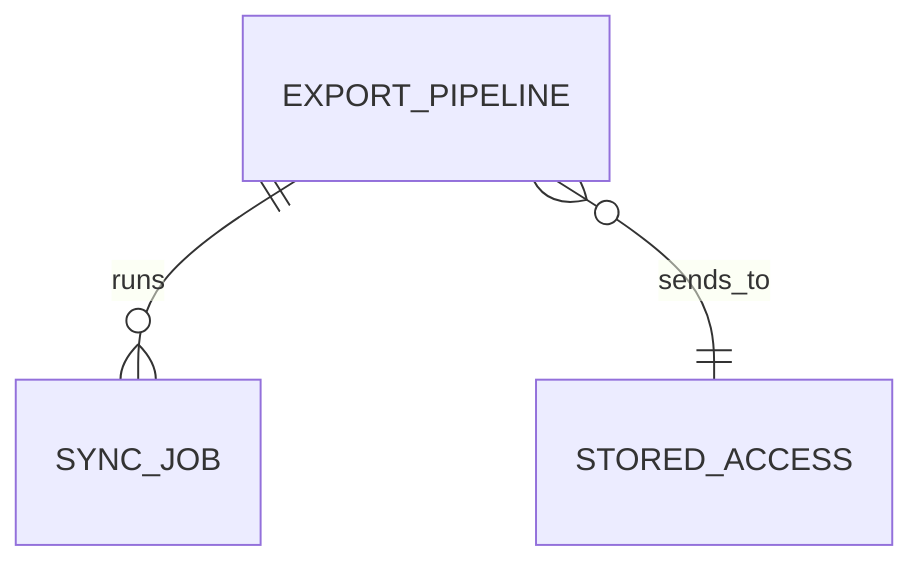
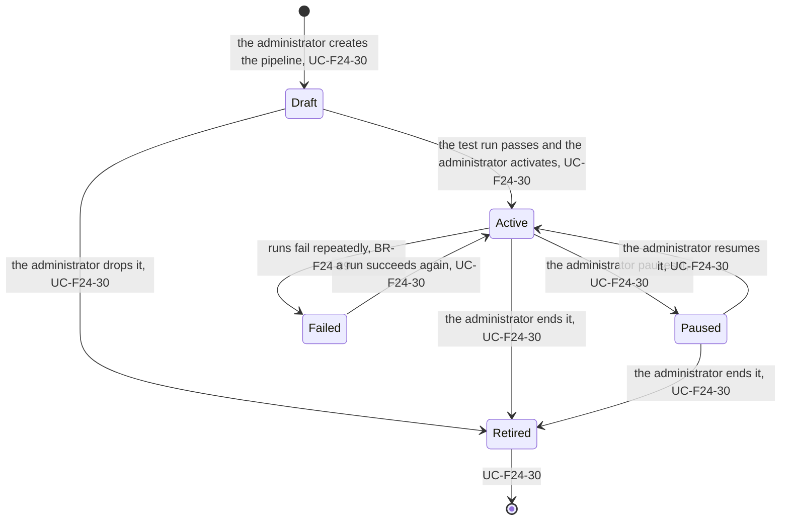

🏠 [Specs](../../../README.md) › 🧩 [Functional capabilities](../../README.md) › 🔌 [F24 Integrations hub](../README.md) ›
🗃️ [Data](README.md) › 🗃️ E-F24-18 Export pipeline

# 🗃️ E-F24-18 Export pipeline

**Status:** ✅ specified

## Purpose

A standing export of chosen records to a warehouse or file store the company owns: its fields, its masking, its
destination and its schedule
([D543](../../../06-decisions/f24-integrations-hub/d543-benchmark-gaps-f24-integrations-hub.md)). It differs from a sync
job ([E-F24-06 Sync job](e-f24-06-sync-job.md)): the pipeline is the standing definition, and each of its runs is
recorded as a sync job.

## Fields

| Name | Type | Required | Validation | Default | Example | Personal data | Custom fields |
|---|---|---|---|---|---|---|---|
| name | text | yes | 1 to 80 characters | - | Invoices to the warehouse | no | no |
| records | list of record types | yes | types the owner may read | - | invoices | no | no |
| destination | link to a stored access | yes | an access in the vault | - | warehouse 1 | no | no |
| schedule | hourly, daily, weekly | yes | a value of the list | daily | daily | no | no |
| field choices | list of field, export | yes | within the owner's field rights | all allowed fields | customer name masked | no | no |
| last run | date and time | no | after the activation | none | 2026-11-14 04:00 | no | no |
| state | Draft, Active, Paused, Failed, Retired | yes | the lifecycle below | Draft | Active | no | no |
| owner | user | yes | a user of the company | the creator | Claire P. | yes | no |

## Relations

- [E-F24-06 Sync job](e-f24-06-sync-job.md)
- [E-F24-08 Sync log entry](e-f24-08-sync-log-entry.md)

## Lifecycle

## Indexes and search

By name, records, destination, state and last run.

## Retention

Kept 3 years after retirement with its run log, to show what left the company.

## Audit

Every change of a pipeline and its field choices, and every run with its counts, with who and when.

## Import and export

No import. Export of the pipeline's definition for another company of the same provider.

## Used by

- [UC-F24-30](../use-cases/08-ai-connectors-suites-and-warehouse/uc-f24-30-export-data-to-a-warehouse.md)

## Open questions

None.

---

⬅️ [E-F24-17 Connector draft](e-f24-17-connector-draft.md) · ⬆️ [Up](README.md) ·
➡️ [E-F24-19 Firm sync](e-f24-19-firm-sync.md)
