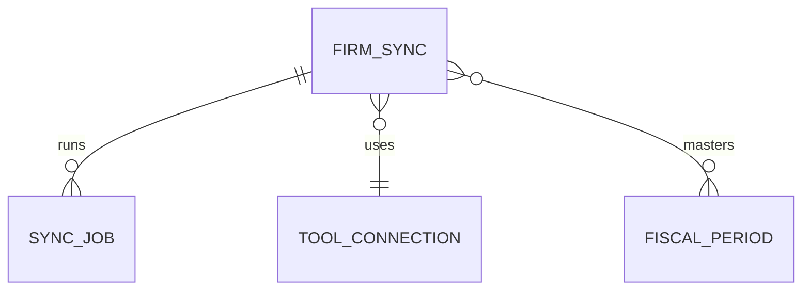
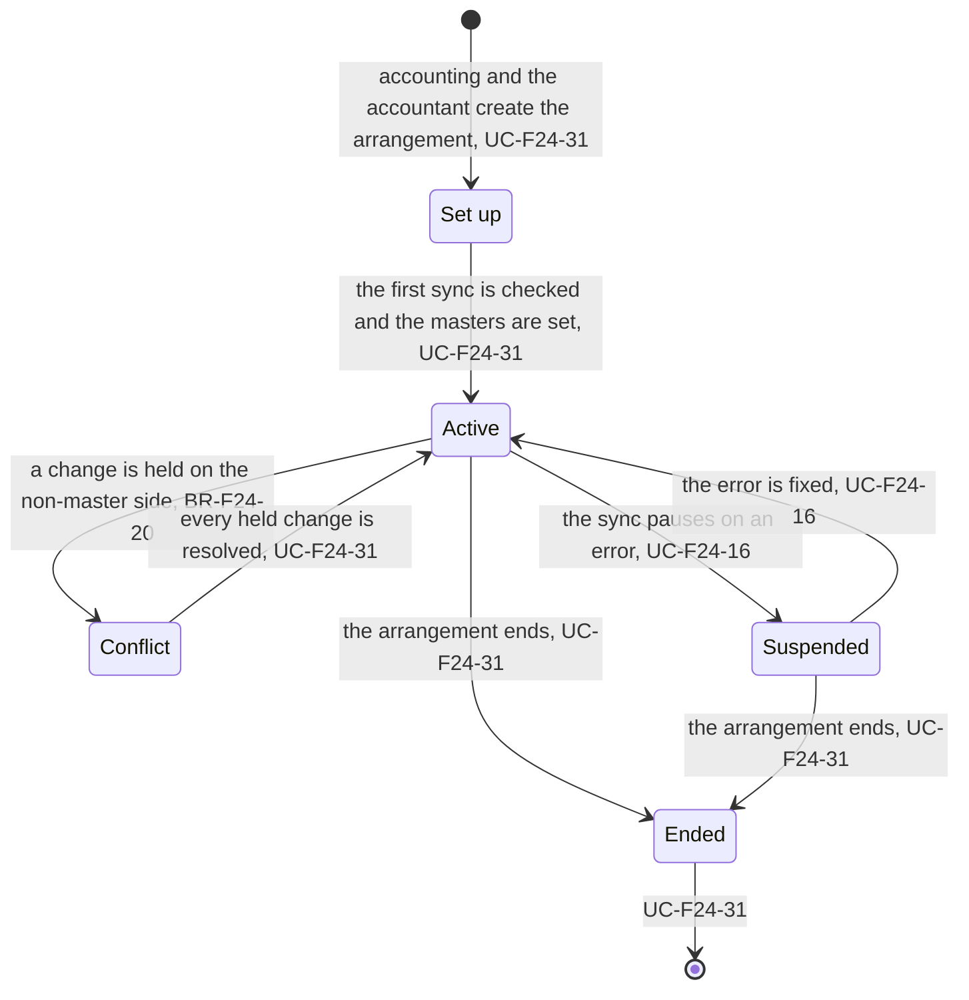

🏠 [Specs](../../../README.md) › 🧩 [Functional capabilities](../../README.md) › 🔌 [F24 Integrations hub](../README.md) ›
🗃️ [Data](README.md) › 🗃️ E-F24-19 Firm sync

# 🗃️ E-F24-19 Firm sync

**Status:** ✅ specified

## Purpose

The link between the company's books and an accountant's software: the connection, the master of each period and the
changes held for review
([D543](../../../06-decisions/f24-integrations-hub/d543-benchmark-gaps-f24-integrations-hub.md)). It differs from a sync
job ([E-F24-06 Sync job](e-f24-06-sync-job.md)): the firm sync is the standing arrangement, and each run is a sync job.

## Fields

| Name | Type | Required | Validation | Default | Example | Personal data | Custom fields |
|---|---|---|---|---|---|---|---|
| firm connection | tool connection (E-F24-02) | yes | a connection of the firm's software | - | firm software | no | no |
| period masters | list of period and master | yes | one master per period | SimpleERP | 2025 firm | no | no |
| last run | date and time | no | after the set-up | none | 2026-11-14 03:00 | no | no |
| held changes | list of changes | no | made on the non-master side | none | entry 4108 | no | no |
| set by | users | yes | an accounting user and the accountant | - | Anna R. and the firm | yes | no |
| state | Set up, Active, Conflict, Suspended, Ended | yes | the lifecycle below | Set up | Active | no | no |
| owner | user | yes | a user of the company | the creator | Claire P. | yes | no |

## Relations

- [E-F24-02 Tool connection](e-f24-02-tool-connection.md)
- [E-F24-06 Sync job](e-f24-06-sync-job.md)
- [E-F8-10 Fiscal period](../../f08-accounting/data/e-f08-10-fiscal-period.md)

## Lifecycle

## Indexes and search

By firm, state and period master.

## Retention

Kept 10 years with the books it concerns
([CR-FR-002](../../../10-country-packs/france/accounting/cr-fr-002-accounting-records-kept-ten-years.md)).

## Audit

Every master set or moved, run, held change and resolution, with who and when, on both sides.

## Import and export

No import. Export of the masters and the held changes with the accounting reports.

## Used by

- [UC-F24-31](../use-cases/08-ai-connectors-suites-and-warehouse/uc-f24-31-sync-with-the-accountants-software.md)

## Open questions

None.

---

⬅️ [E-F24-18 Export pipeline](e-f24-18-export-pipeline.md) · ⬆️ [Up](README.md)
