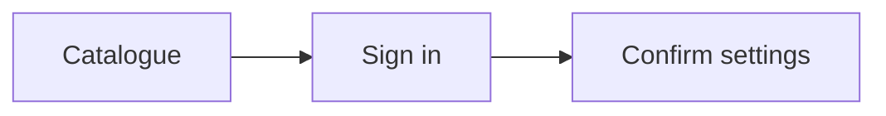
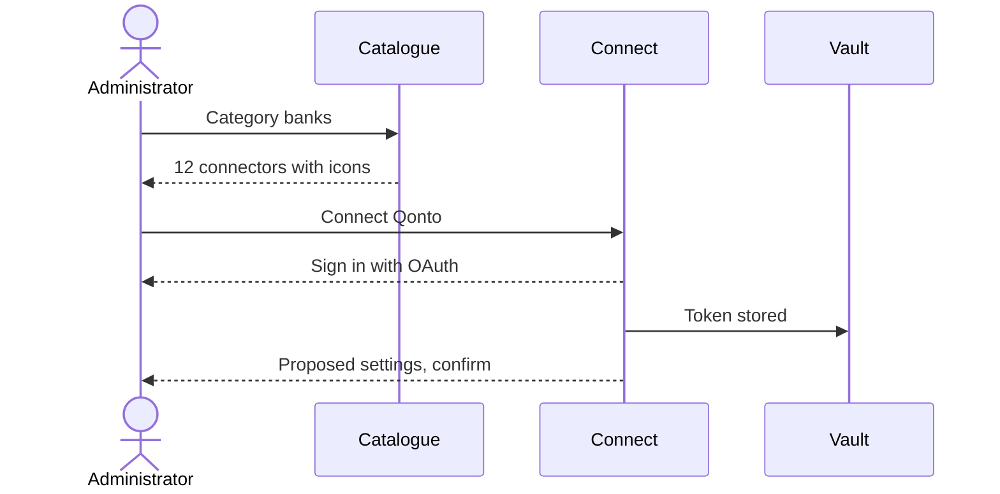

🏠 [Specs](../../../README.md) › 🧩 [Functional capabilities](../../README.md) › 🔌 [F24 Integrations hub](../README.md) ›
🔀 [Flows](README.md) › 🔀 FL-F24-01 Find and connect

# 🔀 FL-F24-01 Find and connect

**Status:** ✅ specified

## Summary

The administrator finds a tool in the catalogue, which lists every connector by category (office suites, CRM, ATS,
banks, payments, shops, accounting, payroll and HR, carriers, e-invoicing, automation) with its icon (BR-F24-16), vendor
country, cost and rights (UC-F24-01); they connect it in the fewest steps, with OAuth where offered, settings discovered
and proposed, credentials in the vault (UC-F24-02); a missing tool can be requested (UC-F24-19).

## Personas

- [U07 Administrator](../../../01-users/personas/u07-administrator.md)

## Flowchart

## Sequence diagram

## Steps

| Step | Persona | Screen | Use case | What happens |
|---|---|---|---|---|
| 1 | U07 | [S-F24-01](../screens/01-find-and-connect/s-f24-01-catalogue.md) | [UC-F24-01](../use-cases/01-find-and-connect/uc-f24-01-browse-the-connector-catalogue.md) | Browse the connector catalogue |
| 2 | U07 | [S-F24-02](../screens/01-find-and-connect/s-f24-02-connect.md) | [UC-F24-02](../use-cases/01-find-and-connect/uc-f24-02-connect-a-tool-in-the-fewest-steps.md) | Connect a tool in the fewest steps |

### Entities and screens

| Entity | States in this flow | Shown at step and screen | Aggregated view |
|---|---|---|---|
| [E-F24-01 Connector](../data/e-f24-01-connector.md) | Active | 1 [S-F24-01](../screens/01-find-and-connect/s-f24-01-catalogue.md) | Connectors |
| [E-F24-02 Tool connection](../data/e-f24-02-tool-connection.md) | Proposed | 1 [S-F24-01](../screens/01-find-and-connect/s-f24-01-catalogue.md); 2 [S-F24-02](../screens/01-find-and-connect/s-f24-02-connect.md) | Tool connections |

## Errors

E1: the sign-in is refused by the tool: the reason is shown and nothing is saved (step 2). E2: the tool asks for a paid
plan: the owner approves first (BR-F24-11). E3: a connector has no logo yet: its category's icon is shown (BR-F24-16).
E4: the tool is not in the catalogue: the request form opens (UC-F24-19).

## Images

Every step and error, for each persona taking part, in light and dark mode (D120). Steps are numbered as in the Steps
table; E rows are the error cases.

| Step | Persona | Device | Light | Dark |
|---|---|---|---|---|
| 1 | U07 | desktop | [light](../images/01-find-and-connect/u07-administrator/1-catalogue-desktop-light.png) | [dark](../images/01-find-and-connect/u07-administrator/1-catalogue-desktop-dark.png) |
| 2 | U07 | desktop | [light](../images/01-find-and-connect/u07-administrator/2-connect-desktop-light.png) | [dark](../images/01-find-and-connect/u07-administrator/2-connect-desktop-dark.png) |
| E1 | U07 | desktop | [light](../images/01-find-and-connect/u07-administrator/e1-sign-in-refused-desktop-light.png) | [dark](../images/01-find-and-connect/u07-administrator/e1-sign-in-refused-desktop-dark.png) |

## Open questions

None.

---

⬆️ [Up](README.md) · ➡️ [FL-F24-02 Office suites](fl-f24-02-office-suites.md)
