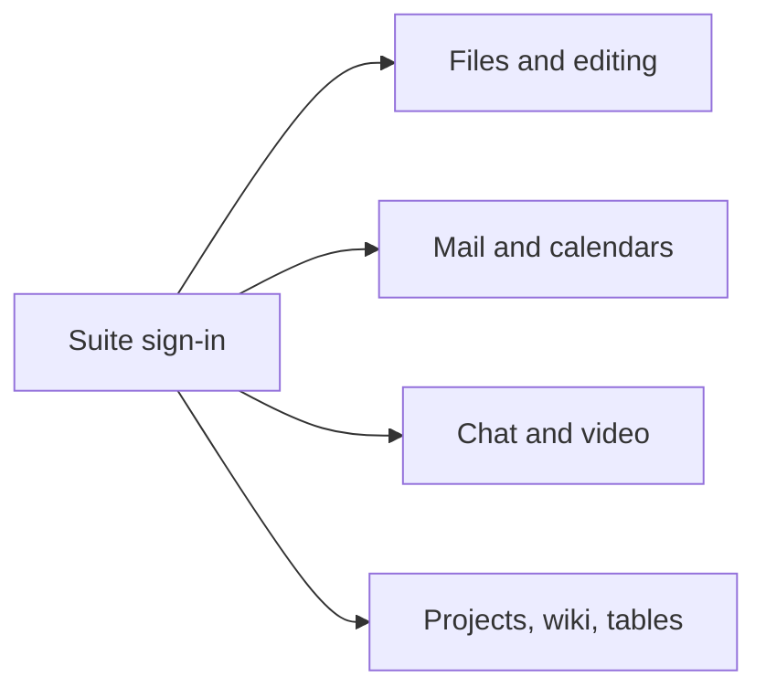

🏠 [Specs](../../../README.md) › 🧩 [Functional capabilities](../../README.md) › 🔌 [F24 Integrations hub](../README.md) ›
🔀 [Flows](README.md) › 🔀 FL-F24-02 Office suites

# 🔀 FL-F24-02 Office suites

**Status:** ✅ specified

## Summary

Covers UC-F24-03, UC-F24-04, UC-F24-05, UC-F24-06, UC-F24-07, UC-F24-08, UC-F24-09.

## Personas

- [U01 Employee](../../../01-users/personas/u01-employee.md)
- [U02 Manager](../../../01-users/personas/u02-manager.md)
- [U07 Administrator](../../../01-users/personas/u07-administrator.md)
- [U16 Office worker](../../../01-users/personas/u16-office-worker.md)

## Flowchart

## Sequence diagram

See each use case.

## Steps

| Step | Persona | Screen | Use case | What happens |
|---|---|---|---|---|
| 1 | U07, U01 | [S-F24-03](../screens/02-office-suites/s-f24-03-suite-sign-in.md) | [UC-F24-03](../use-cases/02-office-suites/uc-f24-03-sign-in-once-through-the-suite-s-identity-provider.md) | Sign in once through the suite's identity provider |
| 2 | U16, U01 | [S-F24-04](../screens/02-office-suites/s-f24-04-suite-files.md) | [UC-F24-04](../use-cases/02-office-suites/uc-f24-04-store-and-edit-documents-in-the-suite.md) | Store and edit documents in the suite |
| 3 | U01 | [S-F24-05](../screens/02-office-suites/s-f24-05-groupware.md) | [UC-F24-05](../use-cases/02-office-suites/uc-f24-05-sync-mail-calendars-and-contacts.md) | Sync mail, calendars and contacts |
| 4 | U01 | [S-F24-06](../screens/02-office-suites/s-f24-06-suite-chat.md) | [UC-F24-06](../use-cases/02-office-suites/uc-f24-06-use-the-suite-s-chat-for-notifications-and-the-assistant.md) | Use the suite's chat for notifications and the AI assistant |
| 5 | U02 | [S-F24-07](../screens/02-office-suites/s-f24-07-suite-video.md) | [UC-F24-07](../use-cases/02-office-suites/uc-f24-07-start-meetings-from-the-suite-s-video.md) | Start meetings from the suite's video |
| 6 | U02, U16 | [S-F24-08](../screens/02-office-suites/s-f24-08-suite-projects.md) | [UC-F24-08](../use-cases/02-office-suites/uc-f24-08-link-projects-wiki-notes-and-tables.md) | Link projects, wiki, notes and tables |
| 7 | U07 | [S-F24-09](../screens/02-office-suites/s-f24-09-suite-api.md) | [UC-F24-09](../use-cases/02-office-suites/uc-f24-09-use-the-suites-full-read-and-write-api.md) | Use the suites' full read and write API |

### Entities and screens

| Entity | States in this flow | Shown at step and screen | Aggregated view |
|---|---|---|---|
| [E-F24-03 Suite component](../data/e-f24-03-suite-component.md) | Active | 1 [S-F24-03](../screens/02-office-suites/s-f24-03-suite-sign-in.md); 2 [S-F24-04](../screens/02-office-suites/s-f24-04-suite-files.md); 3 [S-F24-05](../screens/02-office-suites/s-f24-05-groupware.md); 4 [S-F24-06](../screens/02-office-suites/s-f24-06-suite-chat.md); 5 [S-F24-07](../screens/02-office-suites/s-f24-07-suite-video.md); 6 [S-F24-08](../screens/02-office-suites/s-f24-08-suite-projects.md); 7 [S-F24-09](../screens/02-office-suites/s-f24-09-suite-api.md) | Suite components |
| [E-T02-04 Federated identity provider](../../../03-technical/t02-identity-and-access/data/e-t02-04-federated-identity-provider.md) | Active | Shown elsewhere: [S-T02-04 Federated identity provider](../../../03-technical/t02-identity-and-access/screens/s-t02-04-federated-identity-provider.md), from the admin list [S-T02-L04](../../../03-technical/t02-identity-and-access/screens/00-lists/s-t02-l04-federated-identity-providers.md) | Federated identity providers |
| [E-F24-04 Linked document](../data/e-f24-04-linked-document.md) | Active | 2 [S-F24-04](../screens/02-office-suites/s-f24-04-suite-files.md) | Linked documents |
| [E-F24-05 Calendar link](../data/e-f24-05-calendar-link.md) | Active | 3 [S-F24-05](../screens/02-office-suites/s-f24-05-groupware.md) | Calendar links |
| [E-F4-10 Chat channel](../../f04-meetings/data/e-f04-10-chat-channel.md) | Active | Shown elsewhere: [S-F4-15 Chat](../../f04-meetings/screens/10-benchmark-additions/s-f04-15-chat.md) | Chat channels |
| [E-F4-01 Meeting](../../f04-meetings/data/e-f04-01-meeting.md) | Planned, Live, Ended, Waiting for review, Checked | Shown elsewhere: [S-F4-01 Meeting](../../f04-meetings/screens/01-record-an-online-meeting/s-f04-01-meeting.md) | Meetings |
| [E-F9-18 Project and task](../../f09-hr-and-projects/data/e-f09-18-project-and-task.md) | New, Planned, Active, Delivered, Done | Shown elsewhere: [S-F9-17 Projects](../../f09-hr-and-projects/screens/06-plan-and-deliver-work/s-f09-17-projects.md) | Project and tasks |

## Errors

As each use case.

## Images

Every step and error, for each persona taking part, in light and dark mode (D120). Steps are numbered as in the Steps
table; E rows are the error cases.

| Step | Persona | Device | Light | Dark |
|---|---|---|---|---|
| 1 | U07 | desktop | [light](../images/02-office-suites/u07-administrator/1-sso-desktop-light.png) | [dark](../images/02-office-suites/u07-administrator/1-sso-desktop-dark.png) |
| 1 | U01 | desktop | [light](../images/02-office-suites/u01-employee/1-sso-desktop-light.png) | [dark](../images/02-office-suites/u01-employee/1-sso-desktop-dark.png) |
| 1 | U01 | phone | [light](../images/02-office-suites/u01-employee/1-sso-phone-light.png) | [dark](../images/02-office-suites/u01-employee/1-sso-phone-dark.png) |
| 2 | U16 | desktop | [light](../images/02-office-suites/u16-office-worker/2-files-desktop-light.png) | [dark](../images/02-office-suites/u16-office-worker/2-files-desktop-dark.png) |
| 2 | U16 | phone | [light](../images/02-office-suites/u16-office-worker/2-files-phone-light.png) | [dark](../images/02-office-suites/u16-office-worker/2-files-phone-dark.png) |
| 2 | U01 | desktop | [light](../images/02-office-suites/u01-employee/2-files-desktop-light.png) | [dark](../images/02-office-suites/u01-employee/2-files-desktop-dark.png) |
| 2 | U01 | phone | [light](../images/02-office-suites/u01-employee/2-files-phone-light.png) | [dark](../images/02-office-suites/u01-employee/2-files-phone-dark.png) |
| 3 | U01 | desktop | [light](../images/02-office-suites/u01-employee/3-groupware-desktop-light.png) | [dark](../images/02-office-suites/u01-employee/3-groupware-desktop-dark.png) |
| 3 | U01 | phone | [light](../images/02-office-suites/u01-employee/3-groupware-phone-light.png) | [dark](../images/02-office-suites/u01-employee/3-groupware-phone-dark.png) |
| 4 | U01 | desktop | [light](../images/02-office-suites/u01-employee/4-chat-desktop-light.png) | [dark](../images/02-office-suites/u01-employee/4-chat-desktop-dark.png) |
| 4 | U01 | phone | [light](../images/02-office-suites/u01-employee/4-chat-phone-light.png) | [dark](../images/02-office-suites/u01-employee/4-chat-phone-dark.png) |
| 5 | U02 | desktop | [light](../images/02-office-suites/u02-manager/5-video-desktop-light.png) | [dark](../images/02-office-suites/u02-manager/5-video-desktop-dark.png) |
| 5 | U02 | phone | [light](../images/02-office-suites/u02-manager/5-video-phone-light.png) | [dark](../images/02-office-suites/u02-manager/5-video-phone-dark.png) |
| 6 | U02 | desktop | [light](../images/02-office-suites/u02-manager/6-projects-desktop-light.png) | [dark](../images/02-office-suites/u02-manager/6-projects-desktop-dark.png) |
| 6 | U02 | phone | [light](../images/02-office-suites/u02-manager/6-projects-phone-light.png) | [dark](../images/02-office-suites/u02-manager/6-projects-phone-dark.png) |
| 6 | U16 | desktop | [light](../images/02-office-suites/u16-office-worker/6-projects-desktop-light.png) | [dark](../images/02-office-suites/u16-office-worker/6-projects-desktop-dark.png) |
| 6 | U16 | phone | [light](../images/02-office-suites/u16-office-worker/6-projects-phone-light.png) | [dark](../images/02-office-suites/u16-office-worker/6-projects-phone-dark.png) |
| 7 | U07 | desktop | [light](../images/02-office-suites/u07-administrator/7-api-desktop-light.png) | [dark](../images/02-office-suites/u07-administrator/7-api-desktop-dark.png) |
| E1 | U16 | desktop | [light](../images/02-office-suites/u16-office-worker/e1-locked-desktop-light.png) | [dark](../images/02-office-suites/u16-office-worker/e1-locked-desktop-dark.png) |
| E1 | U16 | phone | [light](../images/02-office-suites/u16-office-worker/e1-locked-phone-light.png) | [dark](../images/02-office-suites/u16-office-worker/e1-locked-phone-dark.png) |

## Open questions

None.

---

⬅️ [FL-F24-01 Find and connect](fl-f24-01-find-and-connect.md) · ⬆️ [Up](README.md) ·
➡️ [FL-F24-03 CRM and ATS](fl-f24-03-crm-and-ats.md)
