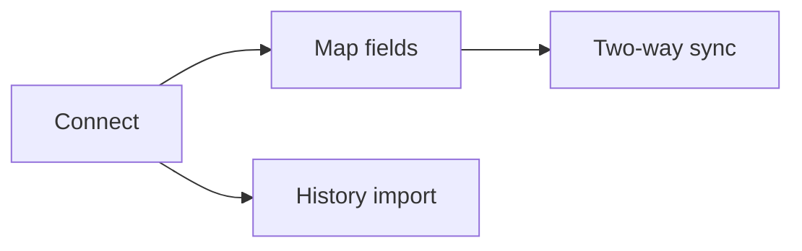

🏠 [Specs](../../../README.md) › 🧩 [Functional capabilities](../../README.md) › 🔌 [F24 Integrations hub](../README.md) ›
🔀 [Flows](README.md) › 🔀 FL-F24-03 CRM and ATS

# 🔀 FL-F24-03 CRM and ATS

**Status:** ✅ specified

## Summary

Covers UC-F24-10, UC-F24-11, UC-F24-12, UC-F24-13.

## Personas

- [U03 Sales](../../../01-users/personas/u03-sales.md)
- [U06 HR](../../../01-users/personas/u06-hr.md)
- [U07 Administrator](../../../01-users/personas/u07-administrator.md)

## Flowchart

## Sequence diagram

See each use case.

## Steps

| Step | Persona | Screen | Use case | What happens |
|---|---|---|---|---|
| 1 | U03 | [S-F24-10](../screens/03-crm-and-ats/s-f24-10-crm-sync.md) | [UC-F24-10](../use-cases/03-crm-and-ats/uc-f24-10-sync-a-crm-both-ways.md) | Sync a CRM both ways |
| 2 | U06 | [S-F24-11](../screens/03-crm-and-ats/s-f24-11-ats-sync.md) | [UC-F24-11](../use-cases/03-crm-and-ats/uc-f24-11-sync-an-ats-both-ways.md) | Sync an ATS both ways |
| 3 | U07 | [S-F24-12](../screens/03-crm-and-ats/s-f24-12-mapping.md) | [UC-F24-12](../use-cases/03-crm-and-ats/uc-f24-12-map-fields-and-resolve-conflicts.md) | Map fields and resolve conflicts |
| 4 | U07 | [S-F24-13](../screens/03-crm-and-ats/s-f24-13-history-import.md) | [UC-F24-13](../use-cases/03-crm-and-ats/uc-f24-13-import-history-once.md) | Import history once |

### Entities and screens

| Entity | States in this flow | Shown at step and screen | Aggregated view |
|---|---|---|---|
| [E-F24-07 Field mapping](../data/e-f24-07-field-mapping.md) | Active | 1 [S-F24-10](../screens/03-crm-and-ats/s-f24-10-crm-sync.md); 2 [S-F24-11](../screens/03-crm-and-ats/s-f24-11-ats-sync.md); 3 [S-F24-12](../screens/03-crm-and-ats/s-f24-12-mapping.md) | Field mappings |
| [E-F24-06 Sync job](../data/e-f24-06-sync-job.md) | Active | 1 [S-F24-10](../screens/03-crm-and-ats/s-f24-10-crm-sync.md); 2 [S-F24-11](../screens/03-crm-and-ats/s-f24-11-ats-sync.md); 4 [S-F24-13](../screens/03-crm-and-ats/s-f24-13-history-import.md) | Sync jobs |

## Errors

As each use case.

## Images

Every step and error, for each persona taking part, in light and dark mode (D120). Steps are numbered as in the Steps
table; E rows are the error cases.

| Step | Persona | Device | Light | Dark |
|---|---|---|---|---|
| 1 | U03 | desktop | [light](../images/03-crm-and-ats/u03-sales/1-crm-desktop-light.png) | [dark](../images/03-crm-and-ats/u03-sales/1-crm-desktop-dark.png) |
| 1 | U03 | phone | [light](../images/03-crm-and-ats/u03-sales/1-crm-phone-light.png) | [dark](../images/03-crm-and-ats/u03-sales/1-crm-phone-dark.png) |
| 1 | U03 | tablet | [light](../images/03-crm-and-ats/u03-sales/1-crm-tablet-light.png) | [dark](../images/03-crm-and-ats/u03-sales/1-crm-tablet-dark.png) |
| 2 | U06 | desktop | [light](../images/03-crm-and-ats/u06-hr/2-ats-desktop-light.png) | [dark](../images/03-crm-and-ats/u06-hr/2-ats-desktop-dark.png) |
| 3 | U07 | desktop | [light](../images/03-crm-and-ats/u07-administrator/3-mapping-desktop-light.png) | [dark](../images/03-crm-and-ats/u07-administrator/3-mapping-desktop-dark.png) |
| 4 | U07 | desktop | [light](../images/03-crm-and-ats/u07-administrator/4-history-desktop-light.png) | [dark](../images/03-crm-and-ats/u07-administrator/4-history-desktop-dark.png) |
| E1 | U03 | desktop | [light](../images/03-crm-and-ats/u03-sales/e1-conflict-desktop-light.png) | [dark](../images/03-crm-and-ats/u03-sales/e1-conflict-desktop-dark.png) |
| E1 | U03 | phone | [light](../images/03-crm-and-ats/u03-sales/e1-conflict-phone-light.png) | [dark](../images/03-crm-and-ats/u03-sales/e1-conflict-phone-dark.png) |
| E1 | U03 | tablet | [light](../images/03-crm-and-ats/u03-sales/e1-conflict-tablet-light.png) | [dark](../images/03-crm-and-ats/u03-sales/e1-conflict-tablet-dark.png) |

## Open questions

None.

---

⬅️ [FL-F24-02 Office suites](fl-f24-02-office-suites.md) · ⬆️ [Up](README.md) ·
➡️ [FL-F24-04 Run and control](fl-f24-04-run-and-control.md)
