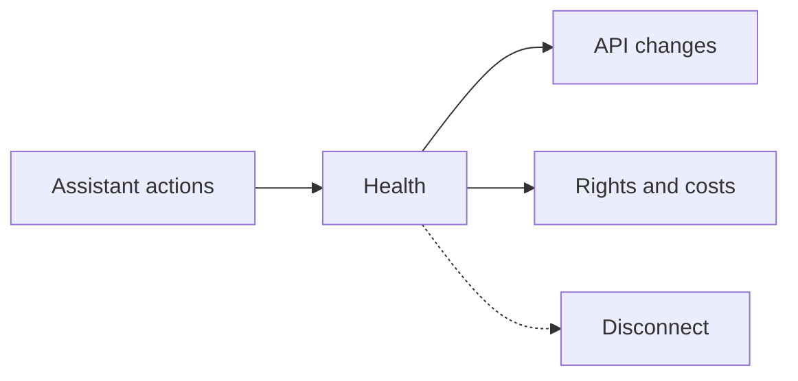

🏠 [Specs](../../../README.md) › 🧩 [Functional capabilities](../../README.md) › 🔌 [F24 Integrations hub](../README.md) ›
🔀 [Flows](README.md) › 🔀 FL-F24-04 Run and control

# 🔀 FL-F24-04 Run and control

**Status:** ✅ specified

## Summary

Covers UC-F24-14, UC-F24-15, UC-F24-16, UC-F24-17, UC-F24-20.

## Personas

- [U03 Sales](../../../01-users/personas/u03-sales.md)
- [U07 Administrator](../../../01-users/personas/u07-administrator.md)
- [U13 Owner](../../../01-users/personas/u13-owner.md)
- [U47 simple-ERP maintainer](../../../01-users/personas/u47-simple-erp-maintainer.md)

## Flowchart

## Sequence diagram

See each use case.

## Steps

| Step | Persona | Screen | Use case | What happens |
|---|---|---|---|---|
| 1 | U13, U03 | [S-F24-14](../screens/04-run-and-control/s-f24-14-assistant-actions.md) | [UC-F24-14](../use-cases/04-run-and-control/uc-f24-14-ask-the-assistant-to-act-in-a-connected-tool.md) | Ask the AI assistant to act in a connected tool |
| 2 | U07 | [S-F24-15](../screens/04-run-and-control/s-f24-15-health.md) | [UC-F24-15](../use-cases/04-run-and-control/uc-f24-15-follow-each-connector-s-health-and-sync-log.md) | Follow each connector's health and sync log |
| 3 | U07, U47 | [S-F24-16](../screens/04-run-and-control/s-f24-16-api-changes.md) | [UC-F24-16](../use-cases/04-run-and-control/uc-f24-16-handle-an-outside-api-change-or-error.md) | Handle an outside API change or error |
| 4 | U07 | [S-F24-17](../screens/04-run-and-control/s-f24-17-disconnect.md) | [UC-F24-17](../use-cases/04-run-and-control/uc-f24-17-disconnect-and-keep-or-delete-the-data.md) | Disconnect and keep or delete the data |
| 5 | U07, U13 | [S-F24-20](../screens/04-run-and-control/s-f24-20-rights-and-costs.md) | [UC-F24-20](../use-cases/04-run-and-control/uc-f24-20-control-the-rights-and-costs-of-connectors.md) | Control the rights and costs of connectors |

### Entities and screens

| Entity | States in this flow | Shown at step and screen | Aggregated view |
|---|---|---|---|
| [E-F24-09 Connector action](../data/e-f24-09-connector-action.md) | Active | 1 [S-F24-14](../screens/04-run-and-control/s-f24-14-assistant-actions.md); 5 [S-F24-20](../screens/04-run-and-control/s-f24-20-rights-and-costs.md) | Connector actions |
| [E-F24-02 Tool connection](../data/e-f24-02-tool-connection.md) | Proposed, Active, Revoked | 4 [S-F24-17](../screens/04-run-and-control/s-f24-17-disconnect.md); 5 [S-F24-20](../screens/04-run-and-control/s-f24-20-rights-and-costs.md) | Tool connections |
| [E-F24-10 Connector incident](../data/e-f24-10-connector-incident.md) | Repaired, Paused, Flagged, Failed | 2 [S-F24-15](../screens/04-run-and-control/s-f24-15-health.md); 3 [S-F24-16](../screens/04-run-and-control/s-f24-16-api-changes.md) | Connector incidents |
| [E-F1-06 Role](../../f01-administration/data/e-f01-06-role.md) | Active | Shown elsewhere: [S-F1-06 Role editor](../../f01-administration/screens/04-edit-a-role/s-f01-06-role-editor.md) | Roles |
| [E-F22-02 Metered call record](../../f22-unified-cost-management/data/e-f22-02-metered-call-record.md) | Recorded | Shown elsewhere: [S-F22-01 Costs overview](../../f22-unified-cost-management/screens/01-see-and-set-up/s-f22-01-costs-overview.md) | Metered call records |

## Errors

As each use case.

## Images

Every step and error, for each persona taking part, in light and dark mode (D120). Steps are numbered as in the Steps
table; E rows are the error cases.

| Step | Persona | Device | Light | Dark |
|---|---|---|---|---|
| 1 | U13 | desktop | [light](../images/04-run-and-control/u13-owner/1-assistant-desktop-light.png) | [dark](../images/04-run-and-control/u13-owner/1-assistant-desktop-dark.png) |
| 1 | U13 | phone | [light](../images/04-run-and-control/u13-owner/1-assistant-phone-light.png) | [dark](../images/04-run-and-control/u13-owner/1-assistant-phone-dark.png) |
| 1 | U03 | desktop | [light](../images/04-run-and-control/u03-sales/1-assistant-desktop-light.png) | [dark](../images/04-run-and-control/u03-sales/1-assistant-desktop-dark.png) |
| 1 | U03 | phone | [light](../images/04-run-and-control/u03-sales/1-assistant-phone-light.png) | [dark](../images/04-run-and-control/u03-sales/1-assistant-phone-dark.png) |
| 1 | U03 | tablet | [light](../images/04-run-and-control/u03-sales/1-assistant-tablet-light.png) | [dark](../images/04-run-and-control/u03-sales/1-assistant-tablet-dark.png) |
| 2 | U07 | desktop | [light](../images/04-run-and-control/u07-administrator/2-health-desktop-light.png) | [dark](../images/04-run-and-control/u07-administrator/2-health-desktop-dark.png) |
| 3 | U47 | desktop | [light](../images/04-run-and-control/u47-simple-erp-maintainer/3-api-change-desktop-light.png) | [dark](../images/04-run-and-control/u47-simple-erp-maintainer/3-api-change-desktop-dark.png) |
| 3 | U47 | phone | [light](../images/04-run-and-control/u47-simple-erp-maintainer/3-api-change-phone-light.png) | [dark](../images/04-run-and-control/u47-simple-erp-maintainer/3-api-change-phone-dark.png) |
| 3 | U07 | desktop | [light](../images/04-run-and-control/u07-administrator/3-api-change-desktop-light.png) | [dark](../images/04-run-and-control/u07-administrator/3-api-change-desktop-dark.png) |
| 4 | U07 | desktop | [light](../images/04-run-and-control/u07-administrator/4-disconnect-desktop-light.png) | [dark](../images/04-run-and-control/u07-administrator/4-disconnect-desktop-dark.png) |
| 5 | U13 | desktop | [light](../images/04-run-and-control/u13-owner/5-rights-costs-desktop-light.png) | [dark](../images/04-run-and-control/u13-owner/5-rights-costs-desktop-dark.png) |
| 5 | U13 | phone | [light](../images/04-run-and-control/u13-owner/5-rights-costs-phone-light.png) | [dark](../images/04-run-and-control/u13-owner/5-rights-costs-phone-dark.png) |
| 5 | U07 | desktop | [light](../images/04-run-and-control/u07-administrator/5-rights-costs-desktop-light.png) | [dark](../images/04-run-and-control/u07-administrator/5-rights-costs-desktop-dark.png) |
| E1 | U07 | desktop | [light](../images/04-run-and-control/u07-administrator/e1-scope-desktop-light.png) | [dark](../images/04-run-and-control/u07-administrator/e1-scope-desktop-dark.png) |

## Open questions

None.

---

⬅️ [FL-F24-03 CRM and ATS](fl-f24-03-crm-and-ats.md) · ⬆️ [Up](README.md) ·
➡️ [FL-F24-05 Keep the catalogue](fl-f24-05-keep-the-catalogue.md)
