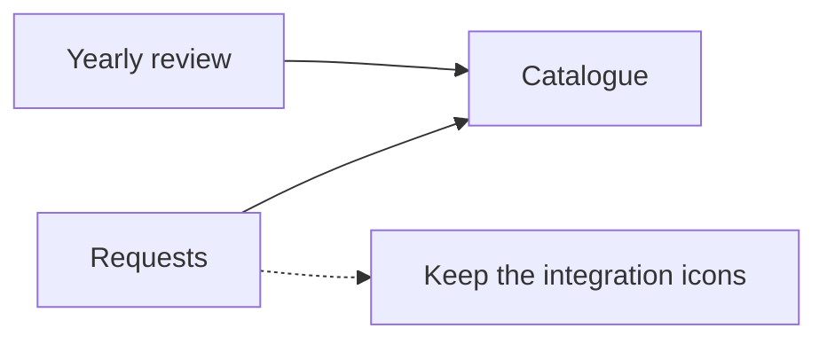

🏠 [Specs](../../../README.md) › 🧩 [Functional capabilities](../../README.md) › 🔌 [F24 Integrations hub](../README.md) ›
🔀 [Flows](README.md) › 🔀 FL-F24-05 Keep the catalogue

# 🔀 FL-F24-05 Keep the catalogue

**Status:** ✅ specified

## Summary

Covers UC-F24-18, UC-F24-19.

## Personas

- [U13 Owner](../../../01-users/personas/u13-owner.md)
- [U47 SimpleERP maintainer](../../../01-users/personas/u47-simpleerp-maintainer.md)

## Flowchart

## Sequence diagram

See each use case.

## Steps

| Step | Persona | Screen | Use case | What happens |
|---|---|---|---|---|
| 1 | U47 | [S-F24-18](../screens/05-keep-the-catalogue/s-f24-18-yearly-review.md) | [UC-F24-18](../use-cases/05-keep-the-catalogue/uc-f24-18-review-the-list-of-50-every-year.md) | Review the list of 50 every year |
| 2 | U13 | [S-F24-19](../screens/05-keep-the-catalogue/s-f24-19-requests.md) | [UC-F24-19](../use-cases/05-keep-the-catalogue/uc-f24-19-request-a-missing-connector.md) | Request a missing connector |
| 3 | U47 | [S-F24-25](../screens/05-keep-the-catalogue/s-f24-25-icon-library.md) | [UC-F24-27](../use-cases/05-keep-the-catalogue/uc-f24-27-keep-the-integration-icons.md) | Keep the integration icons |

### Entities and screens

| Entity | States in this flow | Shown at step and screen | Aggregated view |
|---|---|---|---|
| [E-F24-15 Connector catalogue review](../data/e-f24-15-connector-catalogue-review.md) | Active, Published | 1 [S-F24-18](../screens/05-keep-the-catalogue/s-f24-18-yearly-review.md) | Connector catalogue reviews |
| [E-F24-01 Connector](../data/e-f24-01-connector.md) | Active | 1 [S-F24-18](../screens/05-keep-the-catalogue/s-f24-18-yearly-review.md); 2 [S-F24-19](../screens/05-keep-the-catalogue/s-f24-19-requests.md) | Connectors |
| [E-F24-16 Connector request](../data/e-f24-16-connector-request.md) | Active | 2 [S-F24-19](../screens/05-keep-the-catalogue/s-f24-19-requests.md) | Connector requests |
| [E-F24-12 Integration icon](../data/e-f24-12-integration-icon.md) | Proposed, Approved, Replaced, Withdrawn | 2 [S-F24-19](../screens/05-keep-the-catalogue/s-f24-19-requests.md); 3 [S-F24-25](../screens/05-keep-the-catalogue/s-f24-25-icon-library.md) | Integration icons |

## Errors

As each use case.

## Images

Every step and error, for each persona taking part, in light and dark mode (D120). Steps are numbered as in the Steps
table; E rows are the error cases.

| Step | Persona | Device | Light | Dark |
|---|---|---|---|---|
| 1 | U47 | desktop | [light](../images/05-keep-the-catalogue/u47-simpleerp-maintainer/1-review-desktop-light.png) | [dark](../images/05-keep-the-catalogue/u47-simpleerp-maintainer/1-review-desktop-dark.png) |
| 1 | U47 | phone | [light](../images/05-keep-the-catalogue/u47-simpleerp-maintainer/1-review-phone-light.png) | [dark](../images/05-keep-the-catalogue/u47-simpleerp-maintainer/1-review-phone-dark.png) |
| 2 | U13 | desktop | [light](../images/05-keep-the-catalogue/u13-owner/2-request-desktop-light.png) | [dark](../images/05-keep-the-catalogue/u13-owner/2-request-desktop-dark.png) |
| 2 | U13 | phone | [light](../images/05-keep-the-catalogue/u13-owner/2-request-phone-light.png) | [dark](../images/05-keep-the-catalogue/u13-owner/2-request-phone-dark.png) |
| E1 | U13 | desktop | [light](../images/05-keep-the-catalogue/u13-owner/e1-not-possible-desktop-light.png) | [dark](../images/05-keep-the-catalogue/u13-owner/e1-not-possible-desktop-dark.png) |
| E1 | U13 | phone | [light](../images/05-keep-the-catalogue/u13-owner/e1-not-possible-phone-light.png) | [dark](../images/05-keep-the-catalogue/u13-owner/e1-not-possible-phone-dark.png) |
| 3 | U47 | desktop | [light](../images/05-keep-the-catalogue/u47-simpleerp-maintainer/3-icon-library-desktop-light.png) | [dark](../images/05-keep-the-catalogue/u47-simpleerp-maintainer/3-icon-library-desktop-dark.png) |
| 3 | U47 | phone | [light](../images/05-keep-the-catalogue/u47-simpleerp-maintainer/3-icon-library-phone-light.png) | [dark](../images/05-keep-the-catalogue/u47-simpleerp-maintainer/3-icon-library-phone-dark.png) |

## Open questions

None.

---

⬅️ [FL-F24-04 Run and control](fl-f24-04-run-and-control.md) · ⬆️ [Up](README.md) ·
➡️ [FL-F24-06 Business tools](fl-f24-06-business-tools.md)
