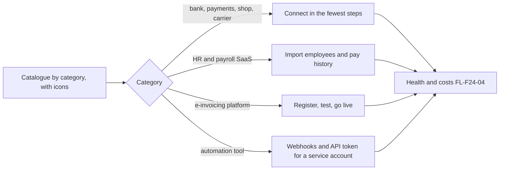
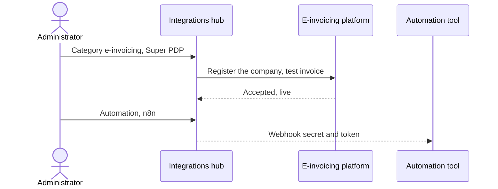

🏠 [Specs](../../../README.md) › 🧩 [Functional capabilities](../../README.md) › 🔌 [F24 Integrations hub](../README.md) ›
🔀 [Flows](README.md) › 🔀 FL-F24-06 Business tools

# 🔀 FL-F24-06 Business tools

**Status:** ✅ specified

## Summary

Beyond office suites, CRM and ATS, the hub connects the company's business tools: banks, payments, online shops,
accounting, payroll and HR software (Silae, PayFit, Lucca), carriers, the e-invoicing platform (D454) and automation
tools (n8n, Make, Zapier), each in the fewest steps and with its icon (D481).

## Personas

- [U07 Administrator](../../../01-users/personas/u07-administrator.md)
- [U05 Accounting](../../../01-users/personas/u05-accounting.md)
- [U06 Human resources](../../../01-users/personas/u06-hr.md)
- [U13 Owner](../../../01-users/personas/u13-owner.md)

## Flowchart

## Sequence diagram

## Steps

| Step | Persona | Screen | Use case | What happens |
|---|---|---|---|---|
| 1 | U07, U13 | [S-F24-02](../screens/01-find-and-connect/s-f24-02-connect.md) | [UC-F24-21](../use-cases/06-business-tools/uc-f24-21-connect-a-bank-payment-shop-accounting-or-carrier-tool.md) | Connect a bank, payment, shop, accounting or carrier tool |
| 2 | U07 | [S-F24-21](../screens/06-business-tools/s-f24-21-automation.md) | [UC-F24-22](../use-cases/06-business-tools/uc-f24-22-automate-with-n8n-make-or-zapier.md) | Automate with n8n, Make or Zapier |
| 3 | U06, U07 | [S-F24-23](../screens/06-business-tools/s-f24-23-hr-and-payroll-import.md) | [UC-F24-23](../use-cases/06-business-tools/uc-f24-23-bring-hr-and-payroll-data-from-silae-payfit-or-lucca.md) | Bring HR and payroll data from Silae, PayFit or Lucca |
| 4 | U07, U05 | [S-F24-22](../screens/06-business-tools/s-f24-22-e-invoicing-platform.md) | [UC-F24-24](../use-cases/06-business-tools/uc-f24-24-connect-the-e-invoicing-platform.md) | Connect the e-invoicing platform |

### Entities and screens

| Entity | States in this flow | Shown at step and screen | Aggregated view |
|---|---|---|---|
| [E-F24-11 Connector category](../data/e-f24-11-connector-category.md) | Active, Retired | 1 [S-F24-02](../screens/01-find-and-connect/s-f24-02-connect.md) | Connector categories |
| [E-F6-06 Customer payment](../../f06-customers-and-sales/data/e-f06-06-customer-payment.md) | Matched, Refused | Shown elsewhere: [S-F6-07 Payments and reconciliation](../../f06-customers-and-sales/screens/03-invoice-and-get-paid/s-f06-07-payments-and-reconciliation.md) | Customer payments |
| [E-F9-01 Employee record](../../f09-hr-and-projects/data/e-f09-01-employee-record.md) | Active | Shown elsewhere: [S-F9-01 Employee](../../f09-hr-and-projects/screens/01-people/s-f09-01-employee.md) | Employee records |
| [E-F13-07 Payslip](../../f13-payroll/data/e-f13-07-payslip.md) | Published, Available | Shown elsewhere: [S-F13-08 Payslips](../../f13-payroll/screens/02-monthly-pay-run/s-f13-08-payslips.md) | Payslips |
| [E-F24-14 E-invoicing registration](../data/e-f24-14-e-invoicing-registration.md) | Registering, Testing, Live, Failed | 4 [S-F24-22](../screens/06-business-tools/s-f24-22-e-invoicing-platform.md) | E-invoicing registrations |
| [E-F24-13 Webhook subscription](../data/e-f24-13-webhook-subscription.md) | Active, Paused | 2 [S-F24-21](../screens/06-business-tools/s-f24-21-automation.md) | Webhook subscriptions |
| [E-F1-18 API token](../../f01-administration/data/e-f01-18-api-token.md) | Active, Revoked, Expired | Shown elsewhere: [S-F1-20 API tokens](../../f01-administration/screens/12-portal-accounts-and-integrations/s-f01-20-api-tokens.md) | API tokens |
| [E-T02-03 Service account](../../../03-technical/t02-identity-and-access/data/e-t02-03-service-account.md) | Active | Shown elsewhere: [S-T02-03 Service account](../../../03-technical/t02-identity-and-access/screens/s-t02-03-service-account.md), from the admin list [S-T02-L03](../../../03-technical/t02-identity-and-access/screens/00-lists/s-t02-l03-service-accounts.md) | Service accounts |
| [E-F24-01 Connector](../data/e-f24-01-connector.md) | Active | Shown elsewhere: [S-F24-01 Catalogue](../screens/01-find-and-connect/s-f24-01-catalogue.md) | Connectors |

## Errors

E1: a bank refuses the connection: statements can be uploaded by hand meanwhile (step 1). E2: a webhook endpoint keeps
failing: it is paused after the retries and the administrator told (step 2). E3: the test invoice is rejected by the
platform: the reason is shown and the company stays on the previous channel (step 4).

## Images

Every step and error, for each persona taking part, in light and dark mode (D120). Steps are numbered as in the Steps
table; E rows are the error cases.

| Step | Persona | Device | Light | Dark |
|---|---|---|---|---|
| 1 | U07 | desktop | [light](../images/06-business-tools/u07-administrator/1-connect-desktop-light.png) | [dark](../images/06-business-tools/u07-administrator/1-connect-desktop-dark.png) |
| 1 | U13 | desktop | [light](../images/06-business-tools/u13-owner/1-connect-desktop-light.png) | [dark](../images/06-business-tools/u13-owner/1-connect-desktop-dark.png) |
| 1 | U13 | phone | [light](../images/06-business-tools/u13-owner/1-connect-phone-light.png) | [dark](../images/06-business-tools/u13-owner/1-connect-phone-dark.png) |
| 2 | U07 | desktop | [light](../images/06-business-tools/u07-administrator/2-automation-desktop-light.png) | [dark](../images/06-business-tools/u07-administrator/2-automation-desktop-dark.png) |
| 3 | U06 | desktop | [light](../images/06-business-tools/u06-hr/3-hr-and-payroll-import-desktop-light.png) | [dark](../images/06-business-tools/u06-hr/3-hr-and-payroll-import-desktop-dark.png) |
| 3 | U07 | desktop | [light](../images/06-business-tools/u07-administrator/3-hr-and-payroll-import-desktop-light.png) | [dark](../images/06-business-tools/u07-administrator/3-hr-and-payroll-import-desktop-dark.png) |
| 4 | U07 | desktop | [light](../images/06-business-tools/u07-administrator/4-e-invoicing-platform-desktop-light.png) | [dark](../images/06-business-tools/u07-administrator/4-e-invoicing-platform-desktop-dark.png) |
| 4 | U05 | desktop | [light](../images/06-business-tools/u05-accounting/4-e-invoicing-platform-desktop-light.png) | [dark](../images/06-business-tools/u05-accounting/4-e-invoicing-platform-desktop-dark.png) |
| E1 | U07 | desktop | [light](../images/06-business-tools/u07-administrator/e1-connect-refused-desktop-light.png) | [dark](../images/06-business-tools/u07-administrator/e1-connect-refused-desktop-dark.png) |

## Open questions

None.

---

⬅️ [FL-F24-05 Keep the catalogue](fl-f24-05-keep-the-catalogue.md) · ⬆️ [Up](README.md) ·
➡️ [FL-F24-07 Employees and their tools](fl-f24-07-employees-and-their-tools.md)
