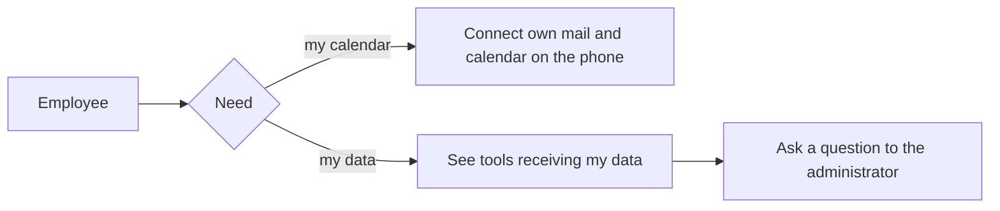
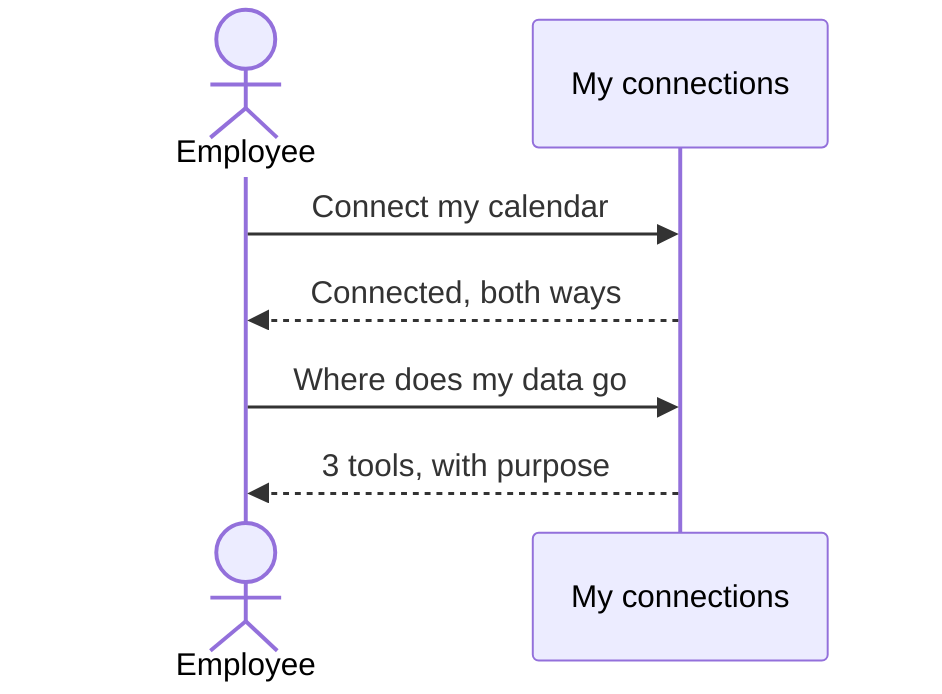

🏠 [Specs](../../../README.md) › 🧩 [Functional capabilities](../../README.md) › 🔌 [F24 Integrations hub](../README.md) ›
🔀 [Flows](README.md) › 🔀 FL-F24-07 Employees and their tools

# 🔀 FL-F24-07 Employees and their tools

**Status:** ✅ specified

## Summary

Employees connect their own mail and calendar from the phone and see which outside tools their personal data goes to
(D481).

## Personas

- [U01 Employee](../../../01-users/personas/u01-employee.md)
- [U07 Administrator](../../../01-users/personas/u07-administrator.md)

## Flowchart

## Sequence diagram

## Steps

| Step | Persona | Screen | Use case | What happens |
|---|---|---|---|---|
| 1 | U01 | [S-F24-24](../screens/07-employees-and-their-tools/s-f24-24-my-connections.md) | [UC-F24-25](../use-cases/07-employees-and-their-tools/uc-f24-25-connect-my-own-calendar-and-mail-on-the-phone.md) | Connect my own calendar and mail on the phone |
| 2 | U01, U07 | [S-F24-24](../screens/07-employees-and-their-tools/s-f24-24-my-connections.md) | [UC-F24-26](../use-cases/07-employees-and-their-tools/uc-f24-26-see-which-tools-receive-my-data.md) | See which tools receive my data |

### Entities and screens

| Entity | States in this flow | Shown at step and screen | Aggregated view |
|---|---|---|---|
| [E-F24-03 Suite component](../data/e-f24-03-suite-component.md) | Active | Shown elsewhere: [S-F24-04 Suite files](../screens/02-office-suites/s-f24-04-suite-files.md) | Suite components |
| [E-F24-05 Calendar link](../data/e-f24-05-calendar-link.md) | Active | 1, 2 [S-F24-24](../screens/07-employees-and-their-tools/s-f24-24-my-connections.md) | Calendar links |
| [E-F24-02 Tool connection](../data/e-f24-02-tool-connection.md) | Proposed, Active, Revoked | 1, 2 [S-F24-24](../screens/07-employees-and-their-tools/s-f24-24-my-connections.md) | Tool connections |
| [E-F3-02 Assistant answer](../../f03-assistant/data/e-f03-02-assistant-answer.md) | Recorded | Shown elsewhere: [S-F3-01 Assistant panel](../../f03-assistant/screens/01-ask-the-assistant/s-f03-01-assistant-panel.md) | Assistant answers |

## Errors

E1: the company has not enabled personal connections: the employee is told whom to ask (step 1).

## Images

Every step and error, for each persona taking part, in light and dark mode (D120). Steps are numbered as in the Steps
table; E rows are the error cases.

| Step | Persona | Device | Light | Dark |
|---|---|---|---|---|
| 1 | U01 | desktop | [light](../images/07-employees-and-their-tools/u01-employee/1-my-connections-desktop-light.png) | [dark](../images/07-employees-and-their-tools/u01-employee/1-my-connections-desktop-dark.png) |
| 1 | U01 | phone | [light](../images/07-employees-and-their-tools/u01-employee/1-my-connections-phone-light.png) | [dark](../images/07-employees-and-their-tools/u01-employee/1-my-connections-phone-dark.png) |
| 2 | U01 | desktop | [light](../images/07-employees-and-their-tools/u01-employee/2-my-connections-desktop-light.png) | [dark](../images/07-employees-and-their-tools/u01-employee/2-my-connections-desktop-dark.png) |
| 2 | U01 | phone | [light](../images/07-employees-and-their-tools/u01-employee/2-my-connections-phone-light.png) | [dark](../images/07-employees-and-their-tools/u01-employee/2-my-connections-phone-dark.png) |
| 2 | U07 | desktop | [light](../images/07-employees-and-their-tools/u07-administrator/2-my-connections-desktop-light.png) | [dark](../images/07-employees-and-their-tools/u07-administrator/2-my-connections-desktop-dark.png) |
| E1 | U01 | desktop | [light](../images/07-employees-and-their-tools/u01-employee/e1-my-connections-refused-desktop-light.png) | [dark](../images/07-employees-and-their-tools/u01-employee/e1-my-connections-refused-desktop-dark.png) |
| E1 | U01 | phone | [light](../images/07-employees-and-their-tools/u01-employee/e1-my-connections-refused-phone-light.png) | [dark](../images/07-employees-and-their-tools/u01-employee/e1-my-connections-refused-phone-dark.png) |

## Open questions

None.

---

⬅️ [FL-F24-06 Business tools](fl-f24-06-business-tools.md) · ⬆️ [Up](README.md) ·
➡️ [FL-F24-08 AI connectors, office suites, warehouse and firms](fl-f24-08-ai-connectors-suites-and-warehouse.md)
