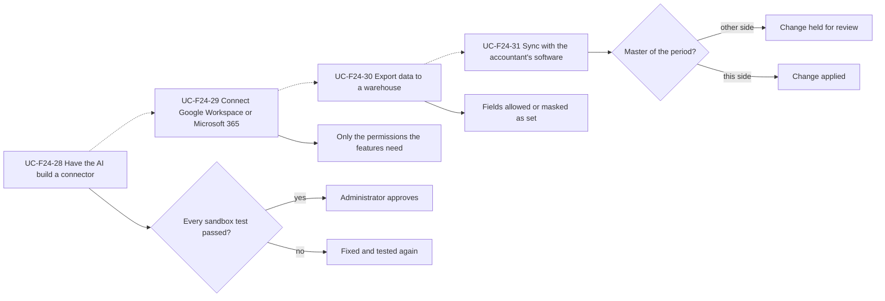
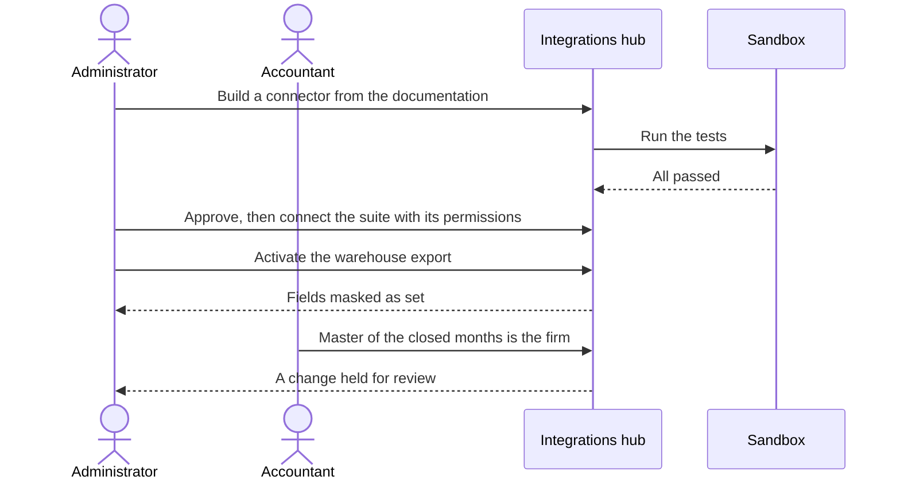

🏠 [Specs](../../../README.md) › 🧩 [Functional capabilities](../../README.md) › 🔌 [F24 Integrations hub](../README.md) ›
🔀 [Flows](README.md) › 🔀 FL-F24-08 AI connectors, office suites, warehouse and firms

# 🔀 FL-F24-08 AI connectors, office suites, warehouse and firms

**Status:** ✅ specified

## Summary

The administrator has the AI assistant build a connector for a tool outside the catalogue and approves it only after its
sandbox tests pass, connects Google Workspace or Microsoft 365 with the fewest permissions, exports chosen records to
the company's own warehouse with the field rights and masking applied, and syncs with the accountant's software with one
master per period ([D543](../../../06-decisions/f24-integrations-hub/d543-benchmark-gaps-f24-integrations-hub.md)).

## Personas

- [U07 Administrator](../../../01-users/personas/u07-administrator.md), who builds, connects and exports
- [U11 IT provider administrator](../../../01-users/personas/u11-provider-admin.md), who does so for clients
- [U08 External accountant](../../../01-users/personas/u08-external-accountant.md), who works in the firm's software
- [U05 Accounting](../../../01-users/personas/u05-accounting.md), who sets the masters

## Flowchart

## Sequence diagram

## Steps

| Step | Persona | Screen | Use case | What happens |
|---|---|---|---|---|
| 1 | [U07](../../../01-users/personas/u07-administrator.md) | [S-F24-26](../screens/08-ai-connectors-suites-and-warehouse/s-f24-26-ai-connector-builder.md) | [UC-F24-28](../use-cases/08-ai-connectors-suites-and-warehouse/uc-f24-28-have-the-ai-build-a-connector.md) | The administrator has the AI assistant draft a connector and approves it after the sandbox tests |
| 2 | [U07](../../../01-users/personas/u07-administrator.md) | [S-F24-27](../screens/08-ai-connectors-suites-and-warehouse/s-f24-27-office-suites.md) | [UC-F24-29](../use-cases/08-ai-connectors-suites-and-warehouse/uc-f24-29-connect-google-workspace-or-microsoft-365.md) | The administrator connects the office suite with the permissions the features need |
| 3 | [U07](../../../01-users/personas/u07-administrator.md) | [S-F24-28](../screens/08-ai-connectors-suites-and-warehouse/s-f24-28-warehouse-export.md) | [UC-F24-30](../use-cases/08-ai-connectors-suites-and-warehouse/uc-f24-30-export-data-to-a-warehouse.md) | The administrator exports chosen records to the warehouse, with each field's masking |
| 4 | [U08](../../../01-users/personas/u08-external-accountant.md) | [S-F24-29](../screens/08-ai-connectors-suites-and-warehouse/s-f24-29-accounting-firm-sync.md) | [UC-F24-31](../use-cases/08-ai-connectors-suites-and-warehouse/uc-f24-31-sync-with-the-accountants-software.md) | Accounting and the accountant set the master of each period and resolve held changes |

### Entities and screens

| Entity | States in this flow | Shown at step and screen | Aggregated view |
|---|---|---|---|
| [E-F24-17 Connector draft](../data/e-f24-17-connector-draft.md) | Drafted, Testing, Failed, Approved, Live, Withdrawn | 1 [S-F24-26](../screens/08-ai-connectors-suites-and-warehouse/s-f24-26-ai-connector-builder.md) | Connector drafts |
| [E-F24-18 Export pipeline](../data/e-f24-18-export-pipeline.md) | Draft, Active, Paused, Failed, Retired | 3 [S-F24-28](../screens/08-ai-connectors-suites-and-warehouse/s-f24-28-warehouse-export.md) | Export pipelines |
| [E-F24-19 Firm sync](../data/e-f24-19-firm-sync.md) | Set up, Active, Conflict, Suspended, Ended | 4 [S-F24-29](../screens/08-ai-connectors-suites-and-warehouse/s-f24-29-accounting-firm-sync.md) | Firm syncs |

## Errors

- **E1 A sandbox test fails.** The connector cannot be approved until every test passes
  ([BR-F24-17](../business-rules/br-f24-17-an-ai-built-connector-runs-in-the-sandbox-first.md), step 1).

## Images

Every step and error, for each persona taking part, in light and dark mode (D120). Steps are numbered as in the Steps
table; E rows are the error cases.

| Step | Persona | Device | Light | Dark |
|---|---|---|---|---|
| 1 | U07 | desktop | [light](../images/08-ai-connectors-suites-and-warehouse/u07-administrator/1-ai-connector-builder-desktop-light.png) | [dark](../images/08-ai-connectors-suites-and-warehouse/u07-administrator/1-ai-connector-builder-desktop-dark.png) |
| 1 | U11 | desktop | [light](../images/08-ai-connectors-suites-and-warehouse/u11-provider-admin/1-ai-connector-builder-desktop-light.png) | [dark](../images/08-ai-connectors-suites-and-warehouse/u11-provider-admin/1-ai-connector-builder-desktop-dark.png) |
| 2 | U07 | desktop | [light](../images/08-ai-connectors-suites-and-warehouse/u07-administrator/2-office-suites-desktop-light.png) | [dark](../images/08-ai-connectors-suites-and-warehouse/u07-administrator/2-office-suites-desktop-dark.png) |
| 3 | U07 | desktop | [light](../images/08-ai-connectors-suites-and-warehouse/u07-administrator/3-warehouse-export-desktop-light.png) | [dark](../images/08-ai-connectors-suites-and-warehouse/u07-administrator/3-warehouse-export-desktop-dark.png) |
| 3 | U11 | desktop | [light](../images/08-ai-connectors-suites-and-warehouse/u11-provider-admin/3-warehouse-export-desktop-light.png) | [dark](../images/08-ai-connectors-suites-and-warehouse/u11-provider-admin/3-warehouse-export-desktop-dark.png) |
| 4 | U08 | desktop | [light](../images/08-ai-connectors-suites-and-warehouse/u08-external-accountant/4-accounting-firm-sync-desktop-light.png) | [dark](../images/08-ai-connectors-suites-and-warehouse/u08-external-accountant/4-accounting-firm-sync-desktop-dark.png) |
| 4 | U05 | desktop | [light](../images/08-ai-connectors-suites-and-warehouse/u05-accounting/4-accounting-firm-sync-desktop-light.png) | [dark](../images/08-ai-connectors-suites-and-warehouse/u05-accounting/4-accounting-firm-sync-desktop-dark.png) |
| E1 | U07 | desktop | [light](../images/08-ai-connectors-suites-and-warehouse/u07-administrator/e1-a-sandbox-test-fails-desktop-light.png) | [dark](../images/08-ai-connectors-suites-and-warehouse/u07-administrator/e1-a-sandbox-test-fails-desktop-dark.png) |

## Open questions

None.

---

⬅️ [FL-F24-07 Employees and their tools](fl-f24-07-employees-and-their-tools.md) · ⬆️ [Up](README.md)
