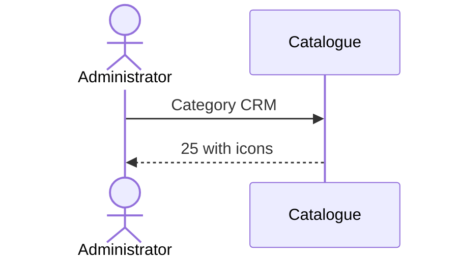

🏠 [Specs](../../../../README.md) › 🧩 [Functional capabilities](../../../README.md) ›
🔌 [F24 Integrations hub](../../README.md) › 📝 [Use cases](../README.md) ›
📝 [Use cases: FL-F24-01 Find and connect](README.md) › 📝 UC-F24-01 Browse the connector catalogue

# 📝 UC-F24-01 Browse the connector catalogue

**Status:** ✅ specified

## Summary

The administrator browses the connector catalogue by category, each connector with its icon, vendor country, cost and
rights.

## Personas

- [U07 Administrator](../../../../01-users/personas/u07-administrator.md)

## Goal

Find the right connector.

## Trigger

Need.

## Frequency

Occasional.

## Preconditions

- None.

## Postconditions

- Success: connector found.
- Failure: request it.

## Main flow

1. Open the hub (S-F24-01).
2. Filter by category (BR-F24-12).
3. Read icons, countries, costs.
4. Open a connector.

## Alternative flows

- 2a. Search by name.

## Error flows

- 4e. Missing: request (UC-F24-19).
- Any step: a service does not answer; the call is retried first (BR-F3-32), then the message follows the error pattern
  (D122) and what was typed stays on the screen.

## Business rules

- [BR-F24-05 The default 50 ATS and CRM](../../business-rules/br-f24-05-the-default-fifty.md)
- [BR-F24-12 The catalogue covers every business category](../../business-rules/br-f24-12-the-catalogue-covers-every-business-category.md)
- [BR-F24-16 Every integration shows its icon](../../business-rules/br-f24-16-every-integration-shows-its-icon.md)

## Entities

- [E-F24-01 Connector](../../data/e-f24-01-connector.md)
- [E-F24-11 Connector category](../../data/e-f24-11-connector-category.md)
- [E-F24-12 Integration icon](../../data/e-f24-12-integration-icon.md)

## Permissions

Everyone browses.

## Notifications

- None.

## Audit events

None.

## AI involvement

Suggests.

## API, MCP and A2A exposure

Through T5 and T6 with the caller's rights (BR-F3-34).

## Screens

- [S-F24-01 Catalogue](../../screens/01-find-and-connect/s-f24-01-catalogue.md)

## Flowchart

See [FL-F24-01 Find and connect](../../flows/fl-f24-01-find-and-connect.md#flowchart).

## Sequence diagram

## Acceptance criteria

1. **Given** CRM **when** filtered **then** 25 with icons.
2. **Given** a connector without logo **when** listed **then** its category icon.
3. **Given** missing **when** searched **then** request offered.

## Non-functional notes

D408's targets ([Performance](../../../../05-non-functional/performance.md)): 95 % of screens within 1 second; lists
paged on the server, the first page within 1 second; reports within 5 seconds or in the background.

## Regulatory references

Data rules of the France country pack that connectors follow:
[CR-FR-049 Processors and transfers outside the EU](../../../../10-country-packs/france/data-protection/cr-fr-049-processors-and-transfers.md),
[CR-FR-195 Candidates' personal data](../../../../10-country-packs/france/data-protection/cr-fr-195-candidate-data.md),
[CR-FR-063 Consent for email and SMS marketing](../../../../10-country-packs/france/consumer/cr-fr-063-electronic-marketing-consent.md),
[CR-FR-170 Switching between cloud services (Data Act)](../../../../10-country-packs/france/digital/cr-fr-170-data-act-switching.md),
[CR-FR-051 Access and erasure requests](../../../../10-country-packs/france/data-protection/cr-fr-051-access-and-erasure.md),
[CR-FR-052 Personal data kept no longer than needed](../../../../10-country-packs/france/data-protection/cr-fr-052-storage-limitation.md).

## Related use cases

- [UC-F24-02 Connect a tool in the fewest steps](uc-f24-02-connect-a-tool-in-the-fewest-steps.md)
- [UC-F24-21 Connect a bank, payment, shop, accounting or carrier tool](../06-business-tools/uc-f24-21-connect-a-bank-payment-shop-accounting-or-carrier-tool.md)

## Open questions

None.

---

⬆️ [Up](README.md) ·
➡️ [UC-F24-02 Connect a tool in the fewest steps](uc-f24-02-connect-a-tool-in-the-fewest-steps.md)
