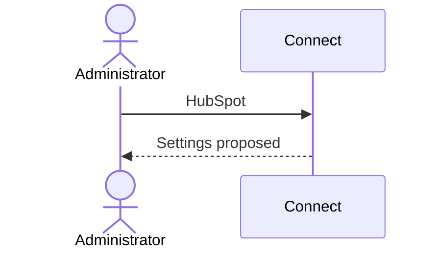

🏠 [Specs](../../../../README.md) › 🧩 [Functional capabilities](../../../README.md) ›
🔌 [F24 Integrations hub](../../README.md) › 📝 [Use cases](../README.md) ›
📝 [Use cases: FL-F24-01 Find and connect](README.md) › 📝 UC-F24-02 Connect a tool in the fewest steps

# 📝 UC-F24-02 Connect a tool in the fewest steps

**Status:** ✅ specified

## Summary

The administrator connects a tool in the fewest steps: OAuth, proposed settings, credentials in the vault.

## Personas

- [U07 Administrator](../../../../01-users/personas/u07-administrator.md)

## Goal

Connected in minutes.

## Trigger

Chosen.

## Frequency

Occasional.

## Preconditions

- Connector.

## Postconditions

- Success: connected.
- Failure: refused.

## Main flow

1. Choose (S-F24-02).
2. Sign in with OAuth.
3. Confirm proposed settings (BR-F24-02).
4. Token in the vault (BR-F24-08).

## Alternative flows

- 2a. API key.
- 2b. A connector whose provider hosts the sign-in of each user's own account (Unipile for LinkedIn,
  [UC-F9-40](../../../f09-hr-and-projects/use-cases/02-recruit/uc-f09-40-search-and-rank-linkedin-profiles.md),
  [D518](../../../../06-decisions/f09-hr-and-projects/d518-linkedin-sourcing-through-unipile.md)): the administrator
  enters the provider's API key once, kept in the secret store
  ([BR-F24-08](../../business-rules/br-f24-08-credentials-in-the-vault.md)), and sets the daily and weekly caps per
  account; each user then links their own account on the provider's hosted sign-in page; SimpleERP keeps the account
  link ([E-F24-02](../../data/e-f24-02-tool-connection.md)) and never sees the password.

## Error flows

- 2e. Refused.
- Any step: a service does not answer; the call is retried first (BR-F3-32), then the message follows the error pattern
  (D122) and what was typed stays on the screen.

## Business rules

- [BR-F24-02 Every connector in the fewest steps](../../business-rules/br-f24-02-fewest-steps-everywhere.md)
- [BR-F24-08 Credentials in the vault](../../business-rules/br-f24-08-credentials-in-the-vault.md)
- [BR-F24-16 Every integration shows its icon](../../business-rules/br-f24-16-every-integration-shows-its-icon.md)

## Entities

- [E-F24-02 Tool connection](../../data/e-f24-02-tool-connection.md)
- [E-F24-12 Integration icon](../../data/e-f24-12-integration-icon.md)

## Permissions

Administrator.

## Notifications

- When connected.

## Audit events

Connections.

## AI involvement

None.

## API, MCP and A2A exposure

Through T5 and T6 with the caller's rights (BR-F3-34).

## Screens

- [S-F24-02 Connect](../../screens/01-find-and-connect/s-f24-02-connect.md)

## Flowchart

See [FL-F24-01 Find and connect](../../flows/fl-f24-01-find-and-connect.md#flowchart).

## Sequence diagram

## Acceptance criteria

1. **Given** OAuth **when** signed in **then** settings proposed.
2. **Given** refused **when** signed in **then** nothing saved.
3. **Given** saved **when** stored **then** token never shown.

## Non-functional notes

D408's targets ([Performance](../../../../05-non-functional/performance.md)): 95 % of screens within 1 second; lists
paged on the server, the first page within 1 second; reports within 5 seconds or in the background.

## Regulatory references

Data rules of the France country pack that connectors follow:
[CR-FR-049 Processors and transfers outside the EU](../../../../10-country-packs/france/data-protection/cr-fr-049-processors-and-transfers.md),
[CR-FR-195 Candidates' personal data](../../../../10-country-packs/france/data-protection/cr-fr-195-candidate-data.md),
[CR-FR-063 Consent for email and SMS marketing](../../../../10-country-packs/france/consumer/cr-fr-063-electronic-marketing-consent.md),
[CR-FR-170 Switching between cloud services (Data Act)](../../../../10-country-packs/france/digital/cr-fr-170-data-act-switching.md),
[CR-FR-051 Access and erasure requests](../../../../10-country-packs/france/data-protection/cr-fr-051-access-and-erasure.md),
[CR-FR-052 Personal data kept no longer than needed](../../../../10-country-packs/france/data-protection/cr-fr-052-storage-limitation.md).

## Related use cases

- [UC-F24-21 Connect a bank, payment, shop, accounting or carrier tool](../06-business-tools/uc-f24-21-connect-a-bank-payment-shop-accounting-or-carrier-tool.md)
- [UC-F9-40 Search and rank LinkedIn profiles](../../../f09-hr-and-projects/use-cases/02-recruit/uc-f09-40-search-and-rank-linkedin-profiles.md)

## Open questions

None.

---

⬅️ [UC-F24-01 Browse the connector catalogue](uc-f24-01-browse-the-connector-catalogue.md) · ⬆️ [Up](README.md) ·
➡️ [UC-F24-03](../02-office-suites/uc-f24-03-sign-in-once-through-the-suite-s-identity-provider.md)
