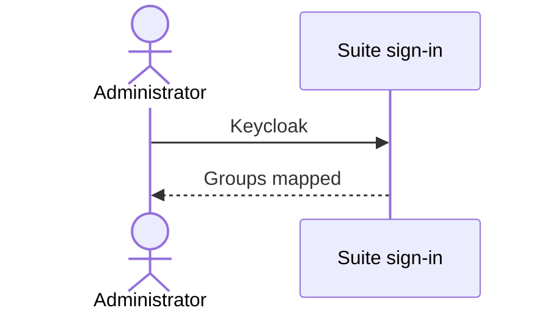

🏠 [Specs](../../../../README.md) › 🧩 [Functional capabilities](../../../README.md) ›
🔌 [F24 Integrations hub](../../README.md) › 📝 [Use cases](../README.md) ›
📝 [Use cases: FL-F24-02 Office suites](README.md) › 📝 UC-F24-03 Sign in once through the suite's identity provider

# 📝 UC-F24-03 Sign in once through the suite's identity provider

**Status:** ✅ specified

## Summary

Users sign in once through the suite's identity provider.

## Personas

- [U07 Administrator](../../../../01-users/personas/u07-administrator.md)
- [U01 Employee](../../../../01-users/personas/u01-employee.md)

## Goal

One sign-in.

## Trigger

Suite used.

## Frequency

Once.

## Preconditions

- Suite.

## Postconditions

- Success: single sign-on.
- Failure: refused.

## Main flow

1. Link (S-F24-03).
2. Map groups.
3. Test.
4. Users sign in once.

## Alternative flows

- 2a. Roles from groups.

## Error flows

- 3e. Refused.
- Any step: a service does not answer; the call is retried first (BR-F3-32), then the message follows the error pattern
  (D122) and what was typed stays on the screen.

## Business rules

- [BR-F24-03 Office suites: full read and write](../../business-rules/br-f24-03-suites-full-read-write.md)

## Entities

- [E-F24-02 Tool connection](../../data/e-f24-02-tool-connection.md)
- [E-F24-03 Suite component](../../data/e-f24-03-suite-component.md)

## Permissions

Administrator.

## Notifications

- Users.

## Audit events

Links.

## AI involvement

None.

## API, MCP and A2A exposure

Through T5 and T6 with the caller's rights (BR-F3-34).

## Screens

- [S-F24-03 Suite sign-in](../../screens/02-office-suites/s-f24-03-suite-sign-in.md)

## Flowchart

See [FL-F24-02 Office suites](../../flows/fl-f24-02-office-suites.md#flowchart).

## Sequence diagram

## Acceptance criteria

1. **Given** linked **when** users sign in **then** once.
2. **Given** groups **when** mapped **then** roles.
3. **Given** refused **when** tested **then** error.

## Non-functional notes

D408's targets ([Performance](../../../../05-non-functional/performance.md)): 95 % of screens within 1 second; lists
paged on the server, the first page within 1 second; reports within 5 seconds or in the background.

## Regulatory references

Data rules of the France country pack that connectors follow:
[CR-FR-049 Processors and transfers outside the EU](../../../../10-country-packs/france/data-protection/cr-fr-049-processors-and-transfers.md),
[CR-FR-195 Candidates' personal data](../../../../10-country-packs/france/data-protection/cr-fr-195-candidate-data.md),
[CR-FR-063 Consent for email and SMS marketing](../../../../10-country-packs/france/consumer/cr-fr-063-electronic-marketing-consent.md),
[CR-FR-170 Switching between cloud services (Data Act)](../../../../10-country-packs/france/digital/cr-fr-170-data-act-switching.md),
[CR-FR-051 Access and erasure requests](../../../../10-country-packs/france/data-protection/cr-fr-051-access-and-erasure.md),
[CR-FR-052 Personal data kept no longer than needed](../../../../10-country-packs/france/data-protection/cr-fr-052-storage-limitation.md).

## Related use cases

- [UC-F24-09 Use the suites' full read and write API](uc-f24-09-use-the-suites-full-read-and-write-api.md)

## Open questions

None.

---

⬅️ [UC-F24-02](../01-find-and-connect/uc-f24-02-connect-a-tool-in-the-fewest-steps.md) · ⬆️ [Up](README.md) ·
➡️ [UC-F24-04 Store and edit documents in the suite](uc-f24-04-store-and-edit-documents-in-the-suite.md)
