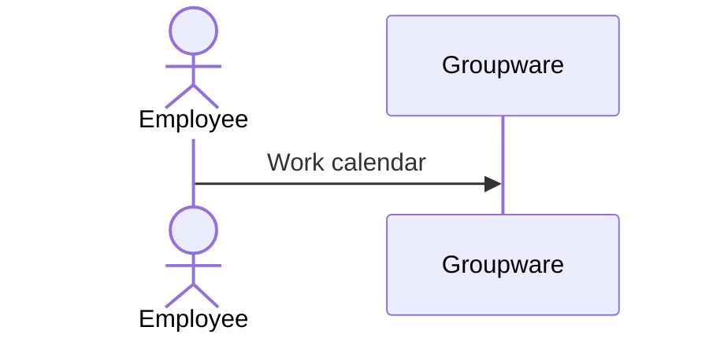

🏠 [Specs](../../../../README.md) › 🧩 [Functional capabilities](../../../README.md) ›
🔌 [F24 Integrations hub](../../README.md) › 📝 [Use cases](../README.md) ›
📝 [Use cases: FL-F24-02 Office suites](README.md) › 📝 UC-F24-05 Sync mail, calendars and contacts

# 📝 UC-F24-05 Sync mail, calendars and contacts

**Status:** ✅ specified

## Summary

An employee syncs mail, calendars and contacts with the suite.

## Personas

- [U01 Employee](../../../../01-users/personas/u01-employee.md)

## Goal

One agenda.

## Trigger

Enabled.

## Frequency

Once.

## Preconditions

- Suite.

## Postconditions

- Success: synced.
- Failure: none.

## Main flow

1. Enable (S-F24-05).
2. Choose calendars.
3. Sync (BR-F24-07).
4. See in both.

## Alternative flows

- 1a. From the phone (UC-F24-25).

## Error flows

- 3e. Conflict.
- Any step: a service does not answer; the call is retried first (BR-F3-32), then the message follows the error pattern
  (D122) and what was typed stays on the screen.

## Business rules

- [BR-F24-03 Office suites: full read and write](../../business-rules/br-f24-03-suites-full-read-write.md)
- [BR-F24-07 Two-way sync with an owner per field](../../business-rules/br-f24-07-two-way-sync-with-ownership.md)

## Entities

- [E-F24-03 Suite component](../../data/e-f24-03-suite-component.md)
- [E-F24-05 Calendar link](../../data/e-f24-05-calendar-link.md)

## Permissions

Own.

## Notifications

- None.

## Audit events

Syncs.

## AI involvement

None.

## API, MCP and A2A exposure

Through T5 and T6 with the caller's rights (BR-F3-34).

## Screens

- [S-F24-05 Groupware](../../screens/02-office-suites/s-f24-05-groupware.md)

## Flowchart

See [FL-F24-02 Office suites](../../flows/fl-f24-02-office-suites.md#flowchart).

## Sequence diagram

## Acceptance criteria

1. **Given** synced **when** an appointment is added **then** both.
2. **Given** conflict **when** found **then** shown.
3. **Given** phone **when** used **then** UC-F24-25.

## Non-functional notes

D408's targets ([Performance](../../../../05-non-functional/performance.md)): 95 % of screens within 1 second; lists
paged on the server, the first page within 1 second; reports within 5 seconds or in the background.

## Regulatory references

Data rules of the France country pack that connectors follow:
[CR-FR-049 Processors and transfers outside the EU](../../../../10-country-packs/france/data-protection/cr-fr-049-processors-and-transfers.md),
[CR-FR-195 Candidates' personal data](../../../../10-country-packs/france/data-protection/cr-fr-195-candidate-data.md),
[CR-FR-063 Consent for email and SMS marketing](../../../../10-country-packs/france/consumer/cr-fr-063-electronic-marketing-consent.md),
[CR-FR-170 Switching between cloud services (Data Act)](../../../../10-country-packs/france/digital/cr-fr-170-data-act-switching.md),
[CR-FR-051 Access and erasure requests](../../../../10-country-packs/france/data-protection/cr-fr-051-access-and-erasure.md),
[CR-FR-052 Personal data kept no longer than needed](../../../../10-country-packs/france/data-protection/cr-fr-052-storage-limitation.md).

## Related use cases

- [UC-F24-25 Connect my own calendar and mail on the phone](../07-employees-and-their-tools/uc-f24-25-connect-my-own-calendar-and-mail-on-the-phone.md)

## Open questions

None.

---

⬅️ [UC-F24-04 Store and edit documents in the suite](uc-f24-04-store-and-edit-documents-in-the-suite.md) ·
⬆️ [Up](README.md) · ➡️ [UC-F24-06](uc-f24-06-use-the-suite-s-chat-for-notifications-and-the-assistant.md)
