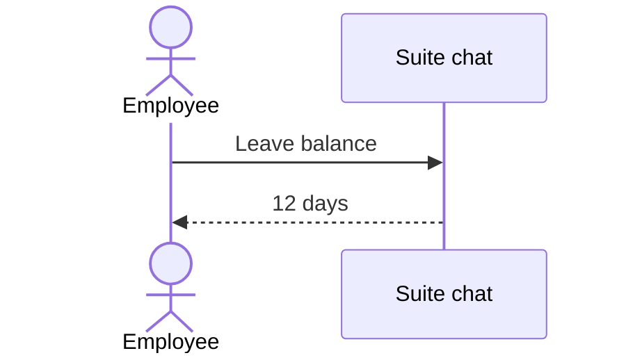

🏠 [Specs](../../../../README.md) › 🧩 [Functional capabilities](../../../README.md) ›
🔌 [F24 Integrations hub](../../README.md) › 📝 [Use cases](../README.md) ›
📝 [Use cases: FL-F24-02 Office suites](README.md) ›
📝 UC-F24-06 Use the suite's chat for notifications and the AI assistant

# 📝 UC-F24-06 Use the suite's chat for notifications and the AI assistant

**Status:** ✅ specified

## Summary

An employee receives notifications in the suite's chat and asks the AI assistant there.

## Personas

- [U01 Employee](../../../../01-users/personas/u01-employee.md)

## Goal

Work in chat.

## Trigger

Enabled.

## Frequency

Daily.

## Preconditions

- Suite chat.

## Postconditions

- Success: used.
- Failure: none.

## Main flow

1. Choose rooms (S-F24-06).
2. Receive notifications.
3. Ask the AI assistant.
4. Confirm writes.

## Alternative flows

- 2a. Mute.

## Error flows

- 3e. Beyond rights.
- Any step: a service does not answer; the call is retried first (BR-F3-32), then the message follows the error pattern
  (D122) and what was typed stays on the screen.

## Business rules

- [BR-F24-03 Office suites: full read and write](../../business-rules/br-f24-03-suites-full-read-write.md)
- [BR-F24-04 Every integration in the AI assistant](../../business-rules/br-f24-04-every-integration-in-the-assistant.md)

## Entities

- [E-F24-03 Suite component](../../data/e-f24-03-suite-component.md)

## Permissions

Own.

## Notifications

- In chat.

## Audit events

Actions.

## AI involvement

Assistant in chat.

## API, MCP and A2A exposure

Through T5 and T6 with the caller's rights (BR-F3-34).

## Screens

- [S-F24-06 Suite chat](../../screens/02-office-suites/s-f24-06-suite-chat.md)

## Flowchart

See [FL-F24-02 Office suites](../../flows/fl-f24-02-office-suites.md#flowchart).

## Sequence diagram

## Acceptance criteria

1. **Given** a room **when** chosen **then** notified.
2. **Given** a question **when** asked **then** answered.
3. **Given** a write **when** asked **then** confirmed.

## Non-functional notes

D408's targets ([Performance](../../../../05-non-functional/performance.md)): 95 % of screens within 1 second; lists
paged on the server, the first page within 1 second; reports within 5 seconds or in the background.

## Regulatory references

Data rules of the France country pack that connectors follow:
[CR-FR-049 Processors and transfers outside the EU](../../../../10-country-packs/france/data-protection/cr-fr-049-processors-and-transfers.md),
[CR-FR-195 Candidates' personal data](../../../../10-country-packs/france/data-protection/cr-fr-195-candidate-data.md),
[CR-FR-063 Consent for email and SMS marketing](../../../../10-country-packs/france/consumer/cr-fr-063-electronic-marketing-consent.md),
[CR-FR-170 Switching between cloud services (Data Act)](../../../../10-country-packs/france/digital/cr-fr-170-data-act-switching.md),
[CR-FR-051 Access and erasure requests](../../../../10-country-packs/france/data-protection/cr-fr-051-access-and-erasure.md),
[CR-FR-052 Personal data kept no longer than needed](../../../../10-country-packs/france/data-protection/cr-fr-052-storage-limitation.md).

## Related use cases

- [UC-F24-14 Ask the AI assistant to act in a connected tool](../04-run-and-control/uc-f24-14-ask-the-assistant-to-act-in-a-connected-tool.md)

## Open questions

None.

---

⬅️ [UC-F24-05 Sync mail, calendars and contacts](uc-f24-05-sync-mail-calendars-and-contacts.md) · ⬆️ [Up](README.md) ·
➡️ [UC-F24-07 Start meetings from the suite's video](uc-f24-07-start-meetings-from-the-suite-s-video.md)
