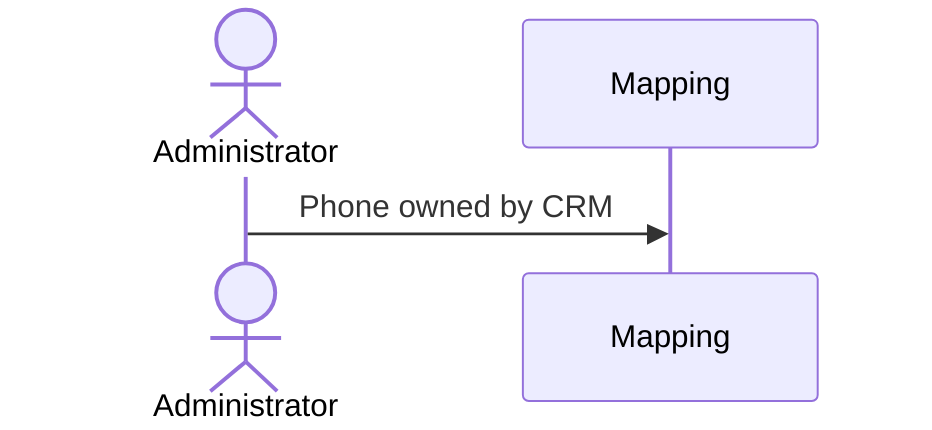

🏠 [Specs](../../../../README.md) › 🧩 [Functional capabilities](../../../README.md) ›
🔌 [F24 Integrations hub](../../README.md) › 📝 [Use cases](../README.md) ›
📝 [Use cases: FL-F24-03 CRM and ATS](README.md) › 📝 UC-F24-12 Map fields and resolve conflicts

# 📝 UC-F24-12 Map fields and resolve conflicts

**Status:** ✅ specified

## Summary

The administrator maps fields and resolves conflicts.

## Personas

- [U07 Administrator](../../../../01-users/personas/u07-administrator.md)

## Goal

Clean sync.

## Trigger

Sync.

## Frequency

Once.

## Preconditions

- Connection.

## Postconditions

- Success: saved.
- Failure: none.

## Main flow

1. Review (S-F24-12).
2. Set owners (BR-F24-07).
3. Save.
4. Resolve conflicts.

## Alternative flows

- 2a. Default owner.

## Error flows

- 4e. Unresolved.
- Any step: a service does not answer; the call is retried first (BR-F3-32), then the message follows the error pattern
  (D122) and what was typed stays on the screen.

## Business rules

- [BR-F24-07 Two-way sync with an owner per field](../../business-rules/br-f24-07-two-way-sync-with-ownership.md)

## Entities

- [E-F24-07 Field mapping](../../data/e-f24-07-field-mapping.md)

## Permissions

Administrator.

## Notifications

- Conflicts.

## Audit events

Mappings.

## AI involvement

Proposes.

## API, MCP and A2A exposure

Through T5 and T6 with the caller's rights (BR-F3-34).

## Screens

- [S-F24-12 Mapping](../../screens/03-crm-and-ats/s-f24-12-mapping.md)

## Flowchart

See [FL-F24-03 CRM and ATS](../../flows/fl-f24-03-crm-and-ats.md#flowchart).

## Sequence diagram

## Acceptance criteria

1. **Given** owners **when** saved **then** used.
2. **Given** conflict **when** found **then** shown.
3. **Given** default **when** chosen **then** applied.

## Non-functional notes

D408's targets ([Performance](../../../../05-non-functional/performance.md)): 95 % of screens within 1 second; lists
paged on the server, the first page within 1 second; reports within 5 seconds or in the background.

## Regulatory references

Data rules of the France country pack that connectors follow:
[CR-FR-049 Processors and transfers outside the EU](../../../../10-country-packs/france/data-protection/cr-fr-049-processors-and-transfers.md),
[CR-FR-195 Candidates' personal data](../../../../10-country-packs/france/data-protection/cr-fr-195-candidate-data.md),
[CR-FR-063 Consent for email and SMS marketing](../../../../10-country-packs/france/consumer/cr-fr-063-electronic-marketing-consent.md),
[CR-FR-170 Switching between cloud services (Data Act)](../../../../10-country-packs/france/digital/cr-fr-170-data-act-switching.md),
[CR-FR-051 Access and erasure requests](../../../../10-country-packs/france/data-protection/cr-fr-051-access-and-erasure.md),
[CR-FR-052 Personal data kept no longer than needed](../../../../10-country-packs/france/data-protection/cr-fr-052-storage-limitation.md).

## Related use cases

- [UC-F24-10 Sync a CRM both ways](uc-f24-10-sync-a-crm-both-ways.md)

## Open questions

None.

---

⬅️ [UC-F24-11 Sync an ATS both ways](uc-f24-11-sync-an-ats-both-ways.md) · ⬆️ [Up](README.md) ·
➡️ [UC-F24-13 Import history once](uc-f24-13-import-history-once.md)
